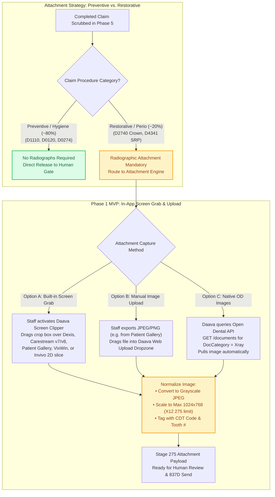

# Specification Addendum I: Dental Imaging & Radiograph Systems Integration Architecture

**Document Version:** 1.1  
**Associated Specification:** End-to-End Dental Insurance & Claims Specification (`dental-insurance-claims-specification.md`, v5.0)  
**Stakeholders:** Jaime Kirk, Carlos Lopez, Opal Anderson  
**Core Systems Covered:** Dexis (v7/8/9/10/Titanium), Carestream Dental Imaging (v7 & v8), Patient Gallery, VixWin, Sopro Imaging, Open Dental Imaging (`AtoZ`), Invivo (Anatomage 3D CBCT), Clearinghouse Attachment Gateways  

---

## 1. Context & Architectural Problem Statement

In dental claim processing, clinical attachments (primarily periapical radiographs, bitewings, and panoramic scans) are mandatory to adjudicate major restorative procedures (e.g., D2740 crowns, D2950 core buildups) and surgical periodontal therapies (D4341/D4342 scaling and root planing).

However, dental imaging software functions as an isolated silo separate from Practice Management System (PMS) relational databases:
1. **Isolated Binary Storage:** Practice Management Systems like Open Dental and Dentrix do not store multi-megabyte radiograph binaries inside their primary database engines (MySQL or FairCom c-tree). Instead, they store basic metadata pointing to external image directories, or launch proprietary external imaging executables.
2. **Proprietary Vendor & Version Fragmentation:** Clinics across DAG utilize divergent imaging suites and multiple software generations—principally **Dexis** (v7–v10 and Titanium), **Carestream Dental Imaging** (running both **v7** and **v8** across different practices), **Patient Gallery**, **VixWin** (KaVo/Gendex), **Sopro Imaging** (Acteon), and native **Open Dental Imaging**.
3. **The 3D CBCT & Invivo Air-Gap:** 3D Cone Beam Computed Tomography (CBCT) acquisitions and visualization suites like **Invivo (Anatomage)** generate massive volumetric DICOM datasets (often $500\text{ MB}\text{--}2\text{ GB}$) stored on dedicated, high-GPU acquisition workstations with zero direct PMS integration.

---

## 2. Imaging System Integration Profiles

| Imaging Platform | Host Architecture & Storage Topology | PMS Integration / Launch Mechanism | Direct API / Extraction Viability |
| :--- | :--- | :--- | :--- |
| **Dexis** *(v7, v8, v9, v10, Titanium)* | Proprietary file store and database (`.DEX` / encrypted TIFFs) residing in local or UNC shared network folders (e.g., `\\Server\Dexis\Data\`). | Command-line bridge launcher. In Open Dental, clicking the Dexis button invokes `Dexis.exe /P:{PatNum}` passing the patient ID via CLI parameters. | **Low.** Proprietary format variations across v7–v10. Programmatic reverse engineering risks file corruption and database lockouts. |
| **Carestream Dental Imaging** *(CS Imaging v7 & v8)* | **Two distinct generations in use across DAG:** • **v7 (Legacy):** Flat network directory (`\\Server\TW\` or `\CSImaging\Data\`) storing proprietary `.rvg` sensor files and TIFFs indexed by legacy Trophy/Kodak patient files. • **v8 (Modern):** Unified 2D/3D Patient Browser backed by a local SQL index and shared DICOM/image repositories. | Open Dental Program Link bridge (`TW.exe` for v7 or `CSImaging.exe` for v8) passing `PatNum` or chart ID via CLI arguments to open the matching patient chart. | **Low to Moderate.** Supporting both v7 and v8 requires maintaining two completely different directory/SQL parsers, making direct disk scraping brittle for Phase 1. |
| **Patient Gallery** | Centralized clinical photo and radiograph presentation hub storing standard image formats (JPEG, PNG, TIFF) alongside patient metadata in a local server repository (`\\Server\PatientGallery\`). | Open Dental Program Link bridge (`PatientGallery.exe`) passing `PatNum`, Last Name, First Name, and DOB so the patient's visual gallery opens directly from their chart. | **Moderate.** Uses standard image formats and supports easy drag-and-drop or single-click JPEG/PNG export, though images live outside Open Dental's native `document` table unless exported. |
| **VixWin** *(KaVo / Gendex)* | Flat file hierarchy containing modified TIFF/BMP files with `.vix` headers stored in shared network directories (`\\Server\VixWin\VxData\`). | Open Dental bridge executes `VXData.exe` or passes patient chart numbers via standard Gendex bridge protocols. | **Moderate.** Files can be parsed on disk if directory structures and patient ID folder conventions are unencrypted. |
| **Sopro Imaging** *(Acteon)* | Proprietary SQL backend or flat directory with Twain hardware capture modules for intraoral cameras and sensors. | Open Dental launches Sopro via standard bridge command line passing patient identifiers. | **Low.** Tightly locked to Acteon proprietary viewer runtime. |
| **Open Dental Native Imaging** | Physical document/image files stored on the local network server share inside the practice `AtoZ` (`OpenDentImages`) directory. | Direct metadata linkage via Open Dental `document` table (`DocNum`, `PatNum`, `FileName`, `DocCategory`). | **High.** Fully indexed. Files can be retrieved via the Open Dental API (`GET /documents/{DocNum}`) or direct disk read. |
| **Invivo (Anatomage) & Standalone CBCT Workstations** | **3D CBCT Visualization & Acquisition:** Invivo renders multi-slice 3D volumetric DICOM (`.dcm`) and `.inv` workspace datasets on dedicated, high-GPU workstations (`C:\` or `D:\ScanData\`). | Manual patient lookup on the 3D workstation console (or basic launch bridge with no image write-back). | **Zero Programmatic Access.** Volumetric 3D files are incompatible with 2D clearinghouse EDI 275 attachments and live on standalone workstations. |

---

## 3. Operational Reality: How Each Tool Fits Day-to-Day Workflows

### 3.1 Carestream v7 vs. v8 & Patient Gallery in Practice
* **Carestream v7 & v8:** When an assistant or hygienist takes a bitewing or PA in a Carestream office, they click the Carestream bridge button inside Open Dental. Whether the office runs **v7** or **v8**, the radiograph stays inside Carestream's database rather than copying back into Open Dental's `AtoZ` folder. Because v7 and v8 store data differently on disk, relying on staff to screen-clip or export from the viewer avoids version-specific breakages.
* **Patient Gallery:** Patient Gallery excels at organizing intraoral camera photos, extraoral photos, and radiographs into side-by-side patient education views. Because it stores standard image formats and allows effortless export, billing coordinators in Patient Gallery offices can either **screen-clip** directly from the gallery window or **export/drag-and-drop** the JPEG/PNG straight into Daava.

### 3.2 Invivo & 3D CBCT Billing Reality
* **Invivo (Anatomage)** is used by doctors to view and plan implants, airways, and pathology from 3D CBCT scans (`D0364–D0368`, `D0380–D0384`, `D0391`).
* **Claims Rule (Master Spec Phase 5):** Per Opal Anderson's clinical rules, PPO contracts require practices to **submit CBCT codes on the claim**, even though insurance almost never covers them and the practice collects the fee from the patient upfront.
* **Attachment Rule:** Clearinghouse `EDI 275` attachments only accept flat 2D images ($\le 5\text{ MB}$). Raw Invivo 3D DICOM volumes are **never attached** to initial claims. In the rare event a payer requests visual proof post-submission, the coordinator simply takes a **2D screenshot slice** inside Invivo.

### 3.3 The Screen-Capture Paradigm
Historically, clearinghouses and billing platforms (including Vyne Dental / FastAttach and DentalXChange) have solved multi-vendor imaging fragmentation through **manual screen clipping**:
* Billing coordinators open **Dexis, Carestream (v7/v8), Patient Gallery, VixWin, or Sopro**, navigate to the diagnostic radiograph, activate the clipping tool, drag a bounding box over the radiograph, and tag the image (e.g., *"Pre-Operative Bitewing - Tooth #19"*).
* The clipping tool compresses the crop to standard JPEG/PNG format and attaches it directly to the clearinghouse attachment queue (`X12 EDI 275` payload).

---

## 4. Phased Product & Engineering Strategy

### The 80/20 Rule of Dental Billing
Routine preventive hygiene procedures (`D1110` prophylaxis, `D0120` periodic exams, `D0274` routine bitewings) account for approximately **$80\%$ of all dental practice claim volume**. These claims **do not require radiograph attachments**. 

Attempting to build automated file-system harvesters for Dexis (v7–v10), Carestream (v7 & v8), Patient Gallery, VixWin, and Sopro prior to MVP rollout represents significant engineering overhead with minimal return on investment.

### Phase 1 (MVP Implementation): In-App Screen Clipper & File Dropzone
1. **Daava Desktop Screen-Clipping Tool:**
   * A lightweight browser-level or desktop-helper utility that allows billing staff to drag a rectangle over any open viewer window (**Dexis 7–10, Carestream v7 & v8, Patient Gallery, VixWin, Sopro, or a 2D slice in Invivo**) and instantly capture the radiograph.
2. **Web Dropzone:**
   * A drag-and-drop file target in the Daava Claim Review interface allowing staff (especially in **Patient Gallery** or **Carestream v8** clinics) to drop exported JPEG/PNG/TIFF files directly into the claim envelope.
3. **Automated Fetch for Native Open Dental Images:**
   * If the practice uses Open Dental's built-in imaging module, Daava automatically retrieves the file via the Open Dental Remote API (`GET /documents`) by querying images attached on the Date of Service (DOS).
4. **Invivo / CBCT Exception Workflow:**
   * CBCT scans (`D0364–D0391`) are universally unbundled and non-covered by standard PPOs. While the claim must be submitted to fulfill PPO contractual requirements, **Invivo 3D DICOM attachments are never required** unless a payer explicitly requests a 2D cross-sectional slice post-submission.

### Phase 2 (Roadmap Implementation): Automated Local Connector Agent
* The **Daava Connector** (installed on the clinic database server for on-premise Open Dental instances) will be extended to scan designated local network shares:
  * Open Dental `AtoZ` directories.
  * Standardized image folders and export directories for **Patient Gallery**, **Carestream v8**, **Dexis**, and **VixWin**.
* Background workers monitor file creation events matching `{PatNum}` and automatically bind recent radiographs to open claim objects, eliminating manual clipping for high-volume DSO operations.

---

## 5. Technical Requirements for Claim Attachment Payloads (EDI 275)

When submitting radiographic evidence to clearinghouses (DentalXChange, Vyne Dental, Stedi), attachments must conform to standard X12 EDI 275 formatting guidelines:

### EDI 275 Attachment Normalization Contract

| Specification Field | Technical Standard & Boundary |
| :--- | :--- |
| **Supported Formats** | JPEG, PNG, or uncompressed TIFF *(automatically normalized to JPEG prior to transmission)*. |
| **Maximum Resolution** | $1024 \times 768\text{ pixels}$ at $72\text{--}96\text{ DPI}$. *(High-resolution scans are automatically downsampled to prevent gateway rejection).* |
| **Maximum Payload Size** | $\le 5\text{ MB}$ per total claim envelope *(raw 3D DICOM datasets excluded; 2D slices only)*. |
| **Mandatory Image Metadata** | • **Attachment Control Number (ACN):** Unique tracking ID linking the `275` payload to the `837D` claim. • **Date of Exposure:** Must match or precede the billed Date of Service (DOS). • **View Type:** Periapical (PA), Bitewing (BWX), Panoramic (Pano), Full Mouth Series (FMX), or 2D CBCT Slice. • **Tooth Number Attribution:** Standard Universal (`#1`–`#32`) or ISO 3950 tooth/quadrant mapping. |