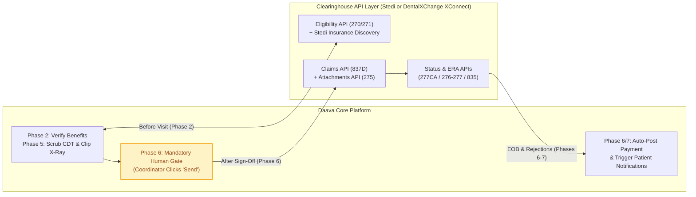
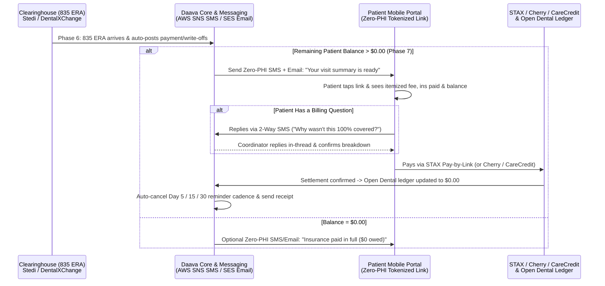

# Specification Addendum II: Clearinghouses, Patient Payments, Financing & Messaging

**Document Version:** 5.1  
**Associated Specification:** End-to-End Dental Insurance & Claims Specification (`dental-insurance-claims-specification.md`, v5.0)  
**Stakeholders:** Jaime Kirk, Carlos Lopez, Opal Anderson  
**Tools Covered:**  
* **Clearinghouses:** Vyne Dental (FastAttach), DentalXChange (XConnect), Stedi, plus unvetted market alternatives  
* **Patient Payments & Financing:** STAX, Pearly (Legacy), CareCredit, Cherry  
* **Patient Messaging & Notifications:** Daava 2-Way SMS (AWS SNS 10DLC) & Automated Email (Amazon SES)  

---

## 1. Overview & Purpose

This addendum outlines the external clearinghouse, payment processing, patient financing, and patient notification workflows that support the **End-to-End Dental Insurance & Claims Specification (`dental-insurance-claims-specification.md`, v5.0)**. Inline references (e.g., *Phase 2*, *Phase 6*, *Phase 7*) indicate where each tool executes within the master workflow.

*(Note: Medicaid and DHMO plans are excluded at intake in **Phase 1** and routed directly to Self-Pay without triggering any clearinghouse transactions; in-house **Smile Plans (`DP`)** also bypass clearinghouse checks.)*

---

## 2. Dental Clearinghouses: Vyne vs. DentalXChange vs. Stedi

A **clearinghouse** acts as the electronic bridge between Open Dental and dental insurance carriers across eligibility verification (**Phase 2**), radiographic attachments (**Phase 5**), claim submission (**Phase 6**), and electronic remittance posting (**Phases 6 & 7**). Currently, **DAG clinics primarily use Vyne Dental** and are actively **migrating to DentalXChange**, while Daava uses **Stedi** for modern API-driven eligibility and claims automation.

| Clearinghouse | Workflow Phases & Current Role | Operational Strengths | Limitations & Watchouts |
| :--- | :--- | :--- | :--- |
| **Vyne Dental** *(FastAttach / Renaissance)* | **Legacy Primary Tool (Phases 2, 5 & 6).** Used across most DAG clinics today for claims (**Phase 6**) and X-ray attachments (**Phase 5**). | • Staff are familiar with the manual desktop screen-clipping tool (**Phase 5**). • Handles basic claim batching and attachments (**Phase 6**). | • **Closed & Proprietary:** Tightly locked down; does not connect cleanly with external platforms like Daava. • **Manual Overhead:** Forces staff into separate desktop windows and web portals to attach X-rays (**Phase 5**) and work rejections (**Phase 6**). • **Stale Data:** Eligibility responses (**Phase 2**) lag behind live carrier portals. • **Status:** *Being phased out in favor of DentalXChange.* |
| **DentalXChange** *(Dental Exchange)* | **Target Primary Clearinghouse (Phases 2, 5 & 6).** DAG is actively migrating offices onto DentalXChange for claim routing and attachments. | • **Platform-Friendly:** Exposes structured **XConnect APIs** alongside seamless Open Dental integration. • **Broad Payer Reach:** Connects to ~1,400 dental payers. • **Built-In Attachment Rules:** Validates payer-specific X-ray/narrative requirements before submission (**Phase 5**). | • **New Volume Caps:** Moved away from unlimited claims to a **700 claims/month tier for \$85/month per office**, charging per-claim overage fees above 700 claims (**Phase 6**). |
| **Stedi** | **Active API Engine (Phases 1, 2, 5, 6 & 7).** Currently used by Daava in **Phase 2** for real-time eligibility, with full API support for claims and ERAs. | • **Modern JSON APIs:** Built specifically for software platforms; translates clean JSON directly into X12 EDI transactions (`270/271`, `837D`, `275`, `835`). • **Full Data Capture:** Easy to store every eligibility (**Phase 2**) and EOB (**Phase 6**) response to improve Daava's scrubbing accuracy over time. | • **Higher Cost:** Significantly more expensive per transaction than DentalXChange. • **Needs Guardrails:** Raw `271` data (**Phase 2**) can display inaccurate default tiers (e.g., on state carve-outs or preventive-only plans) unless filtered by Daava's validation rules. |

### Why Moving Off Vyne Matters
Vyne was built for a coordinator sitting at a desktop manually taking screenshots (**Phase 5**) and logging into a separate web portal to fix rejections (**Phase 6**). Because Vyne is closed and proprietary, automating inside it requires fragile workarounds. **Migrating clinics to DentalXChange (paired with Stedi's APIs) gives Daava reliable, direct connections across Phases 2, 5, and 6.**

---

## 3. Stedi & DentalXChange API Capabilities for Daava

Both **Stedi** and **DentalXChange** offer APIs that cover the full dental claim lifecycle—meaning Daava can use either platform (or a hybrid of both) depending on cost and payer needs.

### 3.1 Stedi's Full Claim-Filing & RCM Capabilities
While Daava initially adopted Stedi for upfront eligibility checks (**Phase 2**), Stedi supports the complete end-to-end claim lifecycle:
* **Insurance Discovery & COB Checks (Phases 1 & 2):** Includes automated **Insurance Discovery** (helpful when carved-out plans like Anthem/Delta COVA Care lack a dental subscriber ID at intake in **Phase 1**) and **Coordination of Benefits (COB)** primacy checks (**Phase 2**).
* **837D Dental Claims Submission (`POST /dental-claims` — Phase 6):** Daava can submit dental claims using a structured JSON payload (or raw X12), supporting full tooth numbers, surfaces, oral cavity codes, full practice UCR billed fees (**Phase 3/5**), and separate billing vs. treating providers (Dentist vs. Hygienist from **Phase 4**). Stedi translates the JSON into standard X12 `837D` EDI and routes it to the payer after human coordinator sign-off (**Phase 6**).
* **275 Unsolicited & Solicited Claim Attachments (Phases 5 & 6):** Stedi provides a **Claim Attachments API** that generates a pre-signed upload URL (`attachmentId`) to link radiographs, perio charts, and narratives (captured via the screen-clipping workflow in *Addendum I*) directly to an `837D` claim. It supports both **unsolicited attachments** (sent upfront with the initial claim) and **solicited attachments** (sent in response to a payer's `277 RFA` Request for Additional Information), up to $6\text{ MB}$ per API call (or $64\text{ MB}$ via SFTP).
* **Real-Time Claim Acknowledgments & Status (`277CA` & `276/277` — Phase 6):** Returns synchronous submission confirmations and payer `277CA` acknowledgments, immediately flagging invalid subscriber IDs or formatting rejections inside Daava's exception queue.
* **Electronic Remittance Advice (`835 ERA` — Phases 6 & 7):** Delivers structured JSON and X12 payment/adjustment breakdowns when payers adjudicate claims, allowing Daava to auto-post payments and write-offs back to Open Dental (**Phase 6**) and trigger patient balance billing notifications (**Phase 7**).

> **Important Operational Rule on ERAs (`835` — Phase 6):** Payers only allow a practice to receive Electronic Remittance Advice (`835 ERAs`) through **one clearinghouse at a time** per payer/provider. Enrolling ERAs on Stedi for a payer will automatically stop ERAs from flowing through DentalXChange (or Vyne) for that payer.

### 3.2 DentalXChange (`XConnect`) API Capabilities
DentalXChange offers its **XConnect Developer APIs** across ~1,400 dental payers, aligning closely with DAG's clinic migration:
* **Eligibility API (`270/271` — Phase 2):** Queries real-time patient coverage, service types, deductibles, annual maximums, and plan limitations.
* **Claim API (`837D` — Phase 6):** Validates claim data against payer-specific edits—including checking whether an enrolled office's claim requires an attachment—and submits the `837D` electronically once approved by the billing coordinator.
* **Attachment API (ClaimConnect Attachments — Phases 5 & 6):** Uploads and links digital X-rays and supporting documentation directly to claims with built-in payer criteria checks.
* **Claim Status API (`276/277` — Phase 6):** Polls payer adjudication status after claim submission so coordinators don't have to manually check carrier portals.
* **ERA / Reconciliation API (`835` — Phases 6 & 7):** Retrieves electronic EOBs and payment reconciliation data for automated posting back to Open Dental.

### 3.3 Side-by-Side API Comparison: Stedi vs. DentalXChange

| Workflow Capability | Master Spec Phase | Stedi Healthcare APIs | DentalXChange (`XConnect` APIs) |
| :--- | :--- | :--- | :--- |
| **Real-Time Eligibility (`270/271`)** | **Phase 2** | **Eligibility Check API** (JSON & X12; fast sub-second response + Insurance Discovery & COB). | **Eligibility API** (JSON; checks coverage, deductibles, maxes, and service types across ~1,400 payers). |
| **X-Ray & Perio Attachments (`275`)** | **Phase 5 & 6** | **Claim Attachments API** (Pre-signed upload URL + `attachmentId`; supports unsolicited & `277 RFA` solicited). | **Attachment API** (Integrated with ClaimConnect; validates payer-specific attachment rules). |
| **Dental Claim Submission (`837D`)** | **Phase 6** | **Dental Claims (837D) API** (JSON-to-X12 or Raw X12; returns `277CA` acknowledgments). | **Claim API** (Validates payer-specific rules and submits `837D` claims). |
| **Claim Status Tracking (`276/277`)** | **Phase 6** | **Claim Status API** (Real-time status checks + `277CA` rejection parsing). | **Claim Status API** (Tracks post-submission adjudication status). |
| **Electronic EOBs (`835 ERA`)** | **Phase 6 & 7** | **Transactions / ERA API** (Structured JSON & X12 payment/adjustment data). | **ERA / Reconciliation API** (Electronic remittance & payment reconciliation payloads). |
| **Mandatory Human Gate** | **Phase 6** | Supported — Daava stages the JSON payload and only fires the API after coordinator approval. | Supported — Daava stages the claim and only submits after coordinator approval. |

---

## 4. Other Clearinghouse Options *(Requires Further Research)*

Beyond Vyne, DentalXChange, and Stedi, several other dental and multi-specialty clearinghouses exist in the market for eligibility (**Phase 2**), attachments (**Phase 5**), and claim routing (**Phase 6**). **None of these options have been vetted by DAG or Daava yet—any new candidate will require further research** into dental payer coverage, Open Dental compatibility, BAA terms, developer API access, and per-claim pricing before consideration:

* **Electronic Dental Services (EDS):** A dental-focused clearinghouse known for transparent claim routing, attachment support, and compatibility with Open Dental. *(Needs research on modern REST API availability and volume pricing).*
* **Tesia Clearinghouse:** A long-standing dental EDI clearinghouse supporting `837D` claims, attachments, and `835 ERAs`. *(Needs research on API access vs. legacy batch file submission).*
* **Optum *(formerly Change Healthcare)*:** One of the largest national healthcare clearinghouse networks with broad dental payer reach. *(Needs research on current onboarding timelines and reliability following its 2024 cyberattack).*
* **Office Ally:** A budget-friendly clearinghouse often used by smaller practices or clinics that cross-code medical and dental claims. *(Needs research; typically relies more on batch file uploads than real-time developer APIs).*
* **Zuub / pVerify *(API Aggregators & RCM Platforms)*:** Dental-focused verification and RCM software providers that offer eligibility (**Phase 2**) and claims visibility (**Phase 6**) APIs layered over underlying clearinghouses. *(Needs research on cost vs. going direct to Stedi/DentalXChange).*
* **Dentrix eClaims *(Henry Schein One)*:** Native clearinghouse built into Dentrix. *(Only relevant for future research if Daava expands into Dentrix offices).*

---

## 5. Patient Payments & Financing: STAX, Pearly, CareCredit & Cherry

To maximize collections during treatment plan acceptance (**Phase 3**) and point-of-service / post-EOB balance billing (**Phase 7**), Daava coordinates direct card processing alongside third-party patient financing.

| Tool | Workflow Phases & Role | How It Works & Strengths | Costs, Watchouts & Operational Fit |
| :--- | :--- | :--- | :--- |
| **STAX** *(Core Card Processor)* | **Primary Card Processor & Payment Link Engine (Phases 3 & 7).** | • **Wholesale Interchange Rates:** Zero percentage markup (e.g., Cascades processed \$76,516 in Oct and paid just \$1,595 in fees, $\approx 2\%$). • **In-Office & Remote:** Powers front-desk tap/insert smart terminals (**Phase 7** check-in copays) AND **STAX Pay-by-Link** via SMS/email (**Phase 3** deposits & **Phase 7** post-EOB statements). | • **Setup Costs:** Clinics purchase smart terminals outright (\$950–\$965 each) and pay a flat annual fee ($\approx \$1,000/\text{year}$ per clinic). • **Daava's Role:** Daava automatically texts **STAX Pay-by-Link** for upfront copays (e.g., age-based fluoride, X-rays, CBCTs, Perio Maintenance) and post-EOB balances (**Phase 7**), writing receipts directly back into Open Dental. |
| **Pearly** *(Legacy Billing)* | **Legacy Post-Visit Statement Tool (Phase 7 — Being Retired).** | • Automatically texts/emails patients when balances exceed 5 days. • Clean itemized statement view showing total fee, adjustments, insurance paid, and balance due. | • **High SaaS Fees & No Free Sync:** Costs **\$235/mo per office** plus **\$75/mo per office** for Open Dental write-back (\$310/mo total), forcing manual posting today. • **Payout Holds:** Held up over \$20,000 in funds for 6 months in Kentucky. • **Status:** *Being retired in **Phase 7** and replaced by Daava + STAX.* |
| **CareCredit** *(Synchrony Bank)* | **Established Healthcare Credit Card (Phases 3 & 7).** | • **High Patient Recognition:** Over 12M+ existing cardholders who already walk into dental offices wanting to use their card. • **Non-Recourse Funding:** Practice is paid upfront within ~2 business days; Synchrony handles collections. • **Native Open Dental Support:** Open Dental already includes built-in CareCredit transaction & merchant fee adjustment tracking. | • **Higher Merchant Fees & Deferred Interest:** Merchant fees typically run **5%–14%** depending on promo term length (6 to 60 months). Short-term promos carry deferred interest (32.99% APR) if the patient misses the payoff window. • **Daava's Role:** Keep active in **Phase 3** (treatment presentation) and **Phase 7** (large balances) for existing cardholders or patients wanting longer fixed-payment plans (24–60 months). |
| **Cherry** | **Modern Point-of-Sale Installment Financing / BNPL (Phases 3 & 7).** | • **Fast Mobile Approval:** 35–60 second phone application using a **soft credit check only**, with high approval rates (~85–90%) up to \$50,000. • **True 0% APR Options:** Offers qualifying patients true 0% APR plans (no deferred interest) and Pay-in-4 options. • **Upfront Payout:** Practice gets paid upfront within 2–3 business days while the patient pays Cherry monthly. | • **Merchant Fees & Late Penalties:** Provider fees vary by term length (starting near 1.9% on short plans and rising on longer promos); passes late/NSF fees to patients on missed payments. • **Daava's Role:** Offer **Cherry alongside CareCredit** during **Phase 3** (high-ticket treatment plans like crowns, implants, or maxed-out Ohio UCR bills) and **Phase 7** (large post-EOB balances) so patients without a CareCredit card can get approved on their phone in seconds. |

### How CareCredit & Cherry Work Together with STAX (Phases 3 & 7)
Most high-performing dental offices do not pick between CareCredit and Cherry—they offer **both** alongside their core card processor (**STAX**):
1. **Standard Copays & Routine Balances ($\le \$1,000$ — Phase 7):** Paid via **STAX** (in-office smart terminal tap/insert at check-in or **STAX Pay-by-Link** SMS post-EOB) to capture ~2% wholesale interchange rates.
2. **Existing Cardholders / Long-Term Fixed Plans (Phases 3 & 7):** Paid via **CareCredit** (leveraging existing patient credit lines and Open Dental's built-in CareCredit ledger adjustments).
3. **New Financing Applicants / High-Ticket Restorative & Implants (Phases 3 & 7):** Offered **Cherry** via a mobile link during **Phase 3** treatment plan review or **Phase 7** checkout so patients get instant soft-check approval without delaying care.

---

## 6. Patient Messaging & Automated Notifications (Especially Phases 6 & 7)

Because Daava already operates an **A2P 10DLC 2-Way SMS engine (AWS SNS)** with automatic **Amazon SES email failover** (captured via TCPA/HIPAA consent in **Phase 1**), patient messaging ties directly into clearinghouse events and payment collection—replacing Pearly's outbound statement texts without paying extra SaaS fees.

### 6.1 Core Messaging Guardrails (Zero-PHI & Compliance)
* **Strict Zero-PHI Outbound Rule:** Outbound text messages and emails *never* include dental procedure names, CDT codes, diagnosis notes, or sensitive insurance details in plain text. Instead, messages deliver a brief, friendly clinic alert with a **secure, tokenized portal link**. Once the patient taps the link and confirms their identity, they view the full itemized ledger.
* **Consent & Opt-Out Continuity:** Communication consent is captured at intake (**Phase 1**) and written to Open Dental's Commlog, with automatic `STOP` / `HELP` compliance across every billing and status text.

### 6.2 How Notifications Work Across the Lifecycle (Focus on Phases 6 & 7)

1. **Upfront Exceptions & Pre-Visit Copays (Phases 1, 2 & 3):**
   * *Eligibility Card Fixes (**Phase 2**):* If Stedi or DentalXChange returns an `AAA:72` or inactive ID error, Daava automatically texts the patient a secure upload link to snap a fresh photo of their card before arrival.
   * *Pre-Visit Copay & Financing Links (**Phase 3**):* For visits with known upfront patient portions (e.g., CBCT scans, age-restricted fluoride, or major restorative copays), staff or automated triggers can text a **STAX Pay-by-Link** deposit request or a **Cherry** instant mobile pre-qualification link ahead of treatment.
2. **Insurance Claim & EOB Status Alerts (Phase 6):**
   * *Claim Processed Notification:* When an `835 ERA` arrives from Stedi or DentalXChange and auto-posts to Open Dental, Daava can notify the patient that their insurance claim has been processed—eliminating anxious calls to the front desk asking *"Did my insurance pay yet?"*
   * *Coverage / Network Transparency:* If a patient scanned a **Medicaid or DHMO** plan (**Phase 1**) or hit an **Ohio annual maximum overrun** (**Phase 3/6**), their portal view clearly displays an plain-English explanation alongside their statement so they are never blindsided by a bill.
3. **Post-EOB Automated Balance Billing & STAX Pay-by-Link (Phase 7 — Core Collections Flow):**
   * *Replaces Pearly's Statement Cadence:* Once the `835 ERA` posts and a remaining patient balance $> \$0$ is confirmed (or immediately after a self-pay visit), Daava triggers an automated SMS + email notification.
   * *Itemized Portal Experience (Pearly-Style Clarity + STAX Settlement):* Tapping the secure link opens an itemized visit breakdown showing **Total Visit Charges**, **Insurance Paid**, **Contractual PPO Write-Offs**, and **Remaining Patient Balance**—paired with one-tap payment buttons:
     * **Pay Now via STAX Pay-by-Link:** Supports Credit/Debit, Apple Pay, Google Pay, and HSA/FSA cards, settling directly into the clinic's bank account at ~2% interchange rates and writing the `$0.00` reconciliation back to Open Dental.
     * **Pay Over Time (Cherry / CareCredit):** For larger balances (e.g., crowns, SRP, or post-maximum UCR balances), the same screen displays a **Cherry** monthly payment link and **CareCredit** payment option right next to the STAX button.
   * *Smart Reminder Drips (Auto-Cancel on Payment):* If a balance remains unpaid, Daava sends gentle, automated follow-up texts/emails (e.g., **Day 5, Day 15, and Day 30**—mirroring Pearly's cadence). The instant the patient pays via STAX, Cherry, CareCredit, or in-office terminal and the Open Dental ledger hits `$0.00`, all scheduled reminders automatically stop.
   * *2-Way SMS Billing Q&A:* Patients frequently delay paying dental bills because they don't understand deductibles, downgrades, or why a service wasn't covered at 100%. Patients can **reply directly to any balance text**; their message routes into Daava's **2-Way SMS Console** so the billing or front-desk coordinator can answer quickly in writing and re-send the payment link.

