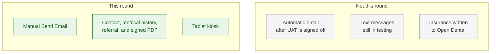
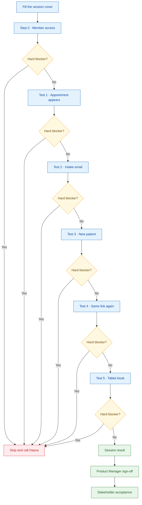
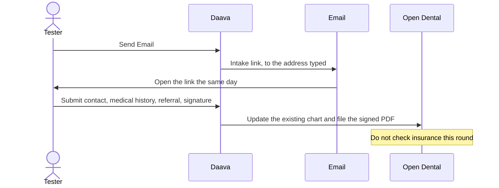

# Clinic UAT Handout

**Document:** Run sheet and acceptance  
**Version:** 1.0  
**Prepared:** 11/18/2026  
**Site:** [https://app.daava.ai](https://app.daava.ai)  
**Tablet kiosk:** [https://app.daava.ai/kiosk](https://app.daava.ai/kiosk)  
**Product Manager:** Jaime Kirk  
**Stakeholders:** Jaime Kirk, Carlos Lopez, Opal Anderson  
**Working checklist:** [Clinic UAT — Test Checklist](https://doc.clickup.com/90141627312/d/h/2kydr4xg-2354/7bb05aebadc618c)

One handout per clinic. Run the tests in order. Mark each section. A hard blocker in any section stops acceptance.

---

## 1. What this round covers

This round checks two things: the intake link arrives by email, and the chart updates with contact details, medical history, referral, and the signed PDF.

Testers may fill in insurance on the form, including a card scan. Nothing about insurance is verified in Open Dental this round. Insurance will be verified in a later phase.

Sign in at the main site. The login takes you to your clinic. The tablet kiosk is the only screen that uses a different address.

| Where | Address |
| --- | --- |
| Main site | `https://app.daava.ai` |
| Tablet kiosk | `https://app.daava.ai/kiosk` |

---

## 2. How the session runs

Fill the session cover, then run Step 0 through Test 5. Any hard blocker ends the session. Sign-off happens only when every section is marked and no blocker is open.

If anything looks unexpected, capture it. A screenshot or a short Loom, plus the clinic, the section, the patient or appointment, and the steps in order.

---

## 3. Session cover

| Field | Write it here |
| --- | --- |
| Clinic | |
| Tester | |
| Test date | |
| Site | `https://app.daava.ai` |
| Kiosk | `https://app.daava.ai/kiosk` |
| Staff member or test patient for Tests 2, 4, and 5 | |
| Appointment from Test 1 | |
| Today’s appointment for Test 5, if different | |
| Identity used for Test 3 | |

**You need:** an Open Dental login, a Daava clinic-admin login, one member email for the invite, a phone, the tablet, a photo ID, and the appointments above. Have an insurance card ready if you want to test card scanning. Use an email address you can open. Never use a real patient’s identity.

### How a section is marked

| Mark | Meaning |
| --- | --- |
| Pass | Every expected result is true, and no hard blocker in that section happened. |
| Fail | An expected result is missing, and it is not a hard blocker. |
| Blocked | A hard blocker in that section happened. Stop. Call the Daava team. Do not continue to acceptance. |

If the page says the registration was submitted but Open Dental write-back may need front-desk follow-up, that is a hard blocker.

---

## 4. Step 0 — Member access

A new clinic user can sign up and can see only their own clinic. Run this first.

1. Sign in as the clinic admin. Open **Member Management**. You see the member list and an **Email to invite** form.
2. Enter the new member’s email. Set **Invite role** to `member`. Leave **Clinic id** blank. Click **Send invite**. The member gets the email. If it does not arrive, copy the link on the screen and send it through your normal secure channel.
3. The member opens the link, enters full name, the same email, and a password of at least 10 characters, then clicks **Create account**. They can sign in right away. Complete authenticator setup if asked.
4. As the new member, open the schedule. Only their clinic and its appointments are shown. The clinic switcher does not offer other clinics, or is not shown. Opening another clinic’s schedule shows no data or an access-denied message.
5. The new member has no Member Management link. Opening it directly does not show the member list or the invite form.
6. Optional, only with a clinic id from Daava. As the clinic admin, not an organization admin, try to invite someone into the other clinic. The invite is rejected.

**Pass:** the member sees only their clinic, and cannot manage the team.

### Hard blockers — Step 0

- [ ] A member sees another clinic’s data, or the clinic switcher offers another clinic.
- [ ] A member can open Member Management or invite, change, or suspend users.
- [ ] A clinic admin can invite into another clinic.

| Step 0 result | Pass / Fail / Blocked | Notes |
| --- | --- | --- |
| | | |

---

## 5. Test 1 — The appointment appears

Daava reads the Open Dental schedule and does not change it.

If the staff member has no Open Dental chart, create an appointment for them in Open Dental, or use the test patient. This appointment is used for Tests 2 and 4. If it is today, it can also be used for Test 5. If it is a future date, create a second appointment today for Test 5.

1. In Open Dental, open **Appointments**.
2. Create an appointment for the staff test patient with a recognizable provider and operatory.
3. In Daava, open **Front Office → Schedule** for the same clinic and date.
4. Refresh the page.

**Pass:** the appointment appears once, with the correct patient, time, provider, and operatory. Nothing in Open Dental changes.

### Hard blockers — Test 1

- [ ] Daava creates, moves, edits, or cancels an appointment.
- [ ] The appointment in Daava is the wrong patient, time, provider, operatory, or clinic.
- [ ] Data from another clinic appears on this schedule.

| Test 1 result | Pass / Fail / Blocked | Appointment date and time | Notes |
| --- | --- | --- | --- |
| | | | |

---

## 6. Test 2 — Intake email for an existing patient

An existing chart updates in place. Insurance is not checked in Open Dental this round.

If the staff member has no Open Dental chart, create an appointment in Open Dental, or use the test patient. Use an email address you can open.

The form walks through About you, Contact and address, Household and contact, Insurance, Work and details, Medical history, Policies and consent, and Review. Fill each section. On Insurance, enter the coverage you want to test, or choose self-pay.

1. In Daava, find the Test 1 appointment.
2. Click **Send Email**, or **Open Intake Link** to open it directly.
3. Enter the email address you can open and click **Confirm & Send**.
4. Open the email and tap the link. Confirm the link opens the intake form.
5. Confirm the form is prefilled from Open Dental.
6. Change one contact detail, add one medication, add one allergy, choose a referral source, complete the insurance step, accept the consents, sign, and submit.
7. Write down the receipt number.

> **Automatic emailing is not on yet.** It will be turned on after UAT is signed off. Until then, use the manual **Send Email** button. It sends only to the address you type. Use the link the same day. Manually generated links expire after 24 hours.
>
> **Text messaging is not live yet** and is still being tested. Do not test texts in this round.

**Pass in Daava:** the email arrives at the address you entered. After submit, a green confirmation and a receipt number. The page says the chart details were written to Open Dental.

**Pass in Open Dental:**

| Screen | Pass looks like |
| --- | --- |
| Family → Patient Information | The contact detail changed. Only one chart exists. |
| Family → Referrals | The referral source appears. |
| Health History | The new medication and allergy appear. |
| Chart → Progress Notes | A Daava note appears. |
| Images | The signed PDF opens and shows the signature. |
| Appointments | The appointment is unchanged. |

### Hard blockers — Test 2

- [ ] A second patient chart is created.
- [ ] Contact, medical, or referral data lands on the wrong patient or the wrong clinic.
- [ ] The signed PDF is missing from Images.
- [ ] Existing medical notes are replaced with unrelated text.
- [ ] The email contains medical details, insurance numbers, or a diagnosis.
- [ ] The intake email does not arrive at the email address you entered.
- [ ] The confirmation says Open Dental write-back may need front-desk follow-up.

| Test 2 result | Pass / Fail / Blocked | Receipt number | Notes |
| --- | --- | --- | --- |
| | | | |

---

## 7. Test 3 — New patient

Start from fresh ground. Create an appointment for a new patient in Open Dental.

Use an identity that is not already in Open Dental. A real clinic member or new hire with no chart yet is best, with their own consent. If no such person is available, use a clearly labeled UAT test patient: a fake name and date of birth, and an email and phone you control. Do not use a real patient’s identity.

Use an email and phone number that are not already on a chart. If they are, Daava may update that chart instead of the new one.

Go to the main site and sign in: `https://app.daava.ai`. Your login takes you to your clinic.

1. Create the new patient’s appointment in Open Dental.
2. Open the new-patient intake form. You can also send the intake email from that appointment the same way as Test 2, and confirm it arrives.
3. Complete name and date of birth, the email and phone you control, address, insurance or self-pay, medical history, consent, and signature.
4. Submit and write down the receipt number.

**Pass:** the link arrives when you send it. Exactly one chart for that new patient, with the contact detail, medical history, referral, and the signed PDF. The appointment you created is unchanged. Insurance is not checked this round.

### Hard blockers — Test 3

- [ ] More than one chart is created, or an existing chart is changed instead.
- [ ] Daava creates, moves, edits, or cancels an appointment.
- [ ] The new chart is in the wrong clinic.
- [ ] The signed PDF is missing from Images.
- [ ] The confirmation says Open Dental write-back may need front-desk follow-up.
- [ ] A real patient’s identity was used.

| Test 3 result | Pass / Fail / Blocked | Receipt number | New chart name | Notes |
| --- | --- | --- | --- | --- |
| | | | | |

---

## 8. Test 4 — The same link again

A second submission updates the same chart.

1. Open the same link from Test 2.
2. Change the mobile number.
3. Submit.

**Pass:** the same chart is updated. No second chart is created. The new PDF name includes **(Update)**.

### Hard blockers — Test 4

- [ ] A second patient chart is created.
- [ ] The update lands on a different patient or clinic.
- [ ] The new PDF is missing, or its name does not include (Update).
- [ ] The confirmation says Open Dental write-back may need front-desk follow-up.

| Test 4 result | Pass / Fail / Blocked | Receipt number | Notes |
| --- | --- | --- | --- |
| | | | |

---

## 9. Test 5 — Tablet kiosk

The tablet matches today’s appointment and writes only to the paired clinic.

Use a real clinic member, or the test patient, who has an Open Dental chart and an appointment today. If the Test 1 appointment is today, reuse it. Tests 2 and 4 only change contact and medical details, so the name, date of birth, and appointment still match. If Test 1 is a future date, use the second appointment you created for today. Do not use a future appointment. Do not use the Test 3 chart.

Open the kiosk on the tablet: `https://app.daava.ai/kiosk`

The kiosk has three steps: Demographics and Insurance, Comprehensive Medical, and Consents and Sign.

1. On the tablet, tap **Staff Settings**, choose your clinic, and enter the staff PIN.
2. In Open Dental, confirm the test patient has a chart and today’s appointment.
3. Enter first name, last name, and date of birth.
4. Tap **Check In**. The correct appointment appears.
5. On Demographics and Insurance, confirm contact, address, emergency contact, and referral match the chart before you edit anything. You may update contact details and complete the photo-ID step or the approved exception. Verify email and mobile with the one-time codes if you are testing them. Enter or update insurance if you want to test that step. Insurance is not checked in Open Dental this round.
6. On Comprehensive Medical, add one medication, one allergy, one condition, and mark premedication for this test.
7. On Consents and Sign, accept the policies and sign.
8. Submit and write down the receipt number.
9. Check the same Open Dental screens as Test 2.

Also confirm, as part of a pass:

- A wrong date of birth, or no appointment today, shows “please see the front desk” and writes nothing.
- Leaving the tablet idle for 60 seconds shows a warning, then the screen resets.
- After a successful check-in, the success screen resets after 15 seconds.

**Pass:** the correct patient and appointment. The chart update is in the paired clinic only. The appointment is unchanged. Prefilled fields matched the chart before you edited them.

### Hard blockers — Test 5

- [ ] Check-in matches the wrong patient or the wrong appointment.
- [ ] The chart update lands in a clinic other than the paired clinic.
- [ ] The kiosk shows or writes chart data that belongs to someone else.
- [ ] A wrong date of birth, or a patient with no appointment today, still writes to a chart.
- [ ] Daava creates, moves, edits, or cancels the appointment.
- [ ] The signed PDF is missing from Images.
- [ ] Existing medical notes are replaced with unrelated text.
- [ ] The confirmation says Open Dental write-back may need front-desk follow-up.

| Test 5 result | Pass / Fail / Blocked | Receipt number | Notes |
| --- | --- | --- | --- |
| | | | |

---

## 10. Hard blockers — full list

This is the same stop list, in one place. The boxes in each section are the ones to watch while you run that section. If you already checked a box above, check it here too.

Any one box stops the UAT. Stop and call the Daava team. Acceptance cannot be signed while any box is checked.

### Access

- [ ] A member sees another clinic’s data, or the clinic switcher offers another clinic.
- [ ] A member can open Member Management or invite, change, or suspend users.
- [ ] A clinic admin can invite into another clinic.

### Schedule and chart

- [ ] A new appointment is created, moved, edited, or cancelled by Daava.
- [ ] A duplicate patient chart is created.
- [ ] Data appears in the wrong patient or the wrong clinic.
- [ ] The signed PDF is missing from Images.
- [ ] Existing medical notes are replaced with unrelated text.

### Messages

- [ ] An email contains medical details, insurance numbers, or a diagnosis.
- [ ] The intake email does not arrive at the email address you entered.
- [ ] The confirmation says Open Dental write-back may need front-desk follow-up.

### Kiosk

- [ ] The kiosk shows or writes data that does not match the patient’s real chart.
- [ ] A wrong date of birth, or no appointment today, still writes to a chart.

| Hard blockers found | None, or the section and what you saw |
| --- | --- |
| | |

---

## 11. Where to look in Open Dental

| What to check | Where |
| --- | --- |
| Patient name, date of birth, address, phone, email | Family → Patient Information |
| Referral source | Family → Referrals |
| Allergies, medications, problems, premedicate | Health History |
| Notes from Daava | Chart → Progress Notes |
| Signed intake PDF | Images |
| Appointment unchanged | Appointments |

---

## 12. Session result

Copy the mark from each section. Acceptance needs every row Pass, or Fail only where a stakeholder has accepted the note in section 14. Any Blocked row stops acceptance.

| Section | Mark | Receipt or evidence | Tester initials | Date |
| --- | --- | --- | --- | --- |
| Step 0 — Member access | | | | |
| Test 1 — Appointment in Daava | | | | |
| Test 2 — Existing patient intake email | | | | |
| Test 3 — New patient intake | | | | |
| Test 4 — Same link again | | | | |
| Test 5 — Tablet kiosk | | | | |

| | |
| --- | --- |
| UAT start date | |
| UAT finish date | |
| Tester name | |
| Tester signature | |
| Date signed | |

---

## 13. Product Manager sign-off

Jaime Kirk, Product Manager, reviews the session result and the hard-blocker list before stakeholders accept.

Sign only when every section is marked and any hard blocker is either absent or written up with evidence.

| | |
| --- | --- |
| Name | Jaime Kirk |
| Role | Product Manager |
| Clinic this sign-off covers | |
| Decision | Accept / Accept with notes / Do not accept |
| Notes, required if not a clean Accept | |
| Date | |
| Signature | |

---

## 14. Stakeholder acceptance

Jaime Kirk, Carlos Lopez, and Opal Anderson each accept or do not accept this UAT for the clinic named above.

UAT is accepted for that clinic only when all three of the following are true:

1. No hard blocker is still open.
2. Jaime Kirk has signed section 13 as Accept or Accept with notes.
3. Jaime Kirk, Carlos Lopez, and Opal Anderson have each signed below as Accept or Accept with notes.

Accept with notes is allowed only when the note names what is still open and who will close it. Do not accept is a no. One Do not accept means this clinic’s UAT is not accepted.

| Name | Role | Decision | Date | Signature | Notes |
| --- | --- | --- | --- | --- | --- |
| Jaime Kirk | Product Manager | Accept / Accept with notes / Do not accept | | | |
| Carlos Lopez | Stakeholder | Accept / Accept with notes / Do not accept | | | |
| Opal Anderson | Stakeholder | Accept / Accept with notes / Do not accept | | | |

| | |
| --- | --- |
| Clinic accepted | |
| Date UAT accepted | |
| Accepted by | |
