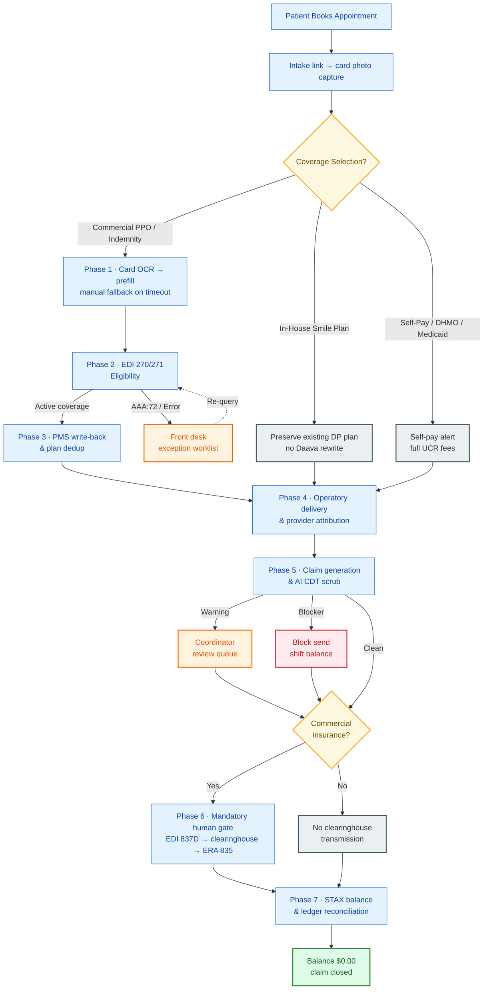
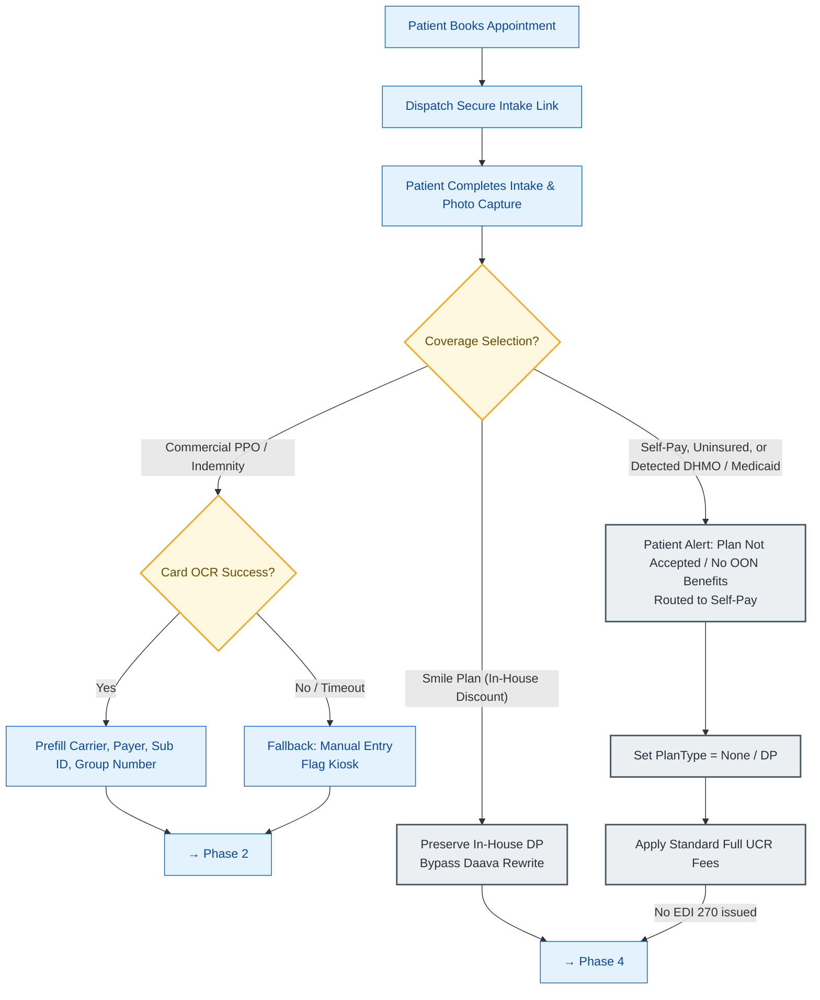
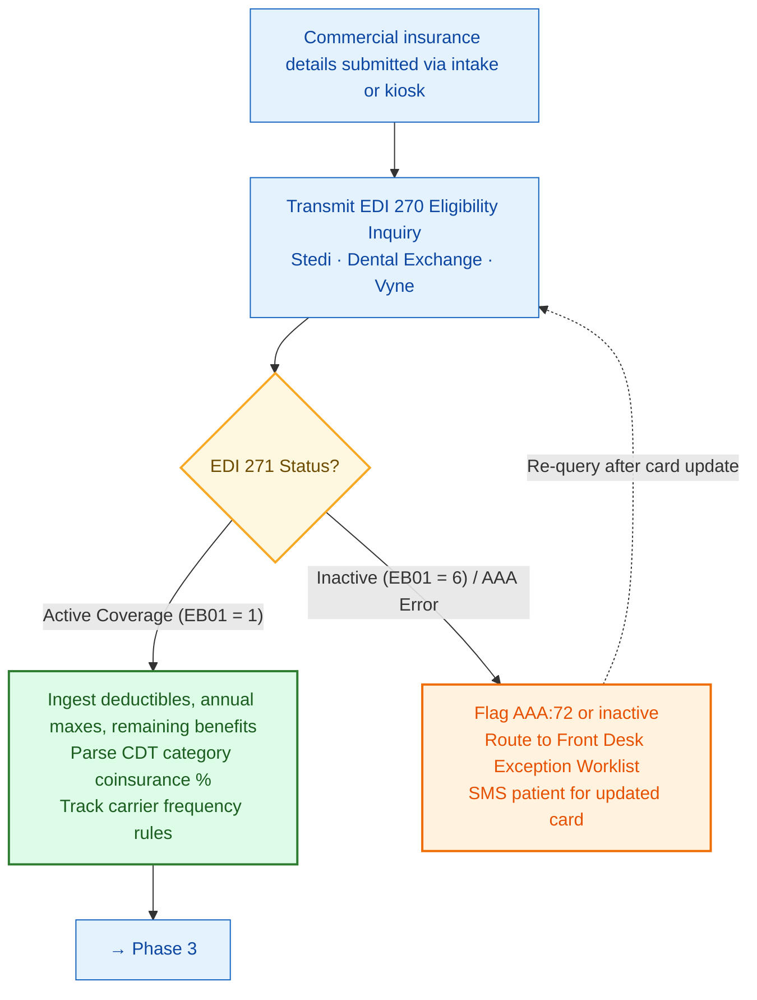
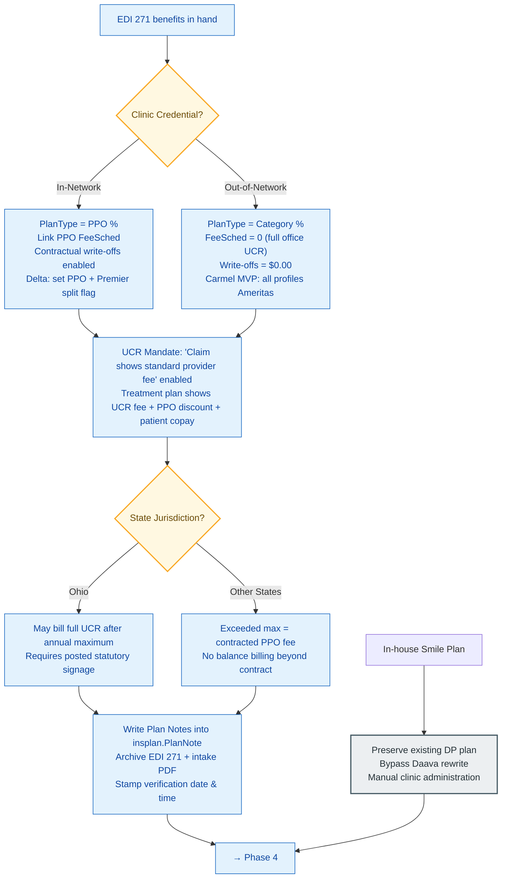
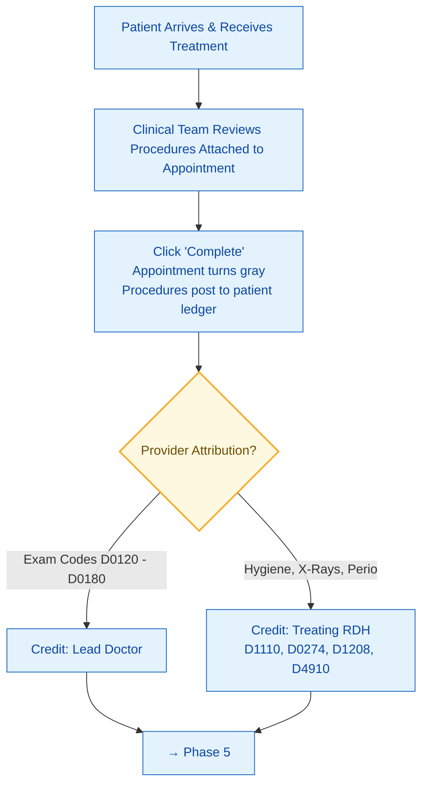
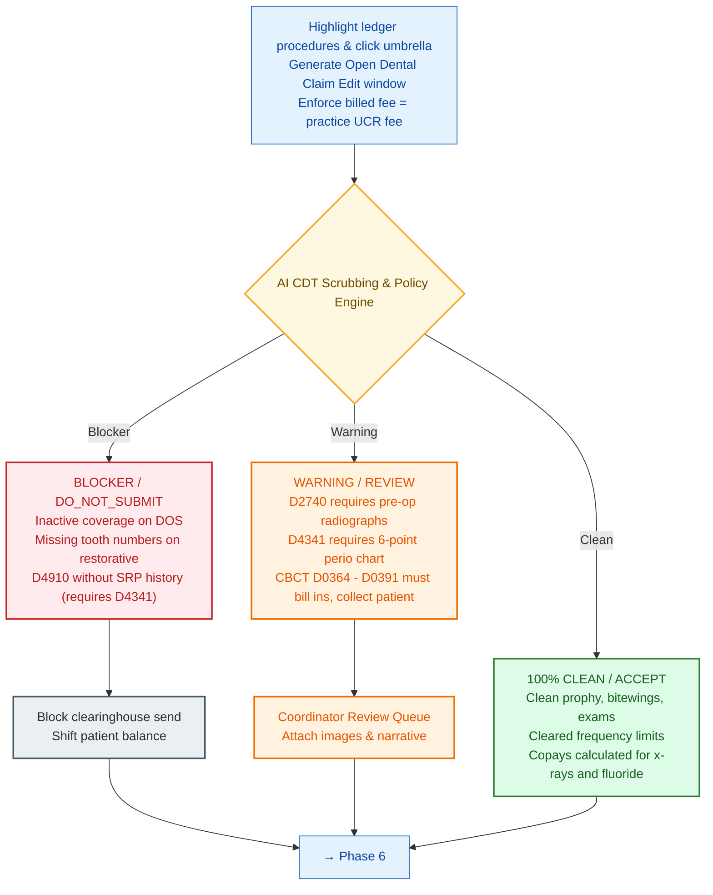
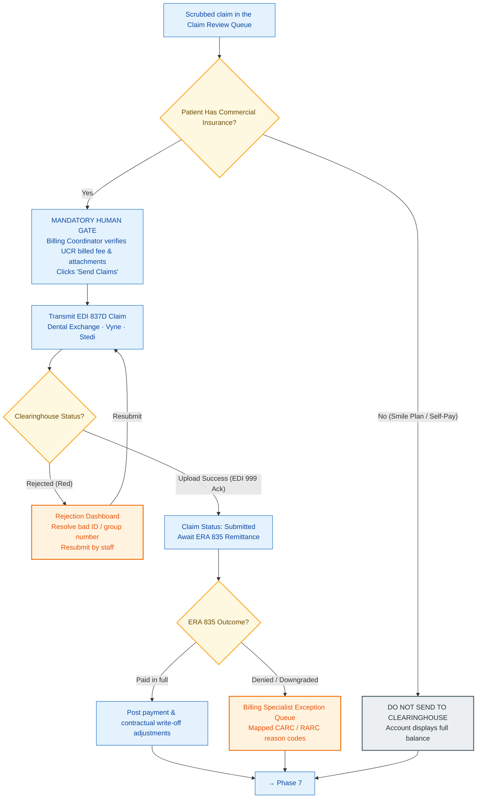
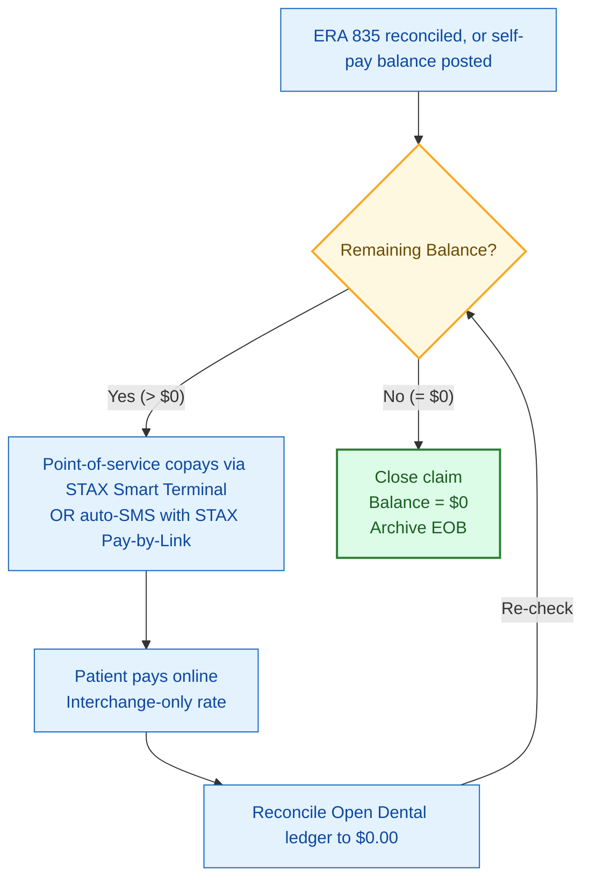

# End-to-End Dental Insurance & Claims Specification

- **Document Version:** 5.0 (updated per post-11/10/2026 meeting feedback)
- **Stakeholders & Reviewers:** Opal Anderson, Jaime Kirk, Carlos Lopez, Tony Xu, Tanmay Patil, Dr. Rohit Reddy, Hrishiraj Ramachandran
- **Target Systems:** Daava Core Platform, Open Dental (v23+), Clearinghouses (Dental Exchange, Vyne Dental, Stedi), STAX Payment Gateway

---

## 1. Executive Summary & Changelog

Following the 11/10/2026 operational review with Opal Anderson, Jaime Kirk, and Carlos Lopez, this specification has been upgraded to Version 5.0 to reflect critical adjustments across clinical workflows, insurance mechanics, clearinghouse constraints, and patient payment processing:

1. **Medicaid & DHMO Full-Stop Triage (Phase 1):** Explicitly separated Medicaid and DHMO plans from standard commercial insurance. Neither plan type offers out-of-network benefits. Because DAG offices do not participate in Medicaid (e.g., DentaQuest, Buckeye, CareSource) or DHMOs (e.g., Cigna DHMO, Aetna DHMO), any scanned card identified as Medicaid or DHMO triggers a mandatory, non-blocking front-end alert informing the patient that their plan is not accepted and automatically routes them to the Self-Pay / UCR workflow.
2. **In-House Discount Membership ("Smile Plan") Preservation (Phases 1 & 3):** Smile Plans are classified as internal Discount Plans (`DP` plan type in Open Dental) and must be enrolled and billed manually by clinic staff. Daava will respect and preserve existing `DP` plans without overwriting them or applying standard PPO coinsurance rules.
3. **Claim Fee vs. Treatment Plan UCR Standard (Phase 3 & 6):** Enforced the industry-standard billing rule across all practices and states: **Claims must always be submitted showing the practice's full standard UCR fee**, never the contracted PPO fee schedule. In Open Dental, this activates the setting under *Other Insurance Information* (`Claim shows standard provider fee`). This ensures fair percentile reporting to national fee databases (NDAS) and guarantees that non-covered services or annual maximum overruns can be billed at full practice fees. In contrast, **Treatment Plans** must display the full UCR fee, the contractual PPO discount, and the estimated patient copay.
4. **Delta Dental Premier vs. PPO Provider Nuance (Phase 3):** Addressed practices with legacy Delta Dental Premier providers (e.g., Mount Pleasant). Delta Dental has closed Premier enrollment to new dentists. To eliminate automated tier mismatch errors, Daava defaults write-backs to standard Delta Dental PPO terms and flags accounts for front-office review when scheduled with grandfathered Premier clinicians.
5. **Human-in-the-Loop Transmission Mandate (Phase 6):** In strict adherence to healthcare compliance and legal review, AI automated agents are prohibited from headlessly releasing claims to clearinghouses. Daava creates, scrubs, and stages claims within Open Dental, but a human billing coordinator must perform final review and initiate electronic transmission.
6. **Clearinghouse Architecture Expansion (Phase 6):** Formally incorporated **Vyne Dental** alongside **Dental Exchange** and **Stedi**. Documented Dental Exchange's tier changes (capped at 700 claims/month for $85 under KKR ownership) and Stedi's modern API integration path.
7. **Payment Processing Shift: Pearly to STAX (Phases 1 & 7):** Replaced third-party billing platform Pearly with DAG's primary merchant processor, **STAX**. STAX eliminates recurring SaaS fees ($235/mo + $75/mo write-back add-on) and operates strictly on true interchange rates. Daava will utilize STAX Pay-by-Link for SMS balance collections and in-operatory smart terminals ($950–$965 outright purchase) to collect copays prior to treatment, writing receipts directly back to the Open Dental ledger.
8. **Universal Exclusions & Mandatory Submission (Phase 5):** Re-emphasized that PPO contracts require *all completed procedures to be billed to insurance*, even when non-covered. CBCT scans (D0364–D0391) must be submitted via EDI 837D, while collecting the full fee from the patient at the point of service. Documented the strict prerequisite of Scaling & Root Planing (D4341/D4342) prior to billing Periodontal Maintenance (D4910).

---

## 2. System Actors & Operational Scopes

| System Actor | Operational Scope & Access Boundaries | Primary System Touchpoints |
| :--- | :--- | :--- |
| **Patient (External)** | Completes mobile intake, captures identity/insurance cards, receives DHMO/Medicaid network notifications, and pays point-of-service or remaining balances via STAX Pay-by-Link. | Mobile Intake (`/intake`), Patient Kiosk (`/kiosk`), STAX SMS Pay-by-Link. |
| **Front Desk / Reception** | Validates daily appointment queues, resolves unassigned provider columns, reviews DHMO/Medicaid self-pay shifts, and collects check-in copays via STAX smart terminals. | Daava Daily Operatory Schedule (`/frontoffice`), STAX Terminal, Open Dental Appointment Module. |
| **Insurance Coordinator** | Oversees EDI 270/271 exceptions, manages master plan deduplication, validates Plan Notes, and conducts human sign-off on 837D batches. | Daava Claim Review Queue (`/frontdesk`), Dental Exchange / Vyne Portals, Open Dental Insurance Module. |
| **Clinical Team (Dentist & Hygienist)** | Delivers care, reviews procedures attached to the appointment, assigns legal provider attribution (Doctor for exams, Hygienist for prophy/fluoride/perio), and sets appointments complete. | Open Dental Treatment Chart, Imaging Module, Progress Notes. |
| **Practice Manager & Operations** | Monitors multi-clinic claim turnaround, audits STAX interchange fees and ledger write-backs, maintains UCR fee schedules, and oversees expansion cohorts. | Daava Management Analytics, STAX Merchant Portal, Open Dental Reports. |

---

## 3. End-to-End Visual Workflow Decision Tree

The workflow is rendered as one **end-to-end phase map** for orientation, followed by a **decision-level diagram for each of the seven phases**. Colour encodes outcome: yellow diamonds are branch points, blue is an operational action, red is a hard blocker, orange requires human review, green is clean/ready, and grey is a terminal non-clearinghouse path.

### 3.1 End-to-end phase map



### 3.2 Phase 1 — Patient Onboarding, Coverage Triage & OCR



### 3.3 Phase 2 — Clearinghouse Real-Time Eligibility (EDI 270/271)



### 3.4 Phase 3 — PMS Write-Back & Plan Deduplication



### 3.5 Phase 4 — Operatory Clinical Delivery & Procedure Sign-Off



### 3.6 Phase 5 — Claim Generation & AI CDT Scrubbing Engine



### 3.7 Phase 6 — Human-in-the-Loop Clearinghouse Transmission (EDI 837D)



### 3.8 Phase 7 — Patient Balance Billing & STAX Reconciliation



### 3.9 Reading the diagrams

| Path | Meaning |
| :--- | :--- |
| **Commercial PPO / Indemnity** | Enters Phases 2 → 3 → 4 → 5, then reaches the mandatory human transmission gate in Phase 6. |
| **Smile Plan (in-house discount)** | Skips eligibility in Phase 2, lands on `Preserve In-House DP` in Phase 3, rejoins clinical delivery in Phase 4, and terminates in the `DO NOT SEND` branch of Phase 6. |
| **Self-Pay / Uninsured / DHMO / Medicaid** | Fails the "Opal Hard Stop" gate in Phase 1, is quoted standard UCR fees, and never triggers an EDI 270 inquiry. |
| **Blocker / Warning / Clean** | The only three outcomes the scrubbing engine may return. A blocker can never reach `Send Claims`; a warning must pass through the Coordinator Review Queue first. |

---

## 4. Phase-by-Phase Process & Decision Logic

### Phase 1: Patient Onboarding, Coverage Triage & OCR

- **Trigger:** Patient schedules online or appointment is created in Open Dental.
- **Step 1.1: Multi-Channel Intake Dispatch**
  - System dispatches a zero-PHI, tokenized intake link via SMS and email.
- **Step 1.2: Coverage Selection & Pre-Screening**
  - **Decision 1.1: Patient Coverage Selection**
    - *Branch A (Commercial Insurance):* Patient enters carrier information and captures front/back card images. Multimodal OCR (Vertex AI / Gemini 1.5 Flash) parses Payer ID, Carrier Name, Member ID, and Group Number.
    - *Branch B (In-House Smile Plan):* Patient selects internal discount membership. System bypasses clearinghouse checks and preserves existing `DP` setup.
    - *Branch C (Self-Pay / Uninsured):* Patient confirms no insurance. Account is set to full office UCR fee schedule.
  - **Decision 1.2: Medicaid & DHMO Exclusion Gate (The "Opal Hard Stop")**
    - *Condition:* OCR extraction or patient selection identifies a Medicaid program (e.g., DentaQuest, Buckeye Community Health, CareSource, UnitedHealthcare Community Plan) or a DHMO carrier (e.g., Cigna Dental Care DHMO, Aetna DMO).
    - *Clinical Reality:* Medicaid is not a PPO and has zero out-of-network benefits. DHMOs operate on strict monthly capitation rosters (paying ~$5/month per patient, $0 for prophylaxis, $0 for anterior fillings, and only ~$220–$250 for crowns). None of DAG's practices participate in DHMO or Medicaid panels.
    - *System Action:* The system halts insurance intake and displays a polite informational modal:

      > **Notice Regarding Your Plan:**
      > *Our office is out-of-network with DHMO and Medicaid plans, which do not provide out-of-network benefits. As a result, we cannot bill your insurance directly. You are welcome to receive care as a Self-Pay patient at our standard office rates or enroll in our in-house Smile Plan.*

    - *Routing:* The patient chart is marked `Self-Pay`, `PlanType = None`, and billing is linked directly to standard office UCR fees. No EDI 270 transaction is triggered.

---

### Phase 2: Clearinghouse Real-Time Eligibility (EDI 270/271)

*(Strictly executed for Branch A: Commercial PPO / Indemnity)*

- **Trigger:** Successful submission of commercial insurance details via intake or kiosk.
- **Step 2.1: Real-Time EDI 270 Inquiry**
  - System constructs an ANSI ASC X12 EDI 270 eligibility inquiry payload.
  - Transmits to clearinghouse gateway (Stedi, Dental Exchange, or Vyne Dental).
- **Step 2.2: EDI 271 Adjudication & Ingestion**
  - **Active Coverage Received (EB01 = '1'):**
    - *Financial Ingestion:* Ingests calendar/fiscal renewal dates, individual/family annual maximums, remaining annual benefits, general deductibles, and preventive deductible waiver status.
    - *Category Coinsurance Parsing:* Extracts exact coinsurance percentages across CDT diagnostic categories (Diagnostic, Preventive, Restorative, Endodontics, Periodontics, Prosthodontics, Major).
    - *Dynamic Frequency Tracking:* Replaces static assumptions with dynamic rules returned by the carrier (e.g., FMX/Panoramic frequency limits vary between 1 per 36 months and 1 per 60 months depending on policy terms).
  - **Inactive / Exception Response (EB01 = '6' or AAA Error Segment):**
    - Flags record as `AAA:72` (Invalid Member ID/Group) or inactive.
    - Routes task directly to Front Desk Exception Worklist.
    - Dispatches automated SMS notification requesting updated card details from the patient.

---

### Phase 3: Practice Management System (PMS) Write-Back & Deduplication

- **Step 3.1: Network Credentialing & Fee Schedule Configuration**
  - **Decision 3.1: Network Status Classification**
    - *In-Network Contracted PPO:* Set `insplan.PlanType = 'p'` (PPO Percentage). Bind contracted carrier fee schedule (`FeeSchedNum`). Contractual write-offs are enabled.
    - *Out-of-Network (Carmel Rollout Mode):* Set `insplan.PlanType = 'c'` (Category Percentage). Bind office standard UCR fee schedule (`FeeSchedNum = 0`). Write-offs are set to $0.00. Coinsurance percentages calculate against full office fees. *For the Carmel MVP pilot, all carrier profiles are standardized under Ameritas.*
    - *Delta Dental Premier Provider Alert:* If treating provider is enrolled in grandfathered Delta Dental Premier (higher fee schedule than PPO), the system sets baseline write-back to PPO and flags the appointment for front-desk audit to avoid provider reimbursement mismatches.
  - **Decision 3.2: Universal Claim Billing Fee Rule (The UCR Mandate)**
    - *The Invariant:* Regardless of network status (In-Network or Out-of-Network), **all claims must be submitted with the practice's full standard UCR fee**.
    - *Open Dental Configuration:* Ensure `Claim shows standard provider fee` is activated in Open Dental under *Other Insurance Information*.
    - *Operational Rationale:*
      1. PPO payers automatically apply their contracted fee schedules upon adjudication; submitting reduced fees artificially deflates regional fee percentiles reported to the National Dental Advisory Service (NDAS) database.
      2. If a patient exceeds their annual maximum or receives a non-covered service, insurers will never adjust reimbursement upward if the practice billed the lower PPO rate.
    - *Treatment Plan Distinction:* The treatment plan presented to the patient displays the standard UCR fee, the contractual PPO discount, and the patient's out-of-pocket obligation.
  - **Decision 3.3: State-Specific Annual Maximum Overrun Rules**
    - *Practices Outside Ohio:* When a patient exceeds their annual maximum, contracted PPO fee schedules remain binding. In-network patients cannot be balance-billed beyond contracted rates.
    - *Ohio Practices (O.R.C. § 3963.02(D)):* Ohio law permits dental practices to bill their full standard UCR fees once an in-network patient exceeds their annual maximum or for non-covered procedures, provided the practice posts statutory disclosure signage in the office. Open Dental ledger calculations must reflect full UCR liability for post-maximum procedures in Ohio clinics.
- **Step 3.2: Master Plan Deduplication & Plan Notes Write-Back**
  - Primary insurance replacement is staged carefully to avoid clobbering history. Daava writes standardized **Plan Notes** directly into the Open Dental `insplan.PlanNote` field.
  - *Standard Plan Note Format:*

    ```text
    Exam: 1/6 mths
    Limited exam: 50% 1 in 12 months
    BWX: 1/12 mths
    PANO/FMX: 1/5 yrs (or 1/3 yrs, per policy)
    Prophy: 1/6 mths
    Fluoride: not covd (age limits apply)
    Sealants: not covd
    Perio Maint: 50% 1/6 mths
    Scaling/Root Planing: (quads per visit) 50% 1/24 mths
    Full Mouth Debridement: 1/lifetime 50%
    Simple extractions: 50%
    Complex oral surgery: NOT A COVERED SERVICE
    Occlusal Guard: not covd
    Crowns/Bridges: 1/7 yrs 50%
    Dentures/Partials: 1/7 yrs 50%
    Implants: 1/7 yrs 50%
    Replacement on Prostho: 7 yrs
    Paid on: Seat date
    Posterior Composites: 50% covd no downgrade
    Missing tooth Clause: none listed
    Verified By: Daava Automated Gateway
    ```

- **Step 3.3: Verification Archival**
  - The compiled intake form and raw EDI 271 response are assembled into a tamper-evident PDF and archived in Open Dental under the **"Insurance Verification"** imaging category, stamped with the verification date and time.

---

### Phase 4: Operatory Clinical Delivery & Procedure Sign-Off

- **Step 4.1: Procedure Verification**
  - Following clinical delivery, the clinical team reviews all **procedures attached to the appointment** in the Open Dental Appointment Book.
  - Clicking **Set Complete** transitions the appointment status to gray and pushes completed procedure codes into the Patient Account Ledger.
- **Step 4.2: Legal Provider Attribution Audit**
  - *Diagnostic Exams (D0120, D0140, D0150, D0160, D0180, etc.):* Credited strictly to the licensed Dentist.
  - *Hygiene, Perio & Preventive (D1110, D0274, D1208, D4910, etc.):* Credited strictly to the treating Dental Hygienist (RDH).

---

### Phase 5: Claim Generation & AI CDT Scrubbing Engine

- **Step 5.1: Ledger Extraction & Claim Edit**
  - Staff select completed ledger procedures and click the umbrella icon to open the Open Dental Claim Edit window. Billed fees default to full UCR rates.
- **Step 5.2: The "Opal Anderson Clinical Rules Matrix"**

| CDT Code & Description | Clinical Prerequisite & Frequency Matrix | Scrubbing Action & Financial Outcome |
| :--- | :--- | :--- |
| **D1110 (Adult Prophylaxis)** | Governed by payer frequency (e.g., 2 per calendar year, 1 per 6 months). Patient must NOT have active periodontal disease history. | Clean: Accept. If patient has prior SRP history, flag for conversion to D4910. |
| **D0274 (4 Bitewings)** | Varies strictly by insurance policy (typically 1 per 12 months). *Note: X-rays are not universally covered at 100%.* | Calculate patient copay based on verified category %. Collect copay at check-in. |
| **D0210 (FMX) / D0330 (Panoramic)** | Frequencies vary by carrier (typically 1 per 36 or 60 months). Shared frequency limitation between FMX and Pano. | Check carrier history. If frequency is exceeded, flag as DO_NOT_SUBMIT to payer; bill patient direct. |
| **D4341 / D4342 (SRP)** | Requires active periodontal disease: pocket depths ≥ 4 mm, bleeding on probing, radiographic calculus. | REVIEW: Mandatory attachment of 6-point periodontal charting and diagnostic radiographs. |
| **D4910 (Perio Maintenance)** | **MANDATORY PREREQUISITE:** Must have documented historical Scaling & Root Planing (D4341/D4342). | **DO_NOT_SUBMIT** if SRP history is absent. Carrier will deny without prior SRP. Patient owes copay. |
| **D0364–D0368 / D0380–D0384 / D0391 (CBCT 3D Scans)** | PPO contracts mandate billing all completed procedures to insurance, even non-covered services. | **MUST bill claim to insurance via EDI 837D**, but collect full fee from patient at point of service. |
| **D2740 (Ceramic Crown)** | Major restorative (typically 50% coinsurance). | REVIEW: Attach pre-operative periapical radiograph, bitewing, and narrative documenting tooth failure. |
| **D1208 (Fluoride Topical)** | Age limits dictated by payer contract (often limited to age 14, 16, or 18; frequently non-covered for adults). | Calculate age copay. Bill to insurance per contract requirements, but collect copay at time of service. |

*(Core Invariant: Dental insurance never guarantees 100% coverage across all diagnostic or preventive codes. System must dynamically calculate out-of-pocket liabilities based on verified EDI 271 category percentages.)*

---

### Phase 6: Human-in-the-Loop Clearinghouse Transmission (EDI 837D)

- **Step 6.1: The Mandatory Human Transmission Gate**
  - **Regulatory & Legal Mandate:** In compliance with healthcare compliance standards and legal review, automated AI agents are strictly prohibited from headlessly transmitting claims directly to clearinghouses.
  - **Operational Execution:** Daava's scrubbing engine stages scrubbed claims in the **Claim Review Queue**. The Billing Coordinator verifies attachments (perio charts, bitewings, narratives) and billed UCR fees, then clicks **"Transmit Claims"** to initiate clearinghouse transfer.
- **Step 6.2: Clearinghouse Dispatch**
  - Batches are uploaded to the active clearinghouse gateway:
    - *Dental Exchange:* Primary clearinghouse. Account parameters monitored (700 claims/month cap at $85 tier; per-claim surcharges beyond threshold).
    - *Vyne Dental:* Enterprise clearinghouse alternative for designated practices.
    - *Stedi Clearinghouse Gateway:* Direct programmatic API gateway for real-time 837D submission and 835 remittance polling.
- **Step 6.3: Clearinghouse Response Handling**
  - *Level 1 Rejection (Red / Upload Error):* Claims rejected for invalid subscriber IDs or missing group numbers route to the Rejection Worklist for front-desk correction and one-click re-batching.
  - *Upload Success (EDI 999 Functional Ack):* Status moves to `Submitted`. System schedules automated polling for EDI 835 Remittance Advice.
- **Step 6.4: Adjudication & Electronic Remittance Advice (EDI 835)**
  - *Paid in Full / Expected:* Auto-posts insurance payment and contractual write-off adjustments directly into Open Dental ledger.
  - *Denied / Downgraded:* Routes claim to Billing Specialist Exception Queue with mapped CARC/RARC denial reason codes.

---

### Phase 7: Patient Balance Billing & Ledger Reconciliation (STAX Integration)

- **Step 7.1: Retirement of Pearly in Favor of STAX**
  - **Operational Decision:** DAG practices have transitioned away from Pearly for billing.
  - **Comparative Financial Rationale:**
    - *Pearly:* Carries a $235/month base fee per clinic, an additional $75/month per clinic surcharge for Open Dental write-backs ($310/month total), and experienced multi-month settlement delays in select markets (e.g., Kentucky).
    - *STAX:* DAG's established merchant processor. STAX charges only wholesale **interchange rates** without markup (e.g., October Cascades volume of $76,516 incurred only $1,595 in fees, ~2%). Clinics own their smart terminals outright ($950–$965 one-time hardware purchase) with a flat ~$1,000 annual platform fee per clinic.
- **Step 7.2: Point-of-Service Copay Collection**
  - Copays identified during Phase 5 scrubbing (e.g., age-restricted Fluoride copays, D4910 Perio Maintenance cost-shares, CBCT imaging fees, and coinsurance differentials) are presented at checkout.
  - Front-desk staff collect copays at check-in or chairside via the **STAX Smart Terminal** (supporting contactless tap, chip insert, Apple Pay, and Google Pay).
- **Step 7.3: Post-Adjudication Statement Generation & Pay-by-Link**
  - Following ERA 835 reconciliation, any remaining patient balance (deductibles, annual maximum overruns, non-covered services) triggers an automated statement workflow.
  - **STAX Pay-by-Link:** Daava generates an itemized digital billing breakdown explaining total charges, insurance payments, contractual write-offs, and remaining balance.
  - **SMS Dispatch:** System dispatches a secure 2-way SMS containing a STAX Pay-by-Link URL directly to the patient's mobile device.
  - **Automated Ledger Reconciliation:** Payments made through STAX Pay-by-Link settle directly into the practice operating account. Daava writes the payment credit back into the Open Dental ledger, reconciling the patient balance to `$0.00`.

---

## 5. Balsamiq Wireframe Screen Specifications

### Screen 1: Mobile Patient Intake — Coverage Selection (`WF-INT-01`)

- **UI Components:**
  - Coverage Radio Cards: `[ Commercial Dental Insurance ]`, `[ In-House Smile Plan ]`, `[ Self-Pay / No Insurance ]`.
  - Camera Upload Modals: High-resolution front and back card capture with automated edge-detection and Vertex OCR parsing status spinner.
  - **Modal Alert (Medicaid / DHMO Gate):** Triggered if OCR detects Medicaid or DHMO credentials. Prominently displays:
    `[ ⚠️ Notice: Your plan does not offer out-of-network benefits. Billed as Self-Pay. ]`
  - Prefilled Input Fields: Carrier Name, Payer ID, Subscriber ID, Group Number, Subscriber Date of Birth, Patient Relationship.

### Screen 2: Staff Exception & Eligibility Queue (`WF-INS-02`)

- **UI Components:**
  - Exception Worklist: Filterable by clinic location, error severity, and appointment date.
  - Status Indicators: `[ Active: Verified ]`, `[ AAA:72 Member ID Mismatch ]`, `[ Out-of-Network DHMO / Medicaid Flag ]`.
  - Direct Remediation Pane: Side-by-side view of uploaded card photo and parsed fields with inline correction fields and one-click `[ Re-Query EDI 270 ]` trigger.

### Screen 3: Benefit Breakdown & Fee Schedule Preview (`WF-PMS-03`)

- **UI Components:**
  - Plan Type Configuration: `(o) PPO Percentage (In-Network)` vs. `( ) Category Percentage (Out-of-Network / Carmel MVP)`.
  - Claim Fee Audit Display: Shows locked setting: `[✓] Claim shows standard provider fee (UCR: $115.00 | Fee Sched: $44.00)`.
  - Provider Split Warning: Highlighted badge if provider is Delta Dental Premier in a PPO clinic.
  - State Legal Jurisdiction Flag: `[ Ohio Practice: Post-Annual Maximum Full UCR Permitted ]`.

### Screen 4: Operatory Appointment Sign-Off & Provider Audit (`WF-OPS-04`)

- **UI Components:**
  - Appointment Book Inspector: Displays procedures linked to the completed appointment block.
  - Provider Credit Allocation Matrix:
    - Diagnostic Exam Codes (D0120–D0180): Assigned strictly to Lead Dentist.
    - Hygiene, Perio & Fluoride Codes (D1110, D0274, D1208, D4910): Assigned strictly to Treating Hygienist.
  - Completion Action: `[ Set Complete ]` button transitions appointment to gray and posts procedures to ledger.

### Screen 5: Claim Scrubbing & Human Transmission Gateway (`WF-CLM-05`)

- **UI Components:**
  - Claim Review Queue: Displays clean, review-required, and blocked claims.
  - Prerequisite Warnings: High-visibility red banner: `[ 🛑 Blocker: D4910 billed without prior D4341 SRP in chart history ]`.
  - Attachment Manager: Attachment checklist verifying pre-op radiographs, periodontal charts, and clinical narratives.
  - **Mandatory Human Action Button:** `[ Approve & Submit Claim to Clearinghouse (Dental Exchange / Vyne) ]`.

### Screen 6: STAX Point-of-Service & Pay-by-Link Checkout (`WF-PAY-06`)

- **UI Components:**
  - Patient Balance Breakdown: Clear display of total procedure fees, insurance allowances, copays, and remaining patient balance.
  - Checkout Trigger: `[ Send to STAX Smart Terminal ]` for in-office chip/tap payment.
  - Remote Payment Dispatch: `[ Dispatch STAX Pay-by-Link via SMS ]` sends instant secure payment link to patient phone.
  - Ledger Sync Status: Shows real-time reconciliation checkmark: `[ ✓ Open Dental Ledger Balanced to $0.00 ]`.
