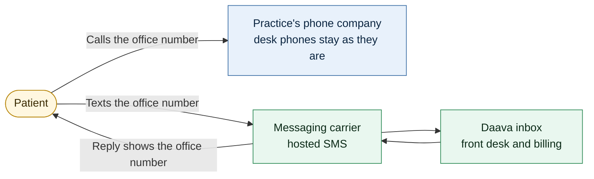
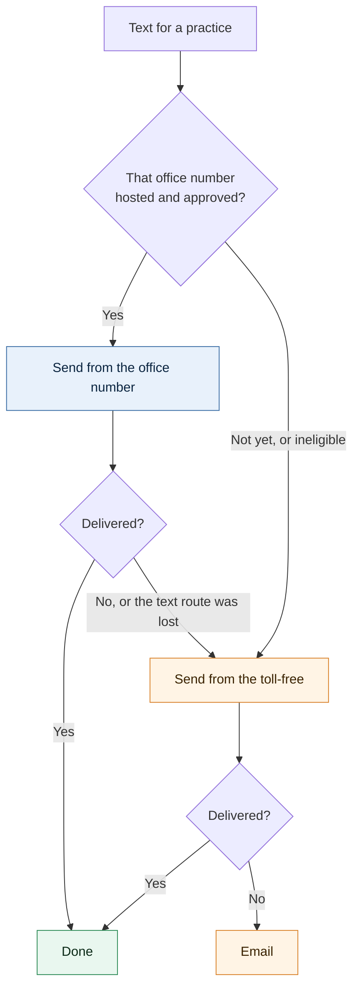
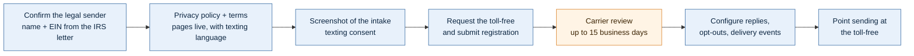
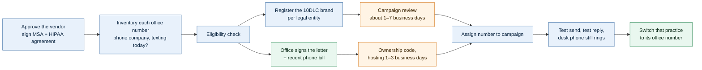

# Texting from the office phone number

**Date:** 11/20/2026
**Status:** Suggestion for review. Not a build commitment.
**For:** Jaime Kirk, Opal Anderson, and the practice stakeholders
**Research:** [DSO Two-Way Texting Architecture](https://docs.google.com/document/d/1FVjLhQ24BnyQC6zGS9DUdjUafkfJ03Loa-z8H_P7nyM) (Gemini deep research, shared 11/20/2026). Code checked against `daava-hq/daava-ai` `main` @ `84bb5ea`.

This report is about one thing: sending and receiving patient texts from the phone number already printed for that practice. Solutionreach does this. The suggestions below are how Daava could get there without waiting on every office before the first text goes out.

---

## How an office number sends a text

The practice keeps its phone company. Voice calls keep ringing the desk. A messaging carrier takes only the text route for that same number, after the practice signs a letter of authorization.

Calls and texts use different carrier records. A call follows the voice record. A text follows a separate messaging record (a NetNumber ID, which older phone vendors call a SPID). Hosted SMS changes the messaging record and leaves the voice record alone. The patient sees the office number. A reply lands in a staff inbox, not on the desk phone.

Solutionreach provisions the landline inside its app, then registers that number for 10DLC before automated texts can send. One number per account. US and Canada. A fax line can be provisioned. Switching phone systems is optional. When the number qualifies, competitors quote about 1 to 3 business days to turn texting on, and then the 10DLC campaign still has to clear.

**What has to be true for a specific number**

- It is a US or Canadian landline, an eligible business VoIP line, or a toll-free. Wireless numbers cannot be hosted.
- Nobody else is already hosting its texts. Solutionreach, RevenueWell, Weave, or the VoIP provider has to release the messaging record first. Hosting it on Daava turns the other vendor's texting off.
- The practice signs a letter of authorization, usually with a recent phone bill. The letter is only good for about 30 days, so it is signed at submission time.
- The number is registered as a 10DLC campaign under that practice's legal name and EIN. Hosting the route does not by itself make carriers deliver automated texts.

**What breaks it**

If the practice changes phone companies, the new company often overwrites the messaging record. Texts can look sent and never arrive. Solutionreach cannot see the carrier change from its side. RevenueWell documents the same gap. The suggested guard is in the fallback section.

---

## What the other platforms do

| Platform | Office number | What they do with everything else |
| :--- | :--- | :--- |
| **Solutionreach** | Hosted SMS. One landline carries conversations, reminders, and recalls | Practices that never provision the landline still get some texts from a short code |
| **RevenueWell** | Hosted SMS, usually live in 1–3 business days | If the number is ineligible, they assign a 10-digit number so onboarding still starts. Some automated alerts stay on shared short codes |
| **NexHealth** | Hosted SMS, if the current phone vendor releases the text rights | Campaigns and review requests always come from a different number, so a STOP on a promotion does not stop care texts |
| **Dental Intelligence / Modento** | Optional. Automated texts stay on a verified toll-free they issue, unless the practice finishes a 10DLC upgrade on the office number | The toll-free is the default, including while the office number is in review |
| **Weave** | Full port, so Weave becomes the phone company, or text-only SMS hosting | A port moves the desk phones. Hosting does not |
| **Emitrr, OhMD** | Hosted SMS into a shared inbox, paperwork handled for the clinic | Same pattern as Solutionreach |
| **Podium** | A local 10-digit number when the office line cannot be hosted | They avoid short codes so the sender still looks like a phone number |

The pattern worth copying from NexHealth: care texts and marketing texts do not have to share a sender. A STOP on a review request should not also stop an intake link.

---

## Suggestion: start on one toll-free, then review each office number

Stakeholders want texts moving. Reviewing every office line first would hold that up, because each number can fail eligibility, and the ones that pass still wait on a letter and a 10DLC campaign.

**Suggested first step.** Request one toll-free number and send notifications from it: intake links, form reminders, verification codes. Dental Intelligence uses a verified toll-free as its default for this. A toll-free is capped at 3 message parts per second, which is enough to start and too slow for a huge blast. That limit is a reason to move offices onto their own numbers, not a reason to wait.

### Why a toll-free rather than a short code

The short code being provisioned is the wrong number to put in front of patients, even as a temporary one.

- **Some T-Mobile customers never receive it.** AWS documents that some prepaid plans, including some T-Mobile prepaid plans, do not accept texts from a short code at all. An intake link sent on that code never arrives, and there is no error the patient can fix. A toll-free is a normal 10-digit number, and those plans can receive it.
- **Patients do not recognize a 5- or 6-digit sender.** Solutionreach moved review texts off a short code because patients read it as a pharmacy or store alert. A toll-free still is not the office's own number, and it is a phone number a person can read.
- **It is the slow, expensive path.** A US short code is listed at $650 to set up and $995 a month, and about 12 weeks after the application is clean. US carrier review also pauses the weeks of 11/23/2026, 12/21/2026, and 12/28/2026. A toll-free is verified in up to 15 business days on AWS, and its area code does not matter, so one number can serve offices in any region. The limit is that a toll-free belongs to one business (see [What it would take](#what-it-would-take)).

The short code's advantage is speed once it is live: 100 message parts per second. That matters for a large blast, and it is a reason to keep the application if it is already in flight. It is a poor reason to make it the number patients see. Suggested use, if it is kept at all, is overflow when the toll-free's 3-per-second cap is the thing blocking a blast, with the same practice name on the first line.

### A local number, if a toll-free feels too generic

A leased 10-digit number in the practice's area code looks more like a local call. One local number does not cover the group. A patient at a practice in another region would get a text from an unfamiliar area code. Covering that means **one local number per region**, and the sender is chosen from the practice's region rather than from a single origination number.

That is doable. It is a backend change: today's sending uses one origination number for every practice. Regional numbers mean a sender on each practice, a 10DLC campaign those numbers share or one campaign per region, and the T-Mobile daily cap that comes with 10DLC. A toll-free avoids that split. The regional approach is worth a decision if stakeholders want the temporary number to look local. It is in the open questions.

**Suggested second step.** Look at each practice's published number on its own.

| Cohort | The number | Suggested treatment |
| :--- | :--- | :--- |
| A | Landline or VoIP, not already text-enabled, eligibility check passes | Letter of authorization, host it, register the 10DLC campaign, then send from it |
| B | Already texting through Solutionreach, RevenueWell, Weave, or the VoIP provider | Schedule a release of the messaging record, then host it. Until release, the toll-free keeps sending |
| C | Wireless, or the phone company will not release it | Stays on the toll-free. Do not promise this office its own number |

AWS can issue the toll-free. AWS cannot host an office's existing number. Hosting needs Bandwidth or Telnyx. Twilio is outside the stack we use. That second carrier is an exception to the AWS-only rule, and it wants a written yes before any office number is hosted. Both carriers offer a HIPAA business associate agreement. Telnyx has a self-serve eligibility check. Bandwidth is the carrier Dental Intelligence uses and is the better escalation path when a phone vendor stalls a release. Steps and lead times for each are in [What it would take](#what-it-would-take).

---

## Suggested fallback

This is the safety net, and sending from office numbers does not work without it. It is still a suggestion: adopt it with the toll-free, rather than discovering the gap after a clinic changes phone companies.

**When it would fire**

- The office number is still being checked, or it landed in cohort C.
- The send from the office number fails.
- Delivery from that office drops off, which is the early sign that a phone-company change overwrote the text route. Suggested response: flip that practice back to the toll-free and ask them to re-sign.

**Why skipping it is the risk**

- Cohort C offices, and every office during review, would have no text at all.
- A carrier change would stop patient texts with no backup, and the failure looks like a successful send.
- A toll-free at 3 message parts per second cannot carry a group-wide reminder blast by itself once many offices are live. Office numbers are what take that load. The toll-free is the net, not the only sender.

**Two rules suggested with the fallback**

- One opt-out record per patient per practice, checked before either number sends. A STOP to the toll-free should not be ignored just because that practice later gets its own number, and a STOP to the office number should not be followed by the same text from the toll-free.
- Every toll-free text leads with the practice name. On AWS, a US toll-free only honors STOP as the opt-out word.

Email failover already exists and stays the last step. Neither AWS number can receive a photo. An insurance card or a clinical photo has to come through the intake link until a carrier that accepts incoming pictures is in place. Bandwidth and Telnyx both accept them on a hosted office number.

---

## Where sending is today

Every text goes out from one AWS origination number. Intake texts name the practice and end with "Reply STOP to opt out." Nothing receives a reply. A STOP on today's shared number would apply to every practice. Addendum II §6 describes payment texts and the two-way billing console as planned.

---

## What it would take

### Vendors

| Vendor | Toll-free | Host an office number | Photo replies | HIPAA agreement | Notes |
| :--- | :--- | :--- | :--- | :--- | :--- |
| **AWS End User Messaging** (current) | Yes. Verified in up to 15 business days. 3 message parts per second | **No.** AWS only issues its own new numbers | No | Covered by the AWS business associate addendum, if Daava has signed it | No new vendor approval needed |
| **Telnyx** | Yes. Verified in 1–2 weeks; Telnyx says usually 5 business days or less | Yes, by API: eligibility check, order, ownership code, letter upload. 1–3 business days | Yes, on hosted numbers | Through sales, above a spending threshold Telnyx does not publish | Published prices. Easiest to automate onboarding |
| **Bandwidth** | Yes. Manual review, up to 5 business days at Bandwidth before the industry reviewer | Yes, through an account manager. Letter signed within 30 days; provisioning can need manual work | Yes, on hosted numbers | Yes. Toll-free, 10DLC, and short codes are listed as covered | Dental Intelligence's carrier. Sales-led, prices negotiated |
| **Twilio** | Yes | Yes | Yes | Only on Security or Enterprise editions | Outside the stack Daava uses. Not suggested |

**Suggested split.** Put the toll-free on AWS now, because it needs no new vendor and the sending code already points at an AWS number. Add Telnyx or Bandwidth when the first office number is ready to host. A verified toll-free keeps its status if it later moves to that carrier, so starting on AWS does not trap the number there (per Bandwidth's toll-free handbook).

**The other way to do it.** Put the toll-free on Telnyx or Bandwidth from the start. Everything is on one carrier, one inbound path, and patients can text photos to the toll-free. The cost is that the AWS-only exception and the HIPAA agreement have to be settled before the first text goes out.

### One rule that shapes the toll-free

A toll-free number belongs to **one business**. Carriers reject a toll-free shared across separate businesses (Bandwidth rejection 1107, Twilio error 30478). The ISV cannot register it in its own name on behalf of several clients.

- If the practices send as one legal entity, for example the group under one EIN with each practice as a DBA, one toll-free can carry all of them. List the practice names as DBAs on the registration, and the samples should show a practice name first.
- If each practice is its own legal entity with its own EIN, each needs **its own toll-free and its own verification**. That is still doable. It is the same backend change as the regional local numbers: the sender is chosen per practice, not from one origination number.

The same question decides how many 10DLC brands the office numbers need later. It is open question 1.

### Step 1: the toll-free (on AWS)

1. **Confirm who the sender is.** The legal name has to match the IRS record exactly, not a trade name. Keep the IRS CP 575 or 147C letter on hand; AWS accepts it when automated verification fails.
2. **Publish a privacy policy and terms** at public URLs, consistent with what intake shows the patient. Required for every new toll-free registration since 09/15/2026.
3. **Capture the opt-in.** A screenshot of the intake texting-consent step (PNG, JPEG, or PDF, up to 500 KB), and a written description of it.
4. **Request the number and submit the registration** in AWS End User Messaging. The form asks for company details, a business contact, a use case (health care and appointment reminders fit), monthly volume, the opt-in, and sample messages. The samples should look like the real texts: practice name first, the intake link, "Reply STOP to opt out."
5. **Wait for carrier review, up to 15 business days.** An unverified toll-free has been blocked from sending since 01/31/2024, so nothing goes out on it while it is pending. A rejection comes back with a reason and starts another review.
6. **Configure the number.** Turn on two-way messaging to an SNS topic so replies and STOPs arrive. Add delivery-event logging so a failed send can trigger the fallback.
7. **Switch sending to the toll-free.** The send code already reads a single origination number from configuration, so the toll-free can carry today's texts with a configuration change. Fallback routing and reply handling are new work.

### Step 2: the office numbers (on Telnyx or Bandwidth)

1. **Approve the vendor and sign the agreements.** The exception to AWS-only, a master agreement, and the HIPAA business associate agreement. Neither Telnyx nor Bandwidth publishes how long contracting takes.
2. **Inventory every office number**: the number, the phone company, whether it is a landline or VoIP, and whether anything texts from it today.
3. **Run the eligibility check** and sort the numbers into cohorts A, B, and C. Telnyx returns this immediately by API, with a reason when a number fails. Bandwidth runs it through the account team.
4. **Register a 10DLC brand for each legal entity.** On Telnyx's published pass-through prices: $4.50 once per brand, $41.50 for standard vetting (1–7 business days, and the trust score sets the T-Mobile daily cap), $15 per campaign review including resubmissions, and $10 a month per campaign. Telnyx reviews a campaign the same or next business day; carrier review usually adds 3 business days or less.
5. **Collect the letter of authorization** from each office, signed within 30 days of submission and listing the number, plus a recent bill from its phone company.
6. **Host the number.** The carrier sends an ownership code to that number, and the office reads it back. Telnyx activates in 1–3 business days after the documents clear. Bandwidth can need manual provisioning, and suggests subscribing to order-status updates and testing each number.
7. **Assign the number to the campaign**, then test: a send to an AT&T, a T-Mobile, and a Verizon phone, a reply, and a call to the desk to confirm voice is unchanged.
8. **Switch that practice's sender to its office number.** The toll-free stays its fallback.

Cohort B adds a step before 3: the office, or its old vendor, releases the messaging record. How long that takes depends on the old vendor and is not published. Cohort C stops at step 3 and stays on the toll-free.

### Engineering work in Daava

Phase 1 is mostly configuration. Phase 2 is real backend work.

| Piece | Phase | What it does |
| :--- | :--- | :--- |
| Sender per practice | 2, or 1 if each practice needs its own toll-free | Replaces the single origination setting with a sender stored on each practice |
| Carrier adapter | 2 | A second sending adapter for Telnyx or Bandwidth, beside the AWS one |
| Reply and STOP handling | 1 | Receives replies from the AWS topic, and later from the carrier's webhook. Records STOP per patient per practice |
| Delivery tracking and fallback | 1 | Reads delivery events. Routes office number, then toll-free, then email |
| Quiet-office alert | 2 | Flags an active office that stops getting replies or delivery confirmations, the early sign of a phone-company change |
| Onboarding records | 2 | Per office: eligibility result, letter and its date, hosting status, campaign ID |
| Staff inbox | 2 | Where patient replies land, per practice. Addendum II's billing console |

Any live test stays on the Riversbend test line.

### Lead times the vendors publish

| Step | Published lead time | Source |
| :--- | :--- | :--- |
| AWS toll-free verification | Up to 15 business days after submission | AWS |
| Telnyx toll-free verification | 1–2 weeks; usually 5 business days or less | Telnyx |
| Bandwidth toll-free verification | Up to 5 business days at Bandwidth, then the industry reviewer | Bandwidth |
| 10DLC brand vetting | 1–7 business days | Telnyx |
| 10DLC campaign approval | About 1–7 business days | Telnyx |
| Office number hosting | 1–3 business days once documents clear | Telnyx, RevenueWell |
| Release from a previous texting vendor | Not published | |
| Vendor contract and HIPAA agreement | Not published | |
| Short code, for comparison | About 12 weeks, plus the 2026 freeze weeks | AWS |

Every one of these restarts on a rejection. The fastest path is a first submission whose legal name, website, consent screenshot, and samples all match.

---

## Open questions

| # | Question | Answer |
| :--- | :--- | :--- |
| 1 | Do the practices send as one legal entity (one EIN, practices as DBAs), or does each have its own EIN? This decides one toll-free or one per practice, and how many 10DLC brands. | |
| 2 | One shared toll-free, or one local 10DLC number per region? A local number means the sender is chosen from the practice's region. | |
| 3 | Which practices should be in the first eligibility pass? | |
| 4 | Which offices already text through Solutionreach, RevenueWell, Weave, or a VoIP provider? | |
| 5 | Should a STOP to the toll-free also stop that practice's office number, and the reverse? | |
| 6 | Are stakeholders comfortable that photo replies wait until an office number is hosted on Bandwidth or Telnyx? | |
| 7 | Does the in-flight short code stay as overflow, or does the toll-free replace it for launch? | |
| 8 | Has Daava signed the AWS business associate addendum? | |
| 9 | Do the privacy policy and terms pages exist, and do they cover texting? | |
| 10 | Toll-free on AWS now, or on Telnyx or Bandwidth from the start? | |
| 11 | Telnyx or Bandwidth for hosting office numbers? | |
| 12 | | |

---

## Sources

Checked 11/20/2026. The research doc's citation list is the long version.

- [Solutionreach, 10/14/2022](https://www.solutionreach.com/release-notes/release-notes-10-14-22) (review texts moved onto the office number so patients recognize the sender, and so STOP applies to one office)
- [Solutionreach, 12/02/2022](https://www.solutionreach.com/release-notes/release-notes-12-02-22) (a phone-company change drops the text route; the practice re-signs)
- [RevenueWell: Hosted SMS](https://help.revenuewell.com/hc/en-us/articles/4597745451803-Hosted-SMS)
- [NexHealth: SMS registration](https://help.nexhealth.com/en/articles/10046696-sms-registration)
- [Dental Intelligence: office-number texting](https://educate.dentalintel.com/en/articles/9242560-porting-your-phone-number-for-inbound-sms-texting) (toll-free is the default for automated texts)
- [Telnyx: Hosted SMS](https://developers.telnyx.com/docs/messaging/messages/hosted-sms) (eligibility check, letter, 1–3 business days, SMS and photos)
- [Bandwidth: text-enable a non-Bandwidth number](https://www.bandwidth.com/support/en/articles/12823125-can-i-text-enable-a-non-bandwidth-phone-number) and [HIPAA-eligible services](https://www.bandwidth.com/support/en/articles/12823993-hipaa-eligible-products-and-services)
- [AWS: origination identities](https://docs.aws.amazon.com/sms-voice/latest/userguide/phone-number-types.html) and [two-way SMS](https://docs.aws.amazon.com/sms-voice/latest/userguide/two-way-sms-phone-number.html) (no incoming photos; no hosting of an existing office number)
- [AWS short-code guide](https://aws.amazon.com/blogs/messaging-and-targeting/guide-to-sms-short-codes-with-aws-end-user-messaging/) (some prepaid plans do not receive them)
- [AWS: toll-free registration](https://docs.aws.amazon.com/end-user-messaging/latest/userguide/nx-reg-type-tollfree.html), [the registration form](https://docs.aws.amazon.com/sms-voice/latest/userguide/registrations-tfn-register.html), and [business verification](https://docs.aws.amazon.com/sms-voice/latest/userguide/registration-help-tfn-verification.html) (up to 15 business days; privacy and terms URLs from 09/15/2026; legal name must match the EIN)
- [Telnyx: toll-free verification guide](https://support.telnyx.com/en/articles/10729979-toll-free-verification-request-guide) and [troubleshooting](https://developers.telnyx.com/docs/messaging/toll-free-verification/troubleshooting) (1–2 weeks, no expedite)
- [Telnyx: 10DLC quickstart](https://developers.telnyx.com/docs/messaging/10dlc/quickstart) and [10DLC costs](https://telnyx.com/resources/what-is-10dlc) (vetting 1–7 business days; brand, vetting, review, and campaign fees)
- [Bandwidth: toll-free verification handbook](https://www.bandwidth.com/support/en/articles/12823247-bandwidth-toll-free-verification-handbook), [rejection reasons](https://www.bandwidth.com/support/en/articles/12823242-toll-free-verification-rejection-reasons) (1107: one toll-free per business), and [hosted messaging FAQ](https://www.bandwidth.com/support/en/articles/12823123-hosted-messaging-faq)
