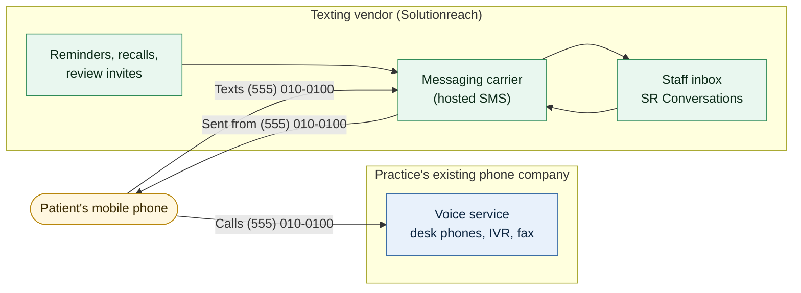
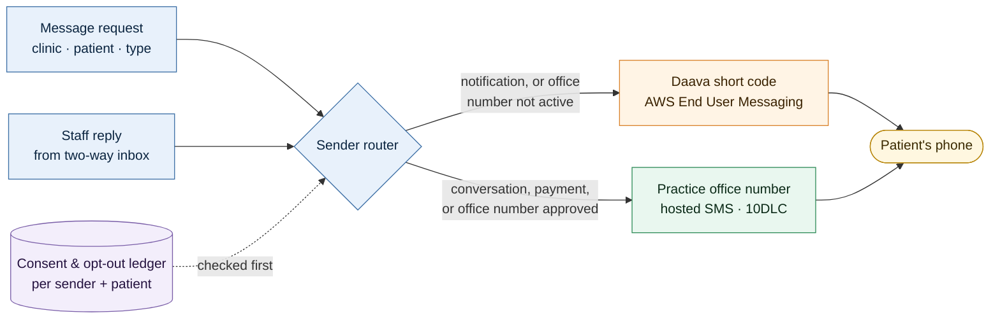
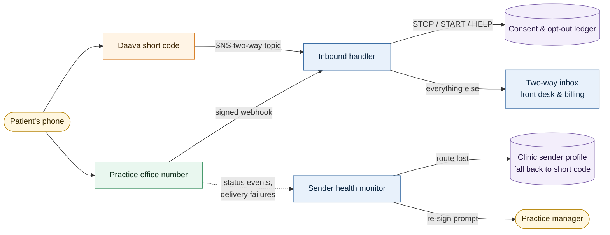
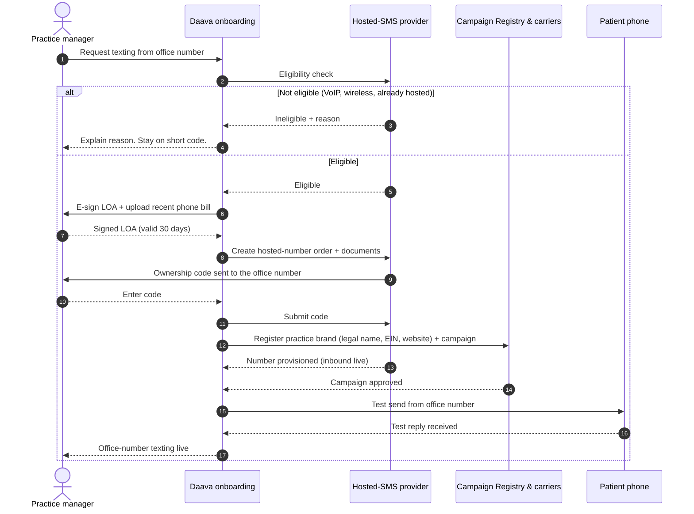
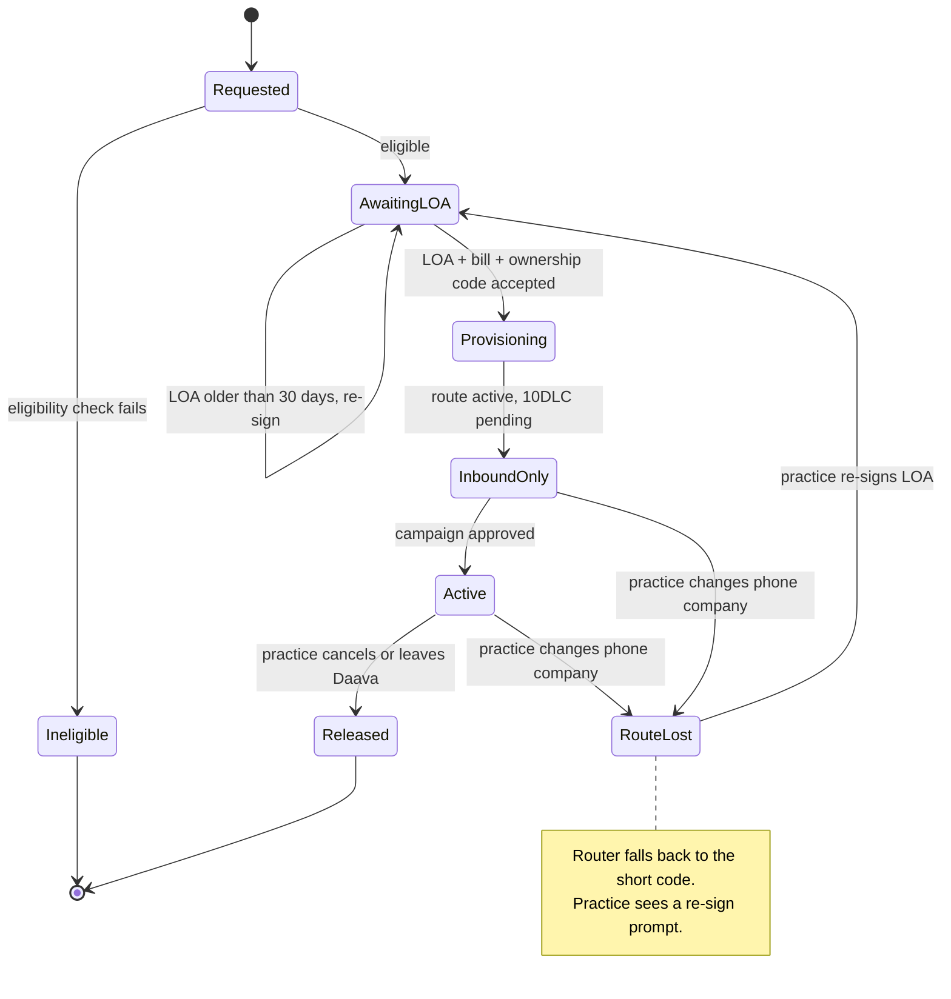
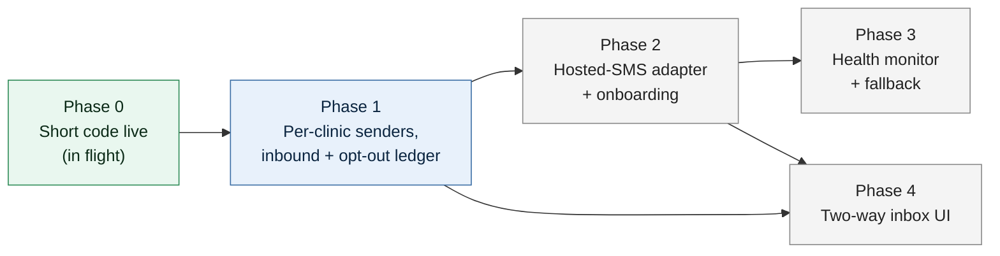

# Office-Number Texting: How Daava Can Text From the Practice's Own Phone Number

**Document Version:** 1.0  
**Date:** 11/20/2026  
**Owner:** Jaime Kirk  
**Status:** Proposal for review  
**Related:** [Addendum II §6, Patient Messaging & Automated Notifications](./addendum_ii_clearinghouses_patient_payments_financing_tools.md)  
**Code baseline:** `daava-hq/daava-ai` `main` @ `84bb5ea` (11/19/2026)

---

## 1. Summary

Solutionreach texts patients from the number printed on the practice's door. It does this with **hosted SMS**. The practice signs a letter of authorization (LOA), and Solutionreach's messaging carrier takes over the *text* route for that number. Voice calls stay with whatever phone company the office already uses. Nothing about the desk phones changes.

Daava can offer the same thing. AWS End User Messaging, our current SMS platform, cannot host a number that lives with another carrier, so this needs a second messaging provider that sells hosted SMS. The recommendation is a **two-sender model**:

| Sender | Who owns it | What it carries | Status |
| :--- | :--- | :--- | :--- |
| **Daava short code** (AWS End User Messaging) | Daava, shared by all practices | One-way, high-volume notifications: intake links, verification codes, form reminders | Being provisioned now |
| **Practice office number** (hosted SMS through Bandwidth or Telnyx) | The practice, with text routing hosted by Daava | Two-way conversations, balance and payment texts, and, once the number's 10DLC campaign is approved, any practice-branded text | Proposed in this report |

This matches how the market splits the job. Solutionreach, RevenueWell, NexHealth, Dental Intelligence and Weave all text from the office number when they can, and every one of them keeps a vendor-owned number (a short code, a toll-free number, or a pool number) for bulk traffic or as the fallback when hosting fails.

> [!IMPORTANT]
> Two decisions are needed before any build work starts (see [§10](#10-decisions-needed)):
> 1. **An exception to the AWS-only infrastructure rule.** The Agent Operations Manual mandates a 100% AWS stack and forbids Twilio. Hosted SMS requires a non-AWS carrier. Bandwidth or Telnyx would be the only non-AWS runtime dependency in the messaging path.
> 2. **Whether automated notifications move to the office number once a practice is approved,** as Solutionreach does, or stay on the short code, as Dental Intelligence and NexHealth do.

---

## 2. How Solutionreach Does It

### 2.1 The mechanism

A US phone number has two routes that the industry treats as separate. The **voice route** is owned by the practice's phone company. The **messaging route** is recorded in a shared carrier routing registry (the NetNumber database, keyed by a service-provider ID). Hosted SMS changes only the messaging record. After the change, a text sent to the office number goes to the hosting vendor's platform instead of the phone company.

### 2.2 What the practice does

1. **Provision the landline** in SR Conversations and sign the LOA.
2. **Register the number for 10DLC** (the carrier registration that 10-digit business numbers need before they can send automated texts). Until this is approved, patient texts do not send.

Constraints from Solutionreach's own documentation:

- One provisioned number per platform.
- US and Canadian numbers only. Fax numbers can be provisioned.
- Switching phone systems is optional. Solutionreach sells a VoIP phone system (SR Phones), but texting does not require it.

### 2.3 What breaks, and how they handle it

When the practice changes phone companies, the new company can overwrite the messaging record as part of moving the number. Solutionreach loses the route. Their release notes say messages can **look sent and never arrive** in this state. Their fix is a dashboard banner when they detect the change, a new LOA, and re-provisioning from inside the app.

### 2.4 Why they moved off their short code

Until 10/14/2022, Solutionreach sent automated review invitations from a 5-digit short code. They moved them to the office number for every practice that has Conversations, for two stated reasons:

- A 5-digit sender looks like spam to patients.
- A `STOP` sent to a shared short code opted the patient out of Solutionreach as a whole. A `STOP` sent to the office number opts them out of **that office only**.

Practices without Conversations still get review texts from the short code.

---

## 3. How the Market Does It

| Vendor | What the patient sees | Voice | High-volume notifications |
| :--- | :--- | :--- | :--- |
| **Solutionreach** | Office number, once provisioned and 10DLC-registered | Stays with the practice's phone company | Office number if Conversations is on; short code otherwise |
| **RevenueWell** | Office landline after a DocuSign LOA, usually live in 1–3 business days | Unchanged; hosting is SMS only | Some TCPA messages still use a 5-digit short code. If hosting fails, an assigned 10-digit number |
| **NexHealth** | Office number, only if the current phone vendor releases the SMS rights | Stays with the phone vendor | Campaigns and review requests **always** use a different number |
| **Dental Intelligence / Modento** | A verified toll-free number by default | Stays with the phone company | Toll-free, unless the practice completes a 10DLC upgrade (about 5–6 weeks after the number is connected). Hosted through Bandwidth |
| **Weave** | Office number, through a full port or text-only SMS Hosting | Full port makes Weave the phone company; SMS Hosting does not | 10DLC registration, up to 10 days, then a chosen default texting number |
| **Open Dental eServices** | A number from their pool, or the office landline through an emailed LOA | Unchanged | Same number; "not every landline is compatible" |

RevenueWell documents the three usual reasons hosting is refused:

1. The number's messaging route is **already hosted** by another texting vendor, so the practice must release it first.
2. The number is **VoIP**, and most VoIP numbers can't be hosted.
3. The number is **not a landline**. Telnyx, for example, rejects wireless numbers outright.

**Takeaway:** no one in the market treats the office number as the *only* sender. Hosting fails often enough that every vendor keeps a number it controls.

---

## 4. Where Daava Is Today

As of `84bb5ea`:

| Area | Current behaviour | Gap for office-number texting |
| :--- | :--- | :--- |
| **Sending** | `AwsSmsAdapter` (`lib/communication/adapters/aws-sms.ts`) publishes through Amazon SNS with a single origination identity from `AWS_SMS_ORIGINATION_NUMBER` or `AWS_SMS_SENDER_ID`. | There is one sender for the whole deployment. No per-clinic sender exists. |
| **Intake auto-send** | `lib/intake/appointment-trigger/senders.ts` reads the same global origination number. Message bodies name the clinic and end with `Reply STOP to opt out.` | The clinic name appears in the text, but every clinic's texts come from the same number. |
| **Inbound texts** | No code receives inbound SMS. | Addendum II §6 describes a two-way SMS console where patients reply to balance texts. That console still has to be built. |
| **Opt-outs** | Handled by AWS's default opt-out list on the origination number. | A `STOP` applies to the shared sender, so it silences every Daava practice for that patient, which is the problem Solutionreach fixed. |
| **Provider choice** | Adapter pattern (`ISmsAdapter`) with SMS-to-email failover. | Adding a hosted-SMS provider fits as a second `ISmsAdapter`. The adapter pattern does not need to change. |

---

## 5. Target Architecture

### 5.1 Sending

Every outbound text passes through one sender router. The router checks the opt-out ledger, then picks the short code or the practice's office number.

### 5.2 Receiving and health

Replies to either sender land in one inbound handler. Provider status events feed a health monitor that moves a clinic back to the short code when its office number loses the text route.

### 5.3 Components

| Component | Responsibility |
| :--- | :--- |
| **Clinic sender profile** | Per clinic, stores the office number, hosting provider, hosting status, 10DLC brand and campaign IDs, and LOA signed date. It replaces the single `AWS_SMS_ORIGINATION_NUMBER` value. Missing or unreadable profile fails closed, never borrowing another clinic's sender. |
| **Sender router** | Chooses the sender for each message from the message type and the clinic's hosting status ([§6](#6-sender-routing-rules)). |
| **Hosted-SMS adapter** | A second `ISmsAdapter` (for example `BandwidthSmsAdapter`) beside `AwsSmsAdapter`, with the same result and error shape. |
| **Inbound handler** | Receives replies from both senders: the AWS two-way SNS topic for the short code, and signed webhooks for the hosted number. It records `STOP`, `START` and `HELP`, then routes everything else to the inbox. |
| **Consent & opt-out ledger** | Keyed by **sender + patient phone**, so a `STOP` to one office number silences that office only. Self-managed opt-outs on the hosted number. |
| **Two-way inbox** | Staff view of patient threads per clinic, which is the Addendum II §6 billing Q&A console. It sends replies through the office number. |
| **Sender health monitor** | Watches provider status events and delivery receipts. When a hosted number loses its route, it flips the clinic back to the short code and alerts the practice to re-sign. |

---

## 6. Sender Routing Rules

| Message type | Office number **not** active | Office number active, 10DLC **pending** | Office number active, 10DLC **approved** |
| :--- | :--- | :--- | :--- |
| Intake link (auto-send) | Short code | Short code | Office number *(if Decision 2 says so)*, else short code |
| Form reminders / last call | Short code | Short code | Office number *(if Decision 2 says so)*, else short code |
| Kiosk / login verification code | Short code | Short code | Short code, always |
| Balance / Pay-by-Link (Addendum II §6) | Short code | Short code | Office number |
| Staff reply from the inbox | Not available | Not available | Office number |
| Patient reply to the short code | Inbox, with an auto-response pointing to the office number when one exists | Same | Same |

Verification codes stay on the short code permanently. They need throughput, not recognition, and a separate sender keeps a practice's `STOP` from blocking a patient's login.

---

## 7. Practice Onboarding Flow

| Step | Owner | Typical time (vendor-published) |
| :--- | :--- | :--- |
| Eligibility check | Daava (API) | Instant |
| LOA + phone bill | Practice manager | Same day if the bill is at hand |
| Ownership verification | Practice manager | Minutes |
| Hosting activation | Provider | 1–3 business days (Telnyx, RevenueWell) |
| 10DLC brand + campaign | Daava as the registering platform | AWS lists campaign review as up to 4 weeks. Dental Intelligence quotes 5–6 weeks. Weave quotes up to 10 days. |

The practice can receive texts on its office number as soon as hosting activates. Automated sending from that number waits for the campaign approval.

---

## 8. Hosted Number Lifecycle

The **RouteLost** state is the failure Solutionreach and Dental Intelligence both document. The provider cannot prevent it. A new phone company's port can override the hosting record, and the original provider has to comply. Daava must detect it from provider events and delivery failures, rather than wait for a practice to notice that patients stopped replying.

---

## 9. Compliance, Throughput and Cost

### 9.1 Compliance requirements

| Requirement | What it means for Daava |
| :--- | :--- |
| **Letter of Authorization** | Signed by the number's subscriber, listing the numbers, dated within 30 days of submission (Bandwidth, Telnyx). Store the signed copy with the clinic sender profile. |
| **10DLC registration** | Each practice is a separate brand, registered with its legal name, EIN and website. The website must host a privacy policy and terms that cover texting (Dental Intelligence lists this as a requirement). Daava registers as the platform for every practice. |
| **TCPA consent** | Already captured at intake ([Addendum II §6.1](./addendum_ii_clearinghouses_patient_payments_financing_tools.md)). The campaign's described opt-in flow must match what intake actually shows. |
| **HIPAA BAA** | Bandwidth lists US 10DLC, toll-free and short-code SMS as HIPAA-eligible under its BAA. Telnyx offers a BAA through sales to customers above unpublished thresholds. Message bodies stay zero-PHI regardless. |
| **Opt-out scope** | `STOP` to an office number applies to that practice only. `STOP` to the shared short code still applies to every practice on it, so shared-code bodies must name the clinic and the help reply must say how to reach the office. |

### 9.2 Throughput

| Sender | Published limit | Note |
| :--- | :--- | :--- |
| US short code | 100 message parts per second to start | Not under the 10DLC daily cap |
| 10DLC office number | About 1.25 to 75 message parts per second per major carrier, set by campaign type and brand trust score | T-Mobile also caps outbound per **tax ID per day**: 2,000 at a low score, 10,000 at 25–49, 40,000 at 50–74, 200,000 at 75–100 |
| Toll-free | 3 message parts per second | Buying more toll-free numbers to get past this is treated as snowshoeing and filtered |

Practices that share an EIN share one T-Mobile daily bucket. A group-wide recall sent from several office numbers under one EIN draws from the same cap. That is one reason the short code should keep bulk notifications.

### 9.3 Cost signals

- **AWS short code:** $650 setup and $995 per month, with an estimated 12 weeks after the application is clean and no delivery SLA. US carrier short-code review pauses the weeks of 11/23/2026, 12/21/2026 and 12/28/2026.
- **Office-number texting at competitors:** Dental Intelligence includes it for single-location practices and charges $30 per month for multi-location groups.
- **Hosted-SMS carriers:** per-message and per-number pricing is quoted by sales. It has not been verified yet and is not used in this report.

---

## 10. Decisions Needed

| # | Decision | Options | Market reference |
| :--- | :--- | :--- | :--- |
| 1 | Approve a non-AWS messaging carrier for hosted SMS | **Bandwidth** (Dental Intelligence's carrier; BAA lists 10DLC) or **Telnyx** (full hosted-order API, BAA via sales). Twilio remains excluded by the Operations Manual. | Every vendor above uses a carrier that sells hosted messaging |
| 2 | Move automated notifications to the office number once approved? | Yes, as Solutionreach does, or keep them on the short code, as Dental Intelligence and NexHealth do | Split |
| 3 | Who signs up: Daava for every practice, or practice opt-in | Opt-in matches every vendor reviewed | All opt-in |
| 4 | One office number per clinic, or per location group | Solutionreach allows one per platform | One per platform |

---

## 11. Build Plan

Phases are ordered by dependency. Each one is shippable on its own.

| Phase | Scope | Depends on |
| :--- | :--- | :--- |
| **0. Short code** | Finish AWS short-code registration. Route intake links, reminders and verification codes through it. | Already in progress |
| **1. Per-clinic senders** | Clinic sender profile replacing the global origination number. Enable two-way SMS on the short code to an SNS topic. Inbound handler. Opt-out ledger keyed by sender + patient. | Phase 0 |
| **2. Hosted SMS** | Decision 1. Provider account and BAA. Hosted-SMS adapter behind `ISmsAdapter`. Onboarding flow from §7 with LOA e-signature and document upload. 10DLC brand and campaign registration per practice. | Phase 1, Decision 1 |
| **3. Health & fallback** | Provider status webhooks and delivery-failure detection. Automatic fallback to the short code on route loss. Practice re-sign prompt. | Phase 2 |
| **4. Inbox** | Front-desk and billing inbox per clinic, which is the Addendum II §6 billing Q&A console. Built on design-system components. | Phases 1 and 2 |

**Pilot first on Riversbend Dental**, the test clinic, using a test landline. No live clinic's number is hosted until the full lifecycle, including a simulated route loss, has passed there.

---

## 12. Risks

| Risk | Impact | Mitigation |
| :--- | :--- | :--- |
| Practice's number is VoIP or already hosted by another texting vendor | Can't host. Practice is disappointed. | Eligibility check before promising anything. Short code remains the sender. Release instructions for the previous vendor. |
| Practice changes phone company | Texts look sent but never arrive | Health monitor, automatic fallback, re-sign prompt (Phase 3) |
| 10DLC campaign rejected | Office number receives texts but can't send automated ones | Campaign copy drafted from approved templates. Practice website privacy and terms checked before submitting. |
| Practice already uses Solutionreach, Weave or another texting vendor | Only one vendor can host the number's texts at a time | Hosting Daava on the number cuts the other vendor off. The practice must choose, and this is said up front. |
| Shared EIN across a group | T-Mobile daily cap shared across all its office numbers | Keep bulk notifications on the short code (Decision 2). Third-party vetting to raise the trust score. |
| Non-AWS dependency | Breaks the AWS-only mandate | Isolated behind one adapter. Short code keeps working if the provider is down. |

---

## 13. Sources

All sources were accessed 11/20/2026.

**Solutionreach**
- [SR Conversations FAQ](https://community.srhealth.com/s/article/SR-Conversations-FAQ)
- [Release notes 10/14/2022: review invites moved from short code to office number](https://www.solutionreach.com/release-notes/release-notes-10-14-22)
- [Release notes 12/02/2022: SPID change detection and re-provisioning](https://www.solutionreach.com/release-notes/release-notes-12-02-22)
- [Pricing FAQ: switching phone systems is optional](https://www.solutionreach.com/pricing)

**Market**
- [RevenueWell: Hosted SMS](https://help.revenuewell.com/hc/en-us/articles/4597745451803-Hosted-SMS)
- [NexHealth: SMS registration and office-number hosting](https://help.nexhealth.com/en/articles/10046696-sms-registration)
- [Dental Intelligence: office-number texting and 10DLC upgrade](https://educate.dentalintel.com/en/articles/9242560-porting-your-phone-number-for-inbound-sms-texting)
- [Dental Intelligence: new LOA when a number is hosted away](https://educate.dentalintel.com/en/articles/13452299-why-you-need-a-new-loa-when-your-10dlc-number-is-hosted-away)
- [Weave: port and SMS Hosting](https://www.weavehelp.com/weavehelp/article/port-your-phone-and-fax-number-s-to-weave)
- [Open Dental webinar: eServices integrated texting](https://www.youtube.com/watch?v=i3peaNtIsZs)

**Carriers and AWS**
- [Bandwidth: Hosted Messaging FAQ](https://www.bandwidth.com/support/en/articles/12823123-hosted-messaging-faq) · [LOAs](https://www.bandwidth.com/support/en/articles/12823124-hosted-messaging-loas) · [HIPAA-eligible services](https://www.bandwidth.com/support/en/articles/12823993-hipaa-eligible-products-and-services) · [Campaign API](https://dev.bandwidth.com/docs/messaging/campaign-management/csp/campaign-api.md)
- [Telnyx: Hosted SMS](https://developers.telnyx.com/docs/messaging/messages/hosted-sms) · [HIPAA and BAAs](https://support.telnyx.com/en/articles/3347891-hipaa-baas-and-the-conduit-exception)
- [AWS: choosing an origination identity](https://docs.aws.amazon.com/sms-voice/latest/userguide/phone-number-types.html) · [10DLC registration](https://docs.aws.amazon.com/sms-voice/latest/userguide/registrations-10dlc.html) · [two-way SMS](https://docs.aws.amazon.com/sms-voice/latest/userguide/two-way-sms-phone-number.html) · [opt-out lists](https://docs.aws.amazon.com/sms-voice/latest/userguide/opt-out-list.html) · [short-code pricing](https://aws.amazon.com/sns/sms-pricing/) · [short-code freezes](https://docs.aws.amazon.com/sms-voice/latest/userguide/phone-numbers-request-short-code.html)
- [AWS re:Post: End User Messaging does not port or host external numbers](https://repost.aws/questions/QUQaCxeYcvRtqIIYgYw068Bg/can-i-port-an-existing-us-number-into-aws-end-user-messaging-for-sms-not-just-voice)
- [Twilio: T-Mobile 10DLC daily limits](https://help.twilio.com/articles/1260804800549-T-Mobile-daily-message-limits-for-long-code-messaging-with-A2P-10DLC) · [10DLC throughput by trust score](https://help.twilio.com/articles/1260803225669)
