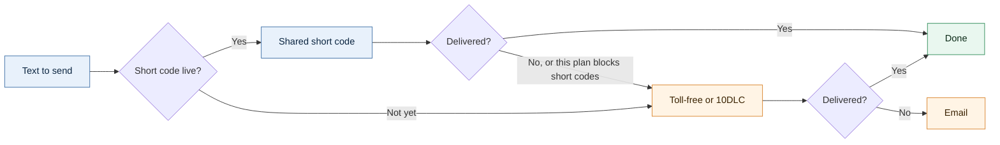

# Patient texting: a suggested path

**Date:** 11/20/2026
**Status:** Suggestion for review. Not a build commitment.
**For:** Jaime Kirk, Opal Anderson, and the practice stakeholders
**Research:** [DSO Two-Way Texting Architecture](https://docs.google.com/document/d/1FVjLhQ24BnyQC6zGS9DUdjUafkfJ03Loa-z8H_P7nyM) (Gemini deep research, shared 11/20/2026). Code checked against `daava-hq/daava-ai` `main` @ `84bb5ea`.

---

## The suggestion

Move forward with **one shared short code**, so notifications can start. Request **one toll-free number or one 10DLC number** at the same time, and use it when the short code cannot deliver.

Texting from each practice's own office phone number is a later suggestion. That is how Solutionreach does it. It is not required to start sending.

The research doc recommends pausing the short code and going straight to office numbers. This suggestion goes the other way, because the stakeholders want texts going out. The risks that doc raises are why the fallback number is part of the suggestion, not a reason to wait.

---

## Why start here

A US short code sends at 100 message parts per second. That covers intake links, form reminders, and verification codes across practices. It is the number already being provisioned.

Office-number texting would hold that up. AWS cannot text-enable a number that already belongs to a practice's phone company. Doing it means a second carrier, a signed letter from each practice, and a carrier registration that runs in weeks. Some numbers, especially VoIP lines and any number already texting through another vendor, cannot be hosted at all.

---

## How a text would go out

Email failover already exists. The new piece is the second phone number, so a failed text has somewhere to go besides email.

---

## What each number is for

| | Shared short code | Toll-free or 10DLC fallback | Office number, later |
| :--- | :--- | :--- | :--- |
| **Job** | Notifications, reminders, verification codes | The same texts, when the short code cannot deliver them | Two-way chat from the number on the door |
| **What the patient sees** | A 5- or 6-digit code | A 10-digit number, either 8xx or a local area code | The practice's real phone number |
| **Speed** | 100 message parts per second | Toll-free: 3 per second. 10DLC: about 1.25 to 75 per second, set by the campaign | A per-practice cap, shared across offices on the same tax ID |
| **Picture replies** | No. AWS does not accept incoming photos | No. Same AWS limit | Needs a carrier that accepts them. AWS does not |
| **A STOP reply** | Stops texts from every Daava practice on that code | Stops texts from that number. Suggested rule below links the two | Stops texts from that practice only |
| **When** | In progress | Suggested now, in parallel | Suggested after sending is live |

---

## Risks of sending on a short code

These are the reasons a short code by itself is a weak patient experience. The fallback number is the suggested cover for the first one. The others are accepted for now, and called out so the front desk is not surprised.

1. **Some patients never receive it.** AWS documents that some prepaid plans, including some T-Mobile prepaid plans, do not accept short-code texts. Those patients get the fallback number, then email.
2. **Patients do not recognize a 5- or 6-digit sender.** Solutionreach moved review texts off a short code for this reason, and said patients read it as a pharmacy or store alert. Every text should lead with the practice name.
3. **One STOP applies to every practice.** A patient who replies STOP to the shared code stops texts from every Daava office. Suggested rule: one opt-out record per patient, checked before either number sends, so the fallback does not quietly re-text someone who already opted out.
4. **Patients cannot text a photo back.** AWS End User Messaging accepts a text reply and does not accept an incoming picture. An insurance card or a photo of a tooth has to come through the intake link. This is true of the fallback number too, as long as both sit on AWS.
5. **It is slow and fixed-cost.** Published AWS price is $650 to set up and $995 a month. About 12 weeks after the application is clean, with no delivery guarantee. US carrier review pauses the weeks of 11/23/2026, 12/21/2026, and 12/28/2026. The fallback number is what sends during those weeks.
6. **Patients cannot call it.** Tapping a short code does not ring the desk.

---

## Suggested fallback: a toll-free or a 10DLC

We need one of these. Both are new numbers AWS can issue. Neither is the office's existing line.

| | Toll-free (8xx) | 10DLC (a 10-digit number we lease) |
| :--- | :--- | :--- |
| **Why consider it** | Dental Intelligence uses a verified toll-free as its default for automated texts. It reads as a business number more readily than 5 digits | A local area code, which is what Podium uses when it cannot host the office line |
| **Limit** | 3 message parts per second. A reminder blast does not belong here | Throughput depends on campaign type and a trust score. T-Mobile also caps the day by tax ID: 2,000 segments at a low score, up to 200,000 at a high one |
| **Opt-out** | On AWS, the carrier only honors STOP for a US toll-free | STOP, CANCEL, END, QUIT, UNSUBSCRIBE, and the other AWS keywords |
| **Fit for this job** | A safety net and a bridge while the short code is in review | The same job, if we would rather the fallback look like a local phone |

**Suggested pick:** a toll-free. The job is to reach the patient the short code missed, and a toll-free is the number Dental Intelligence already trusts for that kind of automated text. A 10DLC is the alternative if the fallback should look like a local phone number. That choice is an open question.

**Risks of having the fallback:**

- Patients may see two unfamiliar numbers. The practice name in the first line is what tells them who it is.
- A STOP to one number does not stop the other unless we build that link. Without it, a patient can opt out of a reminder and get the same reminder from the second number.
- The fallback is too slow for the morning blast. Use it for failures, for plans that block short codes, and for the period before the short code is live.
- It still does not show the office's real number, and it still does not take photos.

---

## Suggested later: the practice's own number

Solutionreach, RevenueWell, NexHealth, Emitrr, and OhMD text from the office number by **hosted SMS**. Weave often does it by becoming the phone company instead. Hosted SMS is the relevant one, because it leaves the desk phones alone.

Voice calls and texts use different carrier records. A letter of authorization lets a messaging carrier take only the text record for that number. Calls stay with the practice's phone company. Patients then see the number on the door. Replies land in a staff inbox. A STOP applies to that practice only. Activation, when the number qualifies, is often 1 to 3 business days, and then the number still needs its own 10DLC campaign before automated texts can send.

**Suggested timing:** after the short code and the fallback are sending. Reasons to wait:

- It does not run on AWS. Bandwidth or Telnyx can do it. Twilio is outside the stack we use. That is an exception to the AWS-only rule, and it wants a written yes before anyone starts.
- Wireless numbers cannot be hosted. Many VoIP numbers cannot. A number already texting through Solutionreach, RevenueWell, or a VoIP provider has to be released first, and hosting it on Daava turns the other vendor's texting off.
- If the practice later changes phone companies, texting can stop with no alert. Messages look sent and never arrive. Solutionreach and RevenueWell both document this, and the suggested guard is a delivery alert plus a re-sign step.
- Putting reminders and marketing on the same number means a STOP on a review request can also stop appointment texts. NexHealth keeps marketing on a separate number. That split is worth copying if we do this later.

The research doc includes a cost model comparing Telnyx, Twilio, and a short code across 10, 50, and 100 clinics. Treat it as illustration. It uses list rates and a made-up message volume, and several of its prices need a carrier quote before they belong in a budget.

---

## Where sending is today

Every text goes out from one AWS origination number. Intake texts name the practice and end with "Reply STOP to opt out." Nothing in the product receives a reply. Email can already take over when a text fails. Addendum II §6 describes the payment texts and the two-way billing console as planned.

---

## Suggested build plan

1. **Keep the short code moving.** Leave the application in flight, and check it against the carrier freeze weeks.
2. **Request the fallback in parallel.** One shared toll-free, or one shared 10DLC, so there is a number that can send before week 12 and a number that can reach prepaid plans.
3. **Send in this order.** Short code when it is live. Fallback when the short code is not live, the send fails, or the plan is known to block short codes. Email after that.
4. **One opt-out record per patient**, checked before either number sends. Practice name on the first line of every text.
5. **No photo replies in this step.** Insurance cards and clinical photos stay on the intake link. Tell the front desk that a picture texted to either number will not arrive.
6. **Office numbers as a follow-on suggestion**, after the two numbers above are delivering. Any pilot stays on the Riversbend test line.

---

## Open questions

| # | Question | Answer |
| :--- | :--- | :--- |
| 1 | Toll-free or 10DLC for the fallback number? | |
| 2 | One shared fallback number, or one per practice? | |
| 3 | Should a STOP to either number stop both? | |
| 4 | Has the short code application been submitted, and does the week of 11/23/2026 freeze it? | |
| 5 | Are stakeholders comfortable that patients cannot text photos back on this step? | |
| 6 | When should we ask practices about texting from their own office number? | |
| 7 | | |
| 8 | | |

---

## Sources

Checked 11/20/2026. The research doc's own citation list is the long version. These are the ones this suggestion relies on.

- [AWS: choosing an origination identity](https://docs.aws.amazon.com/sms-voice/latest/userguide/phone-number-types.html) (short code 100/sec, toll-free 3/sec, 8–12 weeks)
- [AWS short-code price and timeline](https://aws.amazon.com/sns/sms-pricing/) ($650 setup, $995/month, about 12 weeks)
- [AWS short-code guide](https://aws.amazon.com/blogs/messaging-and-targeting/guide-to-sms-short-codes-with-aws-end-user-messaging/) (no voice; some prepaid plans, including some T-Mobile prepaid plans, do not receive them)
- [AWS: two-way SMS](https://docs.aws.amazon.com/sms-voice/latest/userguide/two-way-sms-phone-number.html) (incoming photos are not supported)
- [AWS: opt-out keywords](https://docs.aws.amazon.com/sms-voice/latest/userguide/keywords-required.html) (toll-free honors STOP only)
- [AWS: requesting a short code, including 2026 freeze weeks](https://docs.aws.amazon.com/sms-voice/latest/userguide/phone-numbers-request-short-code.html)
- [Solutionreach, 10/14/2022](https://www.solutionreach.com/release-notes/release-notes-10-14-22) (review texts moved off the short code so patients recognize the sender, and so STOP applies to one office)
- [RevenueWell: Hosted SMS](https://help.revenuewell.com/hc/en-us/articles/4597745451803-Hosted-SMS) (voice unchanged; VoIP often ineligible; a phone-company change breaks texting)
- [NexHealth: SMS registration](https://help.nexhealth.com/en/articles/10046696-sms-registration) (campaigns and reviews stay on a different number)
- [Dental Intelligence: office-number texting](https://educate.dentalintel.com/en/articles/9242560-porting-your-phone-number-for-inbound-sms-texting) (verified toll-free is the default for automated texts)
