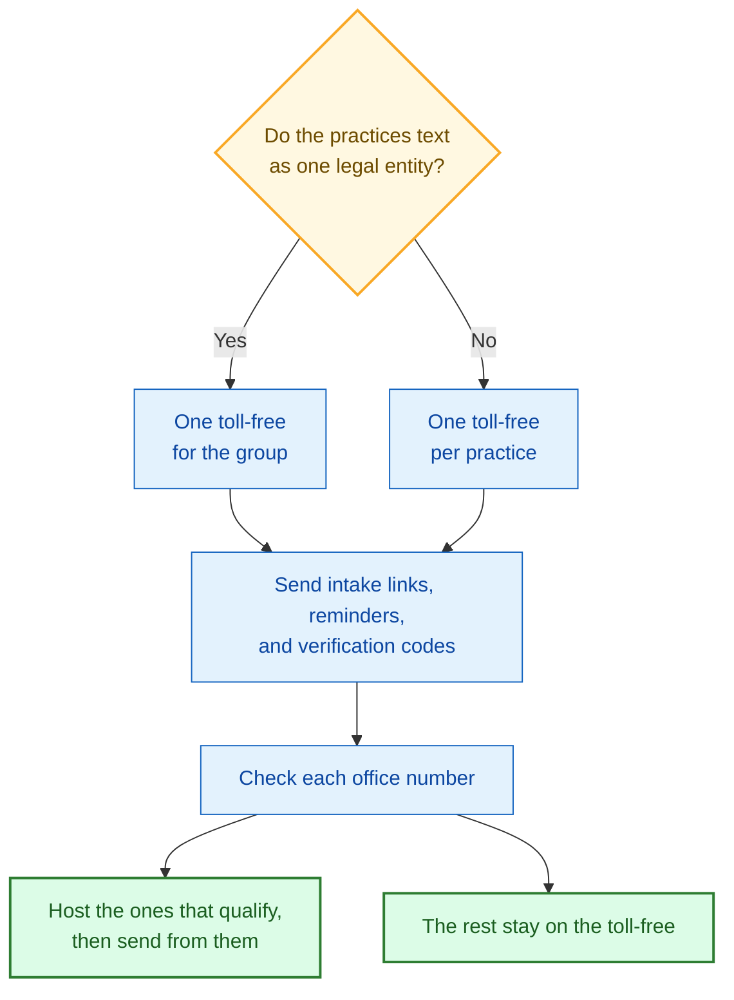
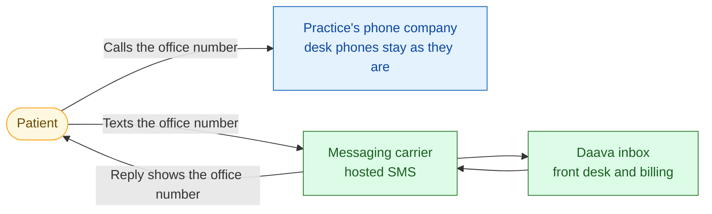
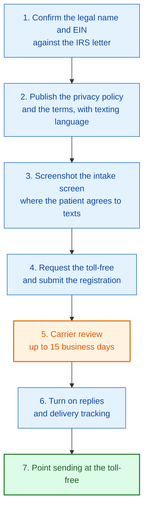
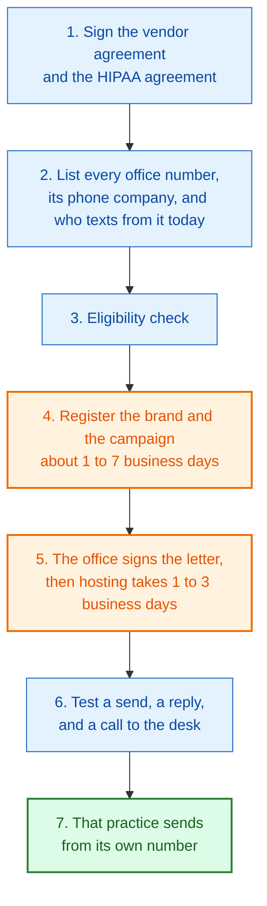
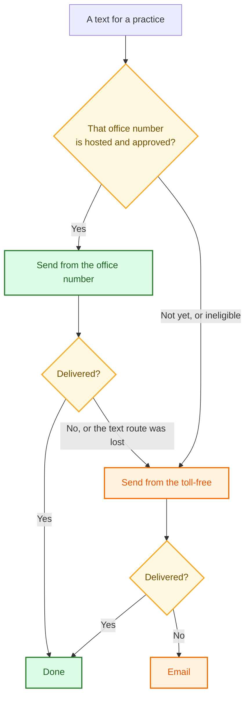

# Texting from the office phone number

- **Date:** 11/20/2026
- **Status:** Suggestion for review. Not a build commitment.
- **For:** Jaime Kirk, Opal Anderson, and the practice stakeholders
- **Research:** [DSO Two-Way Texting Architecture](https://docs.google.com/document/d/1FVjLhQ24BnyQC6zGS9DUdjUafkfJ03Loa-z8H_P7nyM) (Gemini deep research, shared 11/20/2026). Code checked against `daava-hq/daava-ai` `main` @ `84bb5ea`.

This report is about one thing: sending and receiving patient texts from the phone number already printed for that practice. Solutionreach does this. The suggestion is to start patients on a toll-free number this month, then move each office onto its own number as that number clears.

| | Section |
| :--- | :--- |
| The decision | [1. The suggestion](#1-the-suggestion) |
| How it works, and who else does it | [2](#2-how-an-office-number-sends-a-text) and [3](#3-what-the-other-platforms-do) |
| Who we would buy it from | [4. Vendors](#4-vendors) |
| The actual work, in order | [5. The toll-free](#5-setting-up-the-toll-free) and [6. Each office number](#6-setting-up-each-office-number) |
| When a text cannot use the office number | [7. The fallback](#7-the-fallback) |
| What changes inside Daava | [8. Engineering](#8-what-changes-in-daava) |
| How long the carriers take | [9. Lead times](#9-lead-times-the-vendors-publish) |
| Still to decide | [10. Open questions](#10-open-questions) |

---

## 1. The suggestion

Stakeholders want texts moving. Waiting to review every office line first would hold that up: each number can fail eligibility, and the ones that pass still wait on a signed letter and a carrier campaign.

**A toll-free belongs to one business.** Carriers reject a toll-free that several separate businesses share, and they reject one registered in Daava's name on behalf of the clinics. So "one toll-free" is right only when the practices send as one legal entity, with each practice name listed as a DBA. When each practice has its own EIN, each practice gets its own toll-free and its own verification. That is the same backend change as one local number per region: the sender is stored on the practice. This is open question 1, and it is the first thing to confirm, because it decides how many registrations we file.

**Suggested first step.** Request the toll-free (or one per practice, if that is the answer above) and send notifications from it: intake links, form reminders, verification codes. Dental Intelligence uses a verified toll-free as its default for exactly this. A toll-free is capped at 3 message parts per second, enough to start and too slow for a group-wide blast. That cap is a reason to move offices onto their own numbers. The setup is [section 5](#5-setting-up-the-toll-free).

### Why a toll-free rather than a short code

A short code is the wrong number to put in front of patients. The number we are getting is the toll-free.

- **Some T-Mobile customers never receive it.** AWS documents that some prepaid plans, including some T-Mobile prepaid plans, do not accept texts from a short code at all. An intake link sent on that code never arrives, and there is no error the patient can fix. A toll-free is an ordinary 10-digit number, and those plans can receive it.
- **Patients do not recognize a 5- or 6-digit sender.** Solutionreach moved review texts off a short code because patients read it as a pharmacy or store alert. A toll-free is still not the office's own number. It is a phone number a person can read.
- **It is the slow, expensive path.** A US short code is listed at $650 to set up and $995 a month, and about 12 weeks after the application is clean. US carrier review also pauses the weeks of 11/23/2026, 12/21/2026, and 12/28/2026. A toll-free is verified in up to 15 business days on AWS.

A short code is faster once it is live, at 100 message parts per second. That speed is not a reason to use one. A blast the toll-free cannot carry at 3 per second waits for the office numbers.

### A local number, if a toll-free feels too generic

A leased 10-digit number in the practice's area code looks more like a local call. One local number does not cover the group: a patient at a practice in another region would get a text from an unfamiliar area code. Covering that means **one local number per region**, and the sender is chosen from the practice's region.

That is doable, and it is a backend change. Today's sending uses one number for every practice. Regional numbers mean a sender on each practice, a 10DLC campaign those numbers share (or one campaign per region), and the T-Mobile daily cap that comes with 10DLC. A toll-free avoids the area-code split. The regional approach is worth deciding if stakeholders want the temporary number to look local. It is open question 2.

### Then each office number, on its own

| Cohort | The number | Suggested treatment |
| :--- | :--- | :--- |
| **A** | Landline or business VoIP, nothing texting from it today, eligibility check passes | Letter of authorization, host it, register the campaign, then send from it. [Section 6](#6-setting-up-each-office-number). |
| **B** | Already texting through Solutionreach, RevenueWell, Weave, or the VoIP provider | The current vendor releases the text route first, then we host it. The toll-free keeps sending until that release lands. |
| **C** | Wireless, or the phone company will not release it | Stays on the toll-free. This office keeps the toll-free as its sender. |

---

## 2. How an office number sends a text

The practice keeps its phone company. Voice calls keep ringing the desk. A messaging carrier takes only the text route for that same number, after the practice signs a letter of authorization.

Calls and texts use different carrier records. A call follows the voice record. A text follows a separate messaging record (a NetNumber ID, which older phone vendors call a SPID). Hosted SMS changes the messaging record and leaves the voice record alone. The patient sees the office number. A reply lands in a staff inbox, not on the desk phone.

Solutionreach provisions the landline inside its app, then registers that number for 10DLC before automated texts can send. One number per account. US and Canada. A fax line can be provisioned. Switching phone systems is optional. When the number qualifies, competitors quote about 1 to 3 business days to turn texting on, and then the 10DLC campaign still has to clear.

**What has to be true for a specific number**

- It is a US or Canadian landline, an eligible business VoIP line, or a toll-free. Wireless numbers cannot be hosted.
- Nobody else is already hosting its texts. Solutionreach, RevenueWell, Weave, or the VoIP provider has to release the messaging record first. Hosting it for Daava turns the other vendor's texting off.
- The practice signs a letter of authorization, usually with a recent phone bill. The letter is only good for about 30 days, so it is signed at submission time.
- The number is registered as a 10DLC campaign under that practice's legal name and EIN. Hosting the route does not by itself make carriers deliver automated texts.

**What breaks it**

If the practice changes phone companies, the new company often overwrites the messaging record. Texts can look sent and never arrive. Solutionreach cannot see the carrier change from its side. RevenueWell documents the same gap. The guard for that is [section 7](#7-the-fallback).

---

## 3. What the other platforms do

| Platform | Office number | What they do with everything else |
| :--- | :--- | :--- |
| **Solutionreach** | Hosted SMS. One landline carries conversations, reminders, and recalls | Practices that never provision the landline still get some texts from a short code |
| **RevenueWell** | Hosted SMS, usually live in 1–3 business days | If the number is ineligible, they assign a 10-digit number so onboarding still starts. Some automated alerts stay on shared short codes |
| **NexHealth** | Hosted SMS, if the current phone vendor releases the text rights | Campaigns and review requests always come from a different number, so a STOP on a promotion does not stop care texts |
| **Dental Intelligence / Modento** | Optional. Automated texts stay on a verified toll-free they issue, unless the practice finishes a 10DLC upgrade on the office number | The toll-free is the default, including while the office number is in review |
| **Weave** | Full port, so Weave becomes the phone company, or text-only SMS hosting | A port moves the desk phones. Hosting does not |
| **Emitrr, OhMD** | Hosted SMS into a shared inbox, paperwork handled for the clinic | Same pattern as Solutionreach |
| **Podium** | A local 10-digit number when the office line cannot be hosted | They avoid short codes so the sender still looks like a phone number |

The pattern worth copying from NexHealth: care texts and marketing texts do not share a sender. A STOP on a review request should not also stop an intake link. Suggested for later, once office numbers are live: keep marketing off the office number.

---

## 4. Vendors

AWS can issue the toll-free. AWS cannot host an office's existing number, so hosting needs a second carrier. That second carrier is an exception to the AWS-only rule and wants a written yes, including a HIPAA business associate agreement, before any office number is hosted. Twilio can do both jobs and is outside the stack Daava uses, so it is not suggested.

| | **AWS End User Messaging** (in use today) | **Telnyx** | **Bandwidth** |
| :--- | :--- | :--- | :--- |
| **Toll-free** | Yes. Up to 15 business days. 3 message parts a second | Yes. Usually 5 business days, and up to 2 weeks | Yes. Up to 5 business days at Bandwidth, then the industry reviewer |
| **Host the office's own number** | No. AWS only issues new numbers | Yes, by API. Eligibility check, then 1–3 business days | Yes, through an account manager. Can need manual setup |
| **Photo replies** | No | Yes, once the number is hosted | Yes, once the number is hosted |
| **HIPAA agreement** | The AWS agreement, if Daava has signed it | Through sales. The spending bar is not published | Yes. Toll-free, 10DLC, and short code are covered |
| **How you start** | Already in the account | Self-serve, with published prices | Sales. Prices are negotiated. This is Dental Intelligence's carrier |

**Suggested split.** Put the toll-free on AWS now. No new vendor, and the sending code already points at an AWS number. Bring in Telnyx or Bandwidth when the first office number is ready to host. A verified toll-free keeps its status if it later moves to that carrier, so starting on AWS does not trap the number there.

**The other way to do it.** Put the toll-free on Telnyx or Bandwidth from the start. One carrier, one place replies arrive, and patients can text photos to the toll-free. The cost is that the vendor agreement has to be signed before the first text goes out.

Between the two hosting carriers: Telnyx is the easier one to automate, because the eligibility check, the order, and the letter upload are all API calls with published prices. Bandwidth is the better escalation path when a phone vendor stalls a release, and it is the carrier a dental peer already runs on. That choice is open question 11. The prices below are Telnyx's published pass-through of the carrier fees; Bandwidth negotiates its own.

---

## 5. Setting up the toll-free

On AWS, as the suggested first step. The same paperwork applies if the toll-free goes to Telnyx or Bandwidth instead. Orange is time spent waiting on a carrier.

1. **Confirm who the sender is.** The legal name has to match the IRS record exactly, including punctuation, rather than a trade name or "Daava." Keep the IRS CP 575 or 147C letter on hand. AWS accepts it when the automatic check fails. If each practice is its own entity, this step happens once per practice.
2. **Publish a privacy policy and terms** at public web addresses, saying the same thing the intake form tells the patient. Every new toll-free registration has required both since 09/15/2026.
3. **Capture the opt-in.** A screenshot of the intake texting-consent step (PNG, JPEG, or PDF, up to 500 KB) plus a short written description of how a patient agrees.
4. **Request the number and submit the registration** in AWS End User Messaging. The form asks for the company, a business contact, a use case (health care, and appointment reminders, both fit), the monthly volume, the opt-in, and sample messages. The samples should look like the real texts: the practice name first, the intake link, and "Reply STOP to opt out."
5. **Wait for carrier review, up to 15 business days.** An unverified toll-free has been blocked from sending since 01/31/2024, so this number sends nothing while it is pending. A rejection comes back with a reason, and the corrected filing starts the review over.
6. **Turn on replies and delivery tracking.** Replies and STOP messages need somewhere to land, and a failed delivery is what tells Daava to use the fallback. On AWS that is a configuration on the number. Reply handling in the product is new work, described in [section 8](#8-what-changes-in-daava).
7. **Point sending at the toll-free.** Today's texts already go out from one configured number, so this part is a configuration change. The practice name stays on the first line of every text.

---

## 6. Setting up each office number

On Telnyx or Bandwidth, after the toll-free is sending. Cohort A is the happy path below. Cohort B adds a release from the old vendor before the eligibility check can pass. Cohort C stops at the eligibility check and stays on the toll-free.

The campaign registration and the signed letter can run side by side. Both have to finish before the number can send.

1. **Sign the agreements.** The exception to AWS-only, the master agreement, and the HIPAA business associate agreement. Neither vendor publishes how long contracting takes.
2. **List every office number.** The number, the phone company, whether it is a landline or VoIP, and whether anything texts from it today. That list is what sorts offices into cohorts A, B, and C.
3. **Run the eligibility check.** Telnyx returns this immediately, with a reason when a number fails. Bandwidth runs it through the account team. A number already texting somewhere else comes back as already hosted, which is cohort B: the office, or its old vendor, releases the messaging record before we can continue. How long a release takes depends on that vendor and is not published.
4. **Register the 10DLC brand and campaign**, once per legal entity. On Telnyx's published fees: $4.50 once per brand, $41.50 for the standard vetting that sets the trust score, $15 each time a campaign is submitted (a rejection and resubmission costs another $15), and $10 a month per campaign. Vetting takes 1–7 business days. Telnyx reviews a campaign the same or next business day, and the carriers usually add 3 business days or less. The trust score sets T-Mobile's daily cap, and clinics that share an EIN share that cap. Copy the legal name and EIN from the IRS letter. Mixing two entities in one campaign gets the campaign rejected.
5. **Collect the letter and host the number.** Each office signs a letter of authorization listing its number, dated within 30 days of submission, and attaches a recent bill from its phone company. The carrier texts an ownership code to that number and the office reads it back. Telnyx activates in 1–3 business days after the documents clear. Bandwidth can need a person to finish provisioning, and recommends watching the order status and testing the number.
6. **Test it.** A text to an AT&T phone, a T-Mobile phone, and a Verizon phone, a reply back, and a voice call to the desk to confirm the phones still ring.
7. **Switch that practice over.** Its texts go out from the office number. The toll-free stays underneath it as the fallback.

---

## 7. The fallback

This is the safety net, and sending from office numbers does not work without it. Suggested together with the toll-free, so a clinic that changes phone companies has a backup already running.

**When it would fire**

- The office number is still being checked, or it landed in cohort C.
- The send from the office number fails.
- Delivery from that office drops off, which is the early sign that a phone-company change overwrote the text route. Suggested response: flip that practice back to the toll-free and ask them to re-sign.

**Why skipping it is the risk**

- Cohort C offices, and every office during review, would have no text at all.
- A carrier change would stop patient texts with no backup, and the failure looks like a successful send.
- A toll-free at 3 message parts per second cannot carry a group-wide reminder blast by itself once many offices are live. Office numbers take that load. The toll-free is the net.

**Two rules suggested with the fallback**

- One opt-out record per patient per practice, checked before either number sends. A STOP to the toll-free still counts after that practice gets its own number, and a STOP to the office number is not followed by the same text from the toll-free.
- Every toll-free text leads with the practice name. On AWS, a US toll-free only honors STOP as the opt-out word.

Email failover already exists and stays the last step. Neither AWS number can receive a photo. An insurance card or a clinical photo comes through the intake link until the office number is hosted on Bandwidth or Telnyx, which both accept pictures. SMS versus MMS, and where a picture message helps reminders, the promotion, and a photo from the patient, is in [`sms-and-picture-messages.md`](./sms-and-picture-messages.md).

---

## 8. What changes in Daava

Every text today goes out from one AWS number. Intake texts name the practice and end with "Reply STOP to opt out." Nothing receives a reply, so a STOP on today's shared number would apply to every practice. Addendum II §6 describes payment texts and the two-way billing console as planned.

The toll-free itself is mostly configuration. Office numbers are the real product work. Any live test stays on the Riversbend test line.

| Change | When | What it does |
| :--- | :--- | :--- |
| **Point sending at the toll-free** | With the toll-free | The number every text uses today is a setting. Swap in the toll-free. |
| **Reply and STOP handling** | With the toll-free | Replies arrive from AWS, and later from Telnyx or Bandwidth. A STOP is stored per patient, per practice. |
| **Delivery tracking and fallback** | With the toll-free | A failed delivery sends the same text from the toll-free, then by email. |
| **A sender on each practice** | With the office numbers, or with the toll-free if each practice needs its own | Replaces the single shared number with the number that practice should send from. |
| **A second sending carrier** | With the office numbers | Telnyx or Bandwidth sends alongside AWS. |
| **Quiet-office alert** | With the office numbers | Flags an office whose deliveries suddenly stop, the early sign of a phone-company change. |
| **Onboarding record per office** | With the office numbers | Eligibility result, the letter and the date it was signed, hosting status, campaign ID. |
| **Staff inbox** | With the office numbers | Where patient replies land, per practice. This is the billing console in Addendum II. |

---

## 9. Lead times the vendors publish

These are the carriers' clocks. They say nothing about how long the Daava work in section 8 takes. Every one of them starts over when a filing is rejected, so the fastest path is a first submission whose legal name, website, consent screenshot, and sample messages all match.

| Step | Published lead time | Source |
| :--- | :--- | :--- |
| AWS toll-free verification | Up to 15 business days after submission | AWS |
| Telnyx toll-free verification | Usually 5 business days or less, and up to 2 weeks | Telnyx |
| Bandwidth toll-free verification | Up to 5 business days at Bandwidth, then the industry reviewer | Bandwidth |
| 10DLC brand vetting | 1–7 business days | Telnyx |
| 10DLC campaign approval | About 1–7 business days | Telnyx |
| Hosting an office number | 1–3 business days once the letter and the bill are accepted | Telnyx. RevenueWell quotes the same |
| Release from a previous texting vendor | Not published. Depends on that vendor | |
| Vendor contract and HIPAA agreement | Not published | |
| Short code, for comparison | About 12 weeks, plus the review pauses the weeks of 11/23/2026, 12/21/2026, and 12/28/2026 | AWS |

---

## 10. Open questions

| # | Question | Answer |
| :--- | :--- | :--- |
| 1 | Do the practices send as one legal entity (one EIN, each practice as a DBA), or does each practice have its own EIN? This decides one toll-free or one per practice, and how many 10DLC brands we register. | |
| 2 | One toll-free, or one local 10-digit number per region? A local number means the sender is chosen from the practice's region. | |
| 3 | Which practices should be in the first eligibility pass? | |
| 4 | Which offices already text through Solutionreach, RevenueWell, Weave, or a VoIP provider? | |
| 5 | Should a STOP to the toll-free also stop that practice's office number, and the reverse? | |
| 6 | Are stakeholders comfortable that photo replies wait until an office number is hosted on Bandwidth or Telnyx? | |
| 7 | Does the in-flight short code stay as overflow for large blasts, or does the toll-free replace it? | The toll-free replaces it. We are not using a short code. |
| 8 | Has Daava signed the AWS business associate addendum? | |
| 9 | Do the privacy policy and the terms exist as public pages, and do they mention texting? | |
| 10 | Toll-free on AWS now, or on Telnyx or Bandwidth from the start? | |
| 11 | Telnyx or Bandwidth for hosting the office numbers? | |

---

## Sources

Checked 11/20/2026. The research doc's citation list is the long version.

- [Solutionreach, 10/14/2022](https://www.solutionreach.com/release-notes/release-notes-10-14-22) (review texts moved onto the office number so patients recognize the sender, and so STOP applies to one office)
- [Solutionreach, 12/02/2022](https://www.solutionreach.com/release-notes/release-notes-12-02-22) (a phone-company change drops the text route; the practice re-signs)
- [RevenueWell: Hosted SMS](https://help.revenuewell.com/hc/en-us/articles/4597745451803-Hosted-SMS)
- [NexHealth: SMS registration](https://help.nexhealth.com/en/articles/10046696-sms-registration)
- [Dental Intelligence: office-number texting](https://educate.dentalintel.com/en/articles/9242560-porting-your-phone-number-for-inbound-sms-texting) (toll-free is the default for automated texts)
- [Telnyx: Hosted SMS](https://developers.telnyx.com/docs/messaging/messages/hosted-sms) (eligibility check, letter, 1–3 business days, SMS and photos)
- [Bandwidth: text-enable a non-Bandwidth number](https://www.bandwidth.com/support/en/articles/12823125-can-i-text-enable-a-non-bandwidth-phone-number) and [HIPAA-eligible services](https://www.bandwidth.com/support/en/articles/12823993-hipaa-eligible-products-and-services)
- [AWS: origination identities](https://docs.aws.amazon.com/sms-voice/latest/userguide/phone-number-types.html) and [two-way SMS](https://docs.aws.amazon.com/sms-voice/latest/userguide/two-way-sms-phone-number.html) (no incoming photos; no hosting of an existing office number)
- [AWS short-code guide](https://aws.amazon.com/blogs/messaging-and-targeting/guide-to-sms-short-codes-with-aws-end-user-messaging/) (some prepaid plans do not receive them)
- [AWS: toll-free registration](https://docs.aws.amazon.com/end-user-messaging/latest/userguide/nx-reg-type-tollfree.html), [the registration form](https://docs.aws.amazon.com/sms-voice/latest/userguide/registrations-tfn-register.html), and [business verification](https://docs.aws.amazon.com/sms-voice/latest/userguide/registration-help-tfn-verification.html) (up to 15 business days; privacy and terms pages from 09/15/2026; the legal name must match the EIN)
- [Telnyx: toll-free verification guide](https://support.telnyx.com/en/articles/10729979-toll-free-verification-request-guide) and [troubleshooting](https://developers.telnyx.com/docs/messaging/toll-free-verification/troubleshooting) (up to 2 weeks, no expedite)
- [Telnyx: 10DLC quickstart](https://developers.telnyx.com/docs/messaging/10dlc/quickstart) and [10DLC costs](https://telnyx.com/resources/what-is-10dlc) (vetting 1–7 business days; brand, vetting, review, and campaign fees)
- [Bandwidth: toll-free verification handbook](https://www.bandwidth.com/support/en/articles/12823247-bandwidth-toll-free-verification-handbook), [rejection reasons](https://www.bandwidth.com/support/en/articles/12823242-toll-free-verification-rejection-reasons) (a toll-free can belong to only one business), and [hosted messaging FAQ](https://www.bandwidth.com/support/en/articles/12823123-hosted-messaging-faq)
