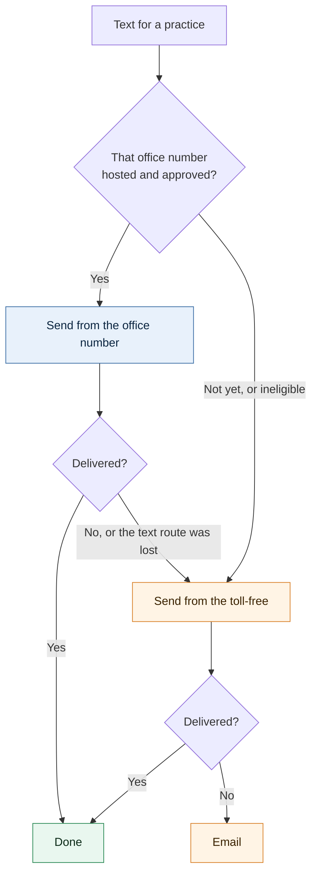

# Texting from the office phone number

**Date:** 11/20/2026
**Status:** Suggestion for review. Not a build commitment.
**For:** Jaime Kirk, Opal Anderson, and the practice stakeholders
**Research:** [DSO Two-Way Texting Architecture](https://docs.google.com/document/d/1FVjLhQ24BnyQC6zGS9DUdjUafkfJ03Loa-z8H_P7nyM) (Gemini deep research, shared 11/20/2026). Code checked against `daava-hq/daava-ai` `main` @ `84bb5ea`.

This report is about one thing: sending and receiving patient texts from the phone number already printed for that practice. Solutionreach does this. The suggestions below are how Daava could get there without waiting on every office before the first text goes out.

---

## How an office number sends a text

The practice keeps its phone company. Voice calls keep ringing the desk. A messaging carrier takes only the text route for that same number, after the practice signs a letter of authorization.

Calls and texts use different carrier records. A call follows the voice record. A text follows a separate messaging record (a NetNumber ID, which older phone vendors call a SPID). Hosted SMS changes the messaging record and leaves the voice record alone. The patient sees the office number. A reply lands in a staff inbox, not on the desk phone.

Solutionreach provisions the landline inside its app, then registers that number for 10DLC before automated texts can send. One number per account. US and Canada. A fax line can be provisioned. Switching phone systems is optional. When the number qualifies, competitors quote about 1 to 3 business days to turn texting on, and then the 10DLC campaign still has to clear.

**What has to be true for a specific number**

- It is a US or Canadian landline, an eligible business VoIP line, or a toll-free. Wireless numbers cannot be hosted.
- Nobody else is already hosting its texts. Solutionreach, RevenueWell, Weave, or the VoIP provider has to release the messaging record first. Hosting it on Daava turns the other vendor's texting off.
- The practice signs a letter of authorization, usually with a recent phone bill. The letter is only good for about 30 days, so it is signed at submission time.
- The number is registered as a 10DLC campaign under that practice's legal name and EIN. Hosting the route does not by itself make carriers deliver automated texts.

**What breaks it**

If the practice changes phone companies, the new company often overwrites the messaging record. Texts can look sent and never arrive. Solutionreach cannot see the carrier change from its side. RevenueWell documents the same gap. The suggested guard is in the fallback section.

---

## What the other platforms do

| Platform | Office number | What they do with everything else |
| :--- | :--- | :--- |
| **Solutionreach** | Hosted SMS. One landline carries conversations, reminders, and recalls | Practices that never provision the landline still get some texts from a short code |
| **RevenueWell** | Hosted SMS, usually live in 1–3 business days | If the number is ineligible, they assign a 10-digit number so onboarding still starts. Some automated alerts stay on shared short codes |
| **NexHealth** | Hosted SMS, if the current phone vendor releases the text rights | Campaigns and review requests always come from a different number, so a STOP on a promotion does not stop care texts |
| **Dental Intelligence / Modento** | Optional. Automated texts stay on a verified toll-free they issue, unless the practice finishes a 10DLC upgrade on the office number | The toll-free is the default, including while the office number is in review |
| **Weave** | Full port, so Weave becomes the phone company, or text-only SMS hosting | A port moves the desk phones. Hosting does not |
| **Emitrr, OhMD** | Hosted SMS into a shared inbox, paperwork handled for the clinic | Same pattern as Solutionreach |
| **Podium** | A local 10-digit number when the office line cannot be hosted | They avoid short codes so the sender still looks like a phone number |

The pattern worth copying from NexHealth: care texts and marketing texts do not have to share a sender. A STOP on a review request should not also stop an intake link.

---

## Suggestion: start on one toll-free, then review each office number

Stakeholders want texts moving. Reviewing every office line first would hold that up, because each number can fail eligibility, and the ones that pass still wait on a letter and a 10DLC campaign.

**Suggested first step.** Request one toll-free number and send notifications from it: intake links, form reminders, verification codes. Dental Intelligence uses a verified toll-free as its default for this. Patients see a 10-digit business number rather than a 5-digit short code. A short code also misses some prepaid plans, including some T-Mobile prepaid plans, takes about 12 weeks, and is listed at $650 to set up and $995 a month. A toll-free is capped at 3 message parts per second, which is enough to start and too slow for a huge blast. That limit is a reason to move offices onto their own numbers, not a reason to wait.

**Suggested second step.** Look at each practice's published number on its own.

| Cohort | The number | Suggested treatment |
| :--- | :--- | :--- |
| A | Landline or VoIP, not already text-enabled, eligibility check passes | Letter of authorization, host it, register the 10DLC campaign, then send from it |
| B | Already texting through Solutionreach, RevenueWell, Weave, or the VoIP provider | Schedule a release of the messaging record, then host it. Until release, the toll-free keeps sending |
| C | Wireless, or the phone company will not release it | Stays on the toll-free. Do not promise this office its own number |

AWS can issue the toll-free. AWS cannot host an office's existing number. Hosting needs Bandwidth or Telnyx. Twilio is outside the stack we use. That second carrier is an exception to the AWS-only rule, and it wants a written yes before any office number is hosted. Both carriers offer a HIPAA business associate agreement. Telnyx has a self-serve eligibility check. Bandwidth is the carrier Dental Intelligence uses and is the better escalation path when a phone vendor stalls a release.

---

## Suggested fallback

This is the safety net, and sending from office numbers does not work without it. It is still a suggestion: adopt it with the toll-free, rather than discovering the gap after a clinic changes phone companies.

**When it would fire**

- The office number is still being checked, or it landed in cohort C.
- The send from the office number fails.
- Delivery from that office drops off, which is the early sign that a phone-company change overwrote the text route. Suggested response: flip that practice back to the toll-free and ask them to re-sign.

**Why skipping it is the risk**

- Cohort C offices, and every office during review, would have no text at all.
- A carrier change would stop patient texts with no backup, and the failure looks like a successful send.
- A toll-free at 3 message parts per second cannot carry a group-wide reminder blast by itself once many offices are live. Office numbers are what take that load. The toll-free is the net, not the only sender.

**Two rules suggested with the fallback**

- One opt-out record per patient per practice, checked before either number sends. A STOP to the toll-free should not be ignored just because that practice later gets its own number, and a STOP to the office number should not be followed by the same text from the toll-free.
- Every toll-free text leads with the practice name. On AWS, a US toll-free only honors STOP as the opt-out word.

Email failover already exists and stays the last step. Neither AWS number can receive a photo. An insurance card or a clinical photo has to come through the intake link until a carrier that accepts incoming pictures is in place. Bandwidth and Telnyx both accept them on a hosted office number.

---

## Where sending is today

Every text goes out from one AWS origination number. Intake texts name the practice and end with "Reply STOP to opt out." Nothing receives a reply. A STOP on today's shared number would apply to every practice. Addendum II §6 describes payment texts and the two-way billing console as planned.

---

## Suggested build plan

1. **Request one toll-free and send from it.** Intake links, reminders, and verification codes. Practice name on the first line.
2. **Run every practice's published number through an eligibility check** and sort them into the three cohorts above. Do this on a carrier that can actually host the number.
3. **Host cohort A**, one letter and one 10DLC campaign per legal entity. Copy the legal name and EIN from the IRS letter. Mixed entities in one campaign get rejected.
4. **Turn each hosted number on only after a test send and a test reply.** Calls to that number should still reach the desk.
5. **Apply the fallback** in the diagram: office number when it is approved, toll-free otherwise, email if the text still fails. Alert when an active office goes quiet for a business day.
6. **Cohort B on a schedule**, so releasing the old vendor does not leave a gap. Cohort C stays on the toll-free.
7. **Keep marketing off the office number** when we get there, following NexHealth. A review request should not be able to STOP an intake link.
8. **Any live test stays on the Riversbend test line.**

A shared EIN across clinics shares T-Mobile's daily cap. Third-party vetting is what raises that cap. Separate EINs mean a separate brand registration each. That detail belongs in the carrier setup, and the open questions ask which tax structure the group is actually on.

---

## Open questions

| # | Question | Answer |
| :--- | :--- | :--- |
| 1 | Is one shared toll-free acceptable for the offices whose own number is not ready? | |
| 2 | Which practices should be in the first eligibility pass? | |
| 3 | Which offices already text through Solutionreach, RevenueWell, Weave, or a VoIP provider? | |
| 4 | One EIN for the group, or a separate EIN per practice? | |
| 5 | Should a STOP to the toll-free also stop that practice's office number, and the reverse? | |
| 6 | Are stakeholders comfortable that photo replies wait until an office number is hosted on Bandwidth or Telnyx? | |
| 7 | Does the in-flight short code stay, or does the toll-free replace it for launch? | |
| 8 | | |

---

## Sources

Checked 11/20/2026. The research doc's citation list is the long version.

- [Solutionreach, 10/14/2022](https://www.solutionreach.com/release-notes/release-notes-10-14-22) (review texts moved onto the office number so patients recognize the sender, and so STOP applies to one office)
- [Solutionreach, 12/02/2022](https://www.solutionreach.com/release-notes/release-notes-12-02-22) (a phone-company change drops the text route; the practice re-signs)
- [RevenueWell: Hosted SMS](https://help.revenuewell.com/hc/en-us/articles/4597745451803-Hosted-SMS)
- [NexHealth: SMS registration](https://help.nexhealth.com/en/articles/10046696-sms-registration)
- [Dental Intelligence: office-number texting](https://educate.dentalintel.com/en/articles/9242560-porting-your-phone-number-for-inbound-sms-texting) (toll-free is the default for automated texts)
- [Telnyx: Hosted SMS](https://developers.telnyx.com/docs/messaging/messages/hosted-sms) (eligibility check, letter, 1–3 business days, SMS and photos)
- [Bandwidth: text-enable a non-Bandwidth number](https://www.bandwidth.com/support/en/articles/12823125-can-i-text-enable-a-non-bandwidth-phone-number) and [HIPAA-eligible services](https://www.bandwidth.com/support/en/articles/12823993-hipaa-eligible-products-and-services)
- [AWS: origination identities](https://docs.aws.amazon.com/sms-voice/latest/userguide/phone-number-types.html) and [two-way SMS](https://docs.aws.amazon.com/sms-voice/latest/userguide/two-way-sms-phone-number.html) (no incoming photos; no hosting of an existing office number)
- [AWS short-code guide](https://aws.amazon.com/blogs/messaging-and-targeting/guide-to-sms-short-codes-with-aws-end-user-messaging/) (some prepaid plans do not receive them)
