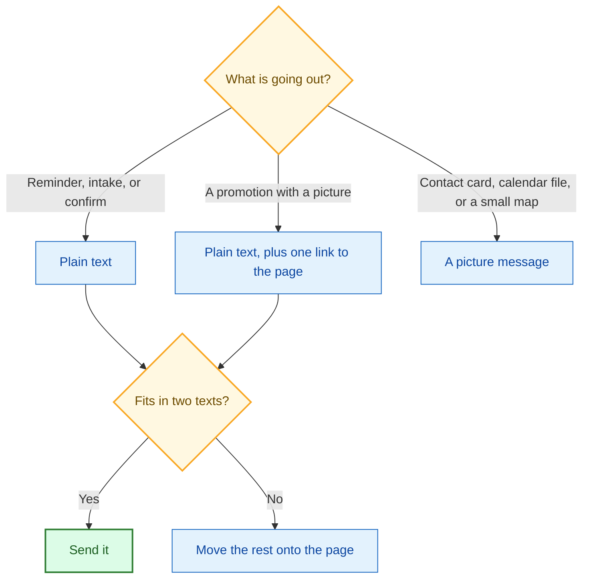
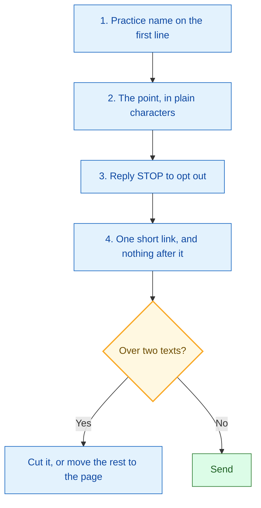
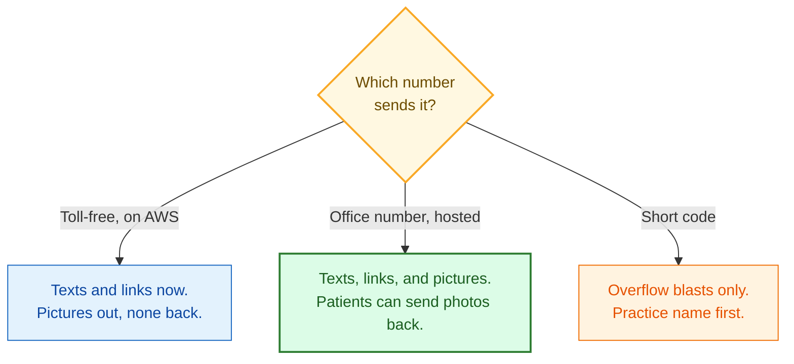

# When a text should stay a text

- **Date:** 11/20/2026
- **Status:** Suggestion for review. Not a build commitment.
- **For:** Jaime Kirk, Opal Anderson, Lacey Shaw, Lauren Janowiecki, and the practice stakeholders
- **From the call:** [Daava Meeting, 11/20/2026](https://docs.google.com/document/d/15GMaXbCfxa2gcisQ22qi7cT3efKJT85V0DcC45L8zMU) (Gemini notes and transcript)
- **Research:** [MMS vs. SMS Message Delivery and AWS End User Messaging MMS Guide](https://docs.google.com/document/d/13mVnaKqz_W9B68DCmsRI6tNhBxUxAY1n2moa8fjpEXY)
- **Related:** [`office-number-texting-report.md`](./office-number-texting-report.md) covers which phone number the text comes from. This guide covers what is inside the text, and [section 5](#5-office-number-vs-toll-free-vs-short-code) covers how that changes on each of the report's numbers.

On the 11/20/2026 call, Lacey asked for the sparkly Invisalign promotion to go out as a text, because patients do not read email and the ads she sees arrive as photos. Lauren asked how that fits in 160 characters once the practice name, a way to stop, and a link are included. Prem showed a composer that will hold about 300 characters, and Tanmay said a text is 160 characters a piece, so 300 is two or three texts. This is the suggested way to do that.

---

## 1. The suggestion

Send reminders, intake links, and appointment confirmations as plain texts. Send a promotion as a plain text with one link to the page that already holds the picture. Send a picture message only for a contact card, a calendar file, or a small map.

A picture rides on a different carrier system than a text. The phone has to download it over cellular data. It fails when data is off, on older phones, and on many plans outside the US and Canada. A text still arrives. That is why the day-to-day messages stay texts, which is also what Tanmay said on the call: a photo inside the iPhone messaging app is iMessage, and a plain text cannot carry it.

WhatsApp came up on the call and was set aside. It is not part of this suggestion.

---

## 2. How the 160 characters work

A plain text holds **160 characters**. When it runs over, the carrier splits it and each piece is **153 characters**, because a few characters are spent joining the pieces. Prem's box at about 300 characters is two pieces. A third piece is the point where the research doc's 2026 list rates say a picture message can cost less than the text. The suggestion is still to shorten the text, or move the rest onto the page, before paying for a picture.

One emoji, one curly quote pasted from Word, or one accented character changes the whole text to a 70-character size. A 140-character reminder that was one text becomes three. The fix is a check in the composer that replaces curly quotes and dashes with plain characters and warns before an emoji is inserted. Switching those reminders to picture messages is the expensive way around the same problem.

| What goes out | How it is billed, on the research doc's AWS list rates |
| :--- | :--- |
| One text, up to 160 plain characters | $0.0120 |
| Two texts, up to 306 | $0.0239 |
| Three texts, up to 459 | $0.0359 |
| One picture message, up to 1,600 characters, with or without a file | $0.0300 |

These are the research doc's published list rates for AWS, with carrier fees included. They are not a Daava quote. The same doc shows the switch at three texts on Telnyx as well. Twilio appears in that comparison and is outside the stack Daava uses.

On the call, Lauren was right that the practice name, a way to stop, and a link all have to fit. The way to stop can be the words "Reply STOP to opt out." It does not have to be a paragraph. A short link is what makes the rest fit. Prem already said the composer can shorten a link when SMS is selected. That belongs in the composer, so the person writing the text sees the short link before they send.

---

## 3. How to write the text

1. **Practice name first.** The patient should see who it is from before anything else. This matches the office-number report.
2. **Plain characters.** No emoji, no curly quotes, no em dash. The composer should fix the quotes on the way in and warn on an emoji.
3. **"Reply STOP to opt out."** Put it before the link. A phone will only build a preview of the link when the link is the last thing in the text, with nothing after it, and only after the patient has saved the number. The preview is a bonus for patients who already have the clinic saved. The STOP line is required either way.
4. **One link, on a Daava domain, shortened.** One link only. The page it opens can hold the picture, the offer, and the button. The preview title on that page stays generic, such as "Complete your forms," with no patient name, no visit type, and no procedure in the title or the web address.
5. **Stop at two texts.** If step 4 still needs a third text, cut a sentence or move it onto the page.

A confirmation follows the same shape. On the call, the offices want a patient to text back C, or whatever word that office uses, and each office needs its own wording. The reply is one text. There is no second tap.

---

## 4. The Invisalign promotion, specifically

Lacey asked for the glittery creative to arrive the way an ad does, as a photo, and then agreed a link to that creative would do it. Lauren's action from the call is the right test: a short text version of that promotion, sent to Prem, with the link opening the page that already has the image.

A picture of that promotion, sent as a picture message to a whole list, is a poor fit for the first version.

- Speed depends on which number sends it. On the AWS toll-free, 5,000 picture messages take about 28 minutes, and a 5,000-patient picture blast on a short code is about 2 minutes. [Section 5](#5-office-number-vs-toll-free-vs-short-code) has each number.
- The image has to be small. Carriers recompress anything large. The safe size is about 300 to 500 KB, even though AWS will accept an image up to 2 MB.
- The same consent and STOP rules apply to a picture as to a text. A picture is not a way around them.
- A treatment promotion is still a marketing text. It stays off the number that sends intake links once offices have their own numbers, so a STOP on the promotion does not stop an intake link. That split is in the office-number report.

---

## 5. Office number vs. toll-free vs. short code

The [office-number report](./office-number-texting-report.md) suggests three senders over time. The first is a toll-free on AWS, used now. The second is each practice's own office number, hosted on Telnyx or Bandwidth as it qualifies. The third is the short code already being provisioned, kept at most for overflow. The rules for a message are the same on all three: plain text by default, a link for a promotion, and a picture only for the three files in [section 6](#6-when-a-picture-message-is-the-right-tool). What changes is speed, file size, whether a patient can send a photo back, and how a promotion gets approved.

| | **Toll-free on AWS** (the start) | **Office number on Telnyx or Bandwidth** (the goal) | **Short code on AWS** (overflow, if kept) |
| :--- | :--- | :--- | :--- |
| **What the patient sees** | An 800-style number | The number on the practice's website | A 5- or 6-digit code |
| **Plain text speed** | 3 parts a second | Set by the practice's 10DLC campaign | 100 parts a second |
| **Picture speed** | 3 a second | Set by the campaign. AT&T allows up to 40 a second for a well-vetted campaign | 40 a second |
| **5,000 one-part texts** | About 28 minutes | About 1 to 21 minutes toward AT&T, by vetting score | Under a minute |
| **5,000 two-part texts** | About 56 minutes | About 2 to 42 minutes toward AT&T. Counts as 10,000 against the T-Mobile daily cap | About 2 minutes |
| **5,000 pictures** | About 28 minutes | About 2 to 33 minutes toward AT&T. Counts as 5,000 against the T-Mobile daily cap | About 2 minutes |
| **Largest safe picture** | 600 KB | 1 MB, but keep to 600 KB | 600 KB |
| **Patient can text a photo back** | No. AWS does not receive pictures | Yes | No |
| **What a promotion needs** | A promotion in the verification samples | A marketing or mixed campaign, ideally separate from reminders | MMS requested in the short code application |

### On the toll-free

This is what Lauren's Invisalign test goes out on, and it is fine for it. A plain text with one link is one or two parts. AWS sends a picture as one part however long the text in it is, so on a toll-free a two-part text is slower than a picture message. That is the one place a picture is faster. It still costs more and still needs the patient's data on, so a link stays the suggestion.

Three things to check before the first send:

1. **The toll-free has MMS turned on.** On AWS, the number's capabilities are fixed when it is bought. Numbers bought after May 2024 include MMS automatically. The capabilities column in the AWS console shows it. If it only says SMS, a picture message needs a new number, and the new number needs its own verification.
2. **The verification samples include a promotion.** The toll-free verification asks what the number will send. If it says only reminders and intake links, a promotion is off the approved use. Add a promotion sample and the opt-in wording before sending one.
3. **No photo comes back.** A patient who replies to the promotion with a picture loses that picture. Insurance cards and clinical photos still go through the intake page.

### On the office number

This is the only one of the three where the patient can text a photo back, which is the part Lacey was picturing. Telnyx and Bandwidth both carry pictures on a hosted office number, both ways. Telnyx's inbound picture links expire quickly, so each one is copied into Daava's own storage as it arrives.

Two things change compared with the toll-free:

- **Speed comes from the 10DLC campaign, not the number.** A well-vetted campaign can send pictures quickly. T-Mobile then caps the whole business each day, and the cap is per EIN across every vendor that business texts through. Each picture counts as one. Each part of a text counts as one, so a two-part text counts as two. An unvetted brand is held to 2,000 a day toward T-Mobile. A vetted brand gets 10,000 to 200,000, depending on its score. For a single practice this matters for a large promotion and not for daily reminders. Practices that share an EIN share the cap.
- **A promotion needs its own campaign.** A campaign registered for appointment reminders does not cover a treatment promotion. The suggestion from the office-number report applies here: put promotions on a separate marketing campaign, ideally a separate number, so a STOP on the Invisalign text does not also stop intake links. NexHealth does the same.

### On the short code

The office-number report suggests keeping the short code only as overflow, and that holds for pictures too.

- **Pictures on a short code are a separate carrier approval.** The application has to ask for MMS, with a sample picture. T-Mobile and Verizon then test the picture on their networks before it goes live. If the short code application in flight asked only for SMS, adding pictures is another round of carrier review.
- **The T-Mobile prepaid problem is the same.** Patients on plans that cannot receive a short code also cannot receive a picture from one.
- **No photo comes back.** AWS does not receive pictures on any number.

Its one advantage is speed. When a promotion has to reach a whole group's list at once and the toll-free's 3-per-second cap is what is stopping it, the short code is the overflow, with the practice name on the first line.

---

## 6. When a picture message is the right tool

Three files are worth a picture message, each once, and each with no clinical detail in it:

| File | Why a picture helps |
| :--- | :--- |
| A contact card for the clinic number | The patient can save the number in one tap. Saving it is also what lets later texts show a link preview. |
| A calendar file for the appointment | The phone can offer to add it. |
| A small map or parking image, 500 KB or under | The patient needs it before they can open a link. |

Anything longer than two texts, such as pre-op instructions, belongs on a page behind one link. A picture message can carry up to 1,600 characters as a single message, and the research doc shows that can cost less than three texts. A page is still the suggestion, because it does not depend on cellular data and it can be updated after the text has gone out.

**How AWS sends one, when we do send one.**

1. The file goes into an S3 bucket in the same AWS account and the same region as the sending number. AWS will not fetch a file from a public web address.
2. The send uses the media-message call, not the plain text call. The text and the file can travel together. A picture message can also be text with no file, which is how a long text avoids being split.
3. Shrink images to 500 KB or under before the upload.
4. US toll-free numbers, local 10-digit numbers, and short codes can send picture messages. Canada does not get them on a toll-free.
5. A patient can text back words. AWS cannot receive a photo. An insurance card or a clinical photo still comes through the intake page. Receiving a photo on the office number waits for Telnyx or Bandwidth, which is the other report.
6. SMS and picture messages are covered by the AWS business associate agreement once Daava has accepted it. Voice and WhatsApp are not.

A new AWS account starts in a sandbox of $1 a month for texts and $1 a month for picture messages, and only to verified destination numbers. Production access is a support request per region.

---

## 7. What never goes in the message

A text and a picture message are both readable on a lock screen, and a picture can land in the patient's photo library. The message itself carries the practice name, the time, a link, and "Reply STOP to opt out." The diagnosis, the procedure, the clinical photo, and the filled-out form stay on the page behind the link.

The same STOP list covers both kinds of message. A stop on a picture message is a stop on the texts from that practice too.

---

## 8. Suggested build

These follow the actions already named on the call.

1. **Shorten links inside the SMS composer.** Prem's item. The person writing the text pastes a long address and sees the short one before sending.
2. **Count the text the way the carrier will.** Show "1 text" or "2 texts" as they type. Warn on an emoji or a curly quote. Hold the send at a third text and point them at the page.
3. **Four templates.** Reminder. Confirmation, with the office's own reply word. Intake link. Promotion, which is a sentence plus one link.
4. **Lauren's Invisalign text is the trial.** One practice, the test number Prem already planned to use, then the sample practice Lacey asked to click through.
5. **Picture messages after the plain texts are reliable.** First use is a contact card for the clinic number. The promotion stays a link. Before the first one, confirm the toll-free has MMS turned on ([section 5](#5-office-number-vs-toll-free-vs-short-code)).
6. **Any live test stays on the test line.**

---

## 9. Open questions

| # | Question | Answer |
| :--- | :--- | :--- |
| 1 | Does Lauren's text version of the Invisalign promotion fit in two texts with the practice name, STOP, and one link? | |
| 2 | Which domain do the short links use? | |
| 3 | Should a promotion go out from the same number as intake links while every office is still on one shared number? | |
| 4 | Is a contact card for the clinic number the first picture message, or do we wait? | |
| 5 | Has Daava accepted the AWS business associate agreement that covers picture messages? | |
| 6 | Does the toll-free show MMS in its capabilities, and do its verification samples include a promotion? | |
| 7 | Did the short code application in flight ask for MMS, or only SMS? | |
| 8 | When offices move to their own numbers, do promotions get a separate marketing campaign and number? | |
| 9 | Which practices share an EIN, and so share one T-Mobile daily cap? | |

---

## Sources

Checked 11/20/2026.

- [Daava Meeting, 11/20/2026](https://docs.google.com/document/d/15GMaXbCfxa2gcisQ22qi7cT3efKJT85V0DcC45L8zMU), transcript from about 00:53:59. Lacey asked for the promotion as a photo. Prem and Tanmay separated a plain text from a picture message and offered a link. Lauren asked about 160 characters, the practice name, unsubscribe, and a short link. Prem described a composer of about 300 characters and a shortener.
- [MMS vs. SMS and AWS MMS guide](https://docs.google.com/document/d/13mVnaKqz_W9B68DCmsRI6tNhBxUxAY1n2moa8fjpEXY). Carrier behavior, the three-text cost comparison, link previews, and the AWS send steps and limits. The prices in section 2 are that doc's list rates.
- [AWS: MMS file types and size](https://docs.aws.amazon.com/sms-voice/latest/userguide/mms-limitations-character.html)
- [AWS: sending an MMS](https://docs.aws.amazon.com/sms-voice/latest/userguide/send-mms-message.html)
- [AWS: throughput](https://docs.aws.amazon.com/sms-voice/latest/userguide/sms-limitations-mps.html) (pictures: 1 a second on a US 10-digit number, 3 on a toll-free, 40 on a short code; texts: 3 on a toll-free, 100 on a short code; a picture is one part)
- [AWS: How to send MMS](https://aws.amazon.com/blogs/messaging-and-targeting/how-to-send-mms-using-aws-end-user-messaging/) (no inbound pictures; numbers bought after May 2024 include MMS) and [requesting a phone number](https://docs.aws.amazon.com/sms-voice/latest/userguide/phone-numbers-request.html) (capabilities cannot change after purchase)
- [Telnyx: Hosted SMS](https://developers.telnyx.com/docs/messaging/messages/hosted-sms) (texts and pictures on a hosted number), [MMS media limits](https://developers.telnyx.com/docs/messaging/messages/mms-transcoding) (size by carrier and number type; inbound links expire), and [rate limits](https://developers.telnyx.com/docs/messaging/messages/rate-limiting) (AT&T 10DLC throughput by vetting score)
- [Twilio: T-Mobile daily limits](https://help.twilio.com/articles/1260804800549-T-Mobile-daily-message-limits-for-long-code-messaging-with-A2P-10DLC) (per EIN, across vendors; each text part and each picture counts as one). Cited for the carrier rule only.
- [Infobip: short codes](https://www.infobip.com/docs/usa-sender-registration/short-code) and [iPost: MMS provisioning](https://help.ipost.com/sms/mms-provisioning) (short code MMS is its own approval; T-Mobile and Verizon test pictures before launch)
