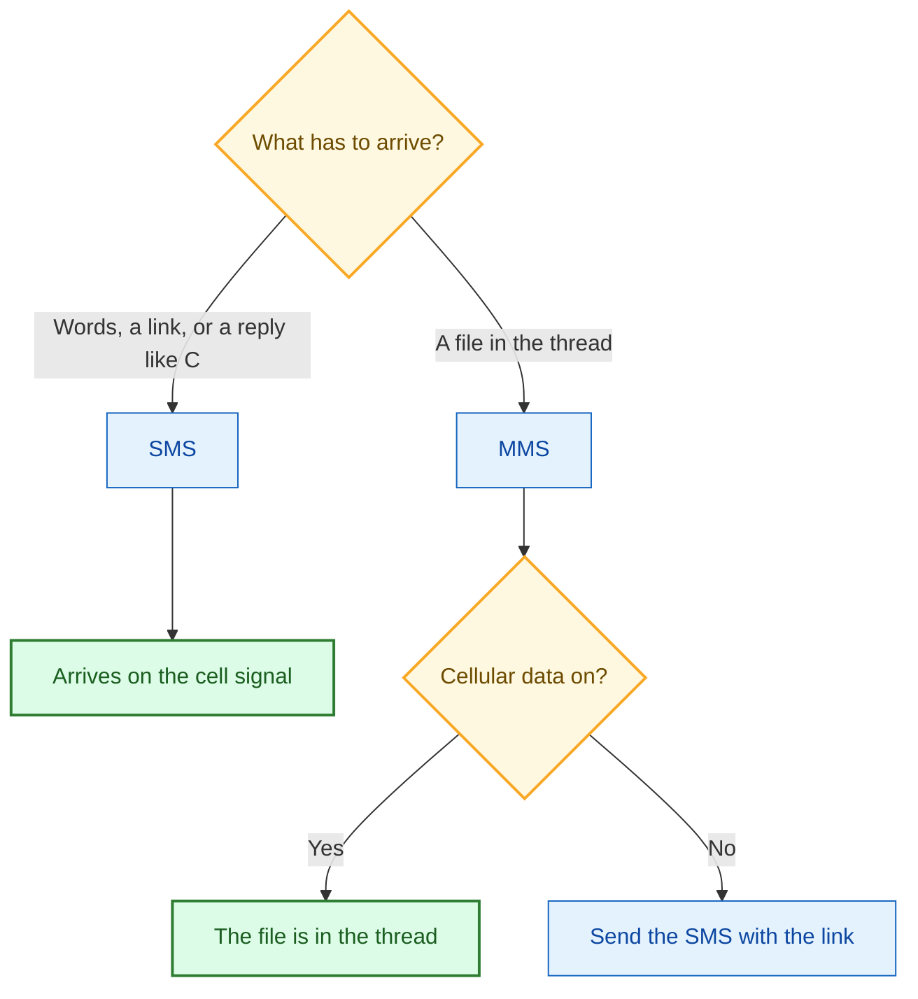
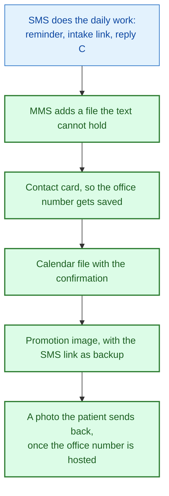

# SMS and MMS, and where a picture message helps

- **Date:** 11/20/2026
- **Status:** Suggestion for review. Not a build commitment.
- **For:** Jaime Kirk, Opal Anderson, Lacey Shaw, Lauren Janowiecki, and the practice stakeholders
- **From the call:** [Daava Meeting, 11/20/2026](https://docs.google.com/document/d/15GMaXbCfxa2gcisQ22qi7cT3efKJT85V0DcC45L8zMU) (Gemini notes and transcript)
- **Research:** [MMS vs. SMS Message Delivery and AWS End User Messaging MMS Guide](https://docs.google.com/document/d/13mVnaKqz_W9B68DCmsRI6tNhBxUxAY1n2moa8fjpEXY)
- **Related:** [`office-number-texting-report.md`](./office-number-texting-report.md) is about which number the message comes from. This guide is about the two kinds of message, and which jobs need the picture kind.

Daava is trying to do what the offices already do in Solutionreach, and what they asked for on the 11/20/2026 call: reminders, a confirmation the patient can answer, an intake link, and a promotion that looks like the ad rather than another email. Those are two different kinds of phone message.

**SMS** is the text. It holds 160 characters, a link, and a reply such as C. **MMS** is the message in the same thread that can carry a file, or a much longer text that does not split. Lacey asked for MMS when she asked for the glittery Invisalign creative to arrive as a photo. Tanmay was describing SMS when he said a text cannot hold an image.

The suggestion is to use both, for different jobs. SMS carries the messages that have to arrive. MMS is how the picture, the contact card, the calendar file, and a photo from the patient get into that same thread.

---

## 1. How SMS and MMS differ

They show up in the same conversation on the patient's phone. They travel on different carrier systems.

| | **SMS** | **MMS** |
| :--- | :--- | :--- |
| What it carries | Text and one link | A file, or up to 1,600 characters of text, or both |
| How it arrives | Over the cell signal. It arrives with mobile data off. | The phone downloads the file over cellular data. Wi-Fi does not count. It fails when data is off, on older phones, and on many plans outside the US and Canada. |
| Length | 160 characters. Past that it splits, and each extra piece holds 153. One emoji or a curly quote shrinks every piece to 70. | One message, up to 1,600 characters, with no split and no emoji penalty. |
| A reply with a photo | Cannot. A reply is words only. | Can, on a carrier that receives MMS. AWS does not. |
| Delivery receipt | The more reliable of the two. | Slower, and the receipt is less consistent, because the phone still has to fetch the file. |
| Consent and STOP | Required | The same rules. A picture is not a way around them. |

---

## 2. Where MMS costs less than a long text

SMS is billed per piece. MMS is one price for the whole message. On the research doc's 2026 AWS list rates, MMS becomes the cheaper send at three SMS pieces.

| What goes out | AWS list rate in the research doc |
| :--- | :--- |
| 1 SMS, up to 160 plain characters | $0.0120 |
| 2 SMS, up to 306 | $0.0239 |
| 3 SMS, up to 459 | $0.0359 |
| 1 MMS, up to 1,600 characters, with or without a file | $0.0300 |

These are that doc's published list rates, carrier fees included. They are not a Daava quote. The same break shows up at three pieces on Telnyx. Twilio is in that comparison and is outside the stack Daava uses.

The trap is a single emoji or a curly quote from Word. It turns a 140-character reminder from one SMS at $0.0120 into three at $0.0358, which already costs more than the MMS. The fix for reminders is a check in the composer that swaps curly quotes for plain ones and warns on an emoji. MMS is the right tool when the message was long on purpose, or when it has a file. It is the expensive way to rescue a short reminder.

---

## 3. Where MMS helps what we are building

SMS does the daily work: the reminder, the intake link, and "reply C to confirm." MMS is what makes four of the things the offices asked for possible inside the text thread.

| What we are trying to do | SMS | Where MMS helps |
| :--- | :--- | :--- |
| **Reminders and intake links** have to arrive, including when the patient's data is off | This is the send. Practice name, the point, "Reply STOP to opt out," one short link. | It does not help. A picture of a reminder fails in the cases where the text would have arrived. |
| **A confirmation the patient can answer**, the way Solutionreach does with C | The reply word. Each office keeps its own. | A calendar file in the same message, so the phone offers to add the visit. The reply is still the SMS word. |
| **Patients recognize the office**, which is why the office-number report starts with the practice name and ends on the office's own number | The name on the first line, and later the office number itself. | A contact card, sent once, that saves the office number in one tap. Saving it is also what lets later SMS links show a preview on iPhone. |
| **A promotion that looks like the ad**, which Lacey asked for because patients are not in their email | A short text plus a link to the page that already has the glitter image. This is the version that reaches the whole list. | The image itself, in the thread, which is the thing she asked for. This is the MMS job. It fits a smaller send, a patient who already texts the office, or a welcome. The SMS with the link goes with it, so a phone that cannot fetch the picture still gets the offer. |
| **Instructions that run past two texts**, such as pre-op or post-op | A link to the page. The page can be updated after the text goes out. | One MMS when the words themselves have to sit in the thread. Up to 1,600 characters, one charge, and past three SMS pieces it costs less. |
| **A photo from the patient**, an insurance card or a picture of a concern | Cannot carry a file back. The intake page is how the photo arrives today. | The only way that photo lands in the thread. This waits until the office number is hosted on Telnyx or Bandwidth. AWS can send MMS and cannot receive one. |

The promotion is the one the call spent time on, so it is worth being specific. Lauren's text version, with a short link, is the right first send: it fits the 160-character problem she raised, and it reaches phones with data off. MMS is how that same promotion becomes the photo she described, for the sends where we want the image in the thread and can accept that some phones will not fetch it. Those phones get the SMS. One message does not have to be chosen for every patient.

A link preview is the in-between. A phone can show a small card for an SMS link, at SMS cost, when the link is the last thing in the text, the page is plain HTML, and the patient has already saved the number. That is a bonus for patients who saved the contact card. It is not a substitute for putting the image in the thread, because most first texts will not get the preview. The preview title stays generic. No patient name, visit type, or procedure in the title or the web address.

---

## 4. How this sits on the toll-free

These messages come from a toll-free number on AWS. That is the number, in place of a short code. Each office's own number comes later, as it qualifies, which is the [other report](./office-number-texting-report.md). SMS and MMS both go out from the toll-free.

| MMS job | Toll-free on AWS | Office number, once hosted |
| :--- | :--- | :--- |
| Contact card, calendar file, map, promotion image | Yes, if the number's capabilities include MMS | Yes |
| Photo back from the patient | No. AWS receives words only | Yes. This is the job that needs this number |
| Speed for a picture | 3 a second. About 28 minutes for 5,000 | Set by the practice's registration. A large list also counts against T-Mobile's daily cap for that business |

The contact card, the calendar file, and Lacey's image go out from the toll-free. The photo a patient sends back waits for the office number. Until then, insurance cards and clinical photos come through the intake page.

Two checks before the first MMS on the toll-free. The capabilities column in AWS has to say MMS. Numbers bought after May 2024 include it, and the capability cannot be added later. And the verification samples have to include whatever we will send. A toll-free approved for reminders and intake links is not approved for a promotion.

If an MMS fails, or the office's text route drops, the fallback from the other report should send the SMS with the link, from the toll-free and then by email. Sending the picture again from a second number does not help a phone that could not download it.

---

## 5. How a message gets written

**An SMS**, which is every reminder, intake link, confirmation, and the backup for a picture:

1. Practice name on the first line.
2. The point, in plain characters. The composer swaps curly quotes and warns on an emoji.
3. "Reply STOP to opt out," before the link.
4. One short link on a Daava domain, and nothing after it.
5. Stop at two pieces. A third piece means cut a sentence, or move it onto the page, or decide it is an MMS on purpose.

**An MMS**, for the four jobs in [section 3](#3-where-mms-helps-what-we-are-building):

1. The same practice name and the same STOP line. The file does not replace them.
2. The file is a contact card, a calendar file, a map, or the promotion image. Shrink an image to 500 KB or under. Carriers recompress anything larger. AWS accepts an image up to 2 MB and other files up to 600 KB. The safe size across carriers is about 600 KB.
3. On AWS, the file has to sit in an S3 bucket in the same account and region as the sending number. The send uses the media call, not the text call.
4. The SMS with the link goes out whenever the picture does not land.
5. A picture the patient sends back is copied into Daava's own storage as it arrives. On Telnyx the link in the incoming notice expires quickly.

Nothing clinical goes in either one. A text and a picture are both readable on a lock screen, and a picture can land in the patient's photo library. The diagnosis, the procedure, the clinical photo, and the filled-out form stay on the page behind the link. A STOP applies to both. Stopping the promotion stops the reminders from that same number too, which is why the other report keeps marketing off the office number once offices have their own.

---

## 6. Suggested build

1. **SMS first, in the composer Prem already showed.** A shortener, a counter that says "1 text" or "2 texts," and a warning on an emoji or a curly quote.
2. **MMS as a choice on the same template**, for a contact card, a calendar file, a map, or the promotion image. Choosing it still sends the SMS with the link when the picture does not arrive.
3. **Lauren's Invisalign text is the SMS trial.** Her image, sent as MMS to the test line beside that text, is the MMS trial. One practice, the test number, then the sample practice Lacey asked to click through.
4. **The first real MMS to patients is the contact card**, sent when an office starts texting from its own number, so the number gets saved.
5. **The inbox stores a photo only after the office number is hosted.** Until then the intake page remains the way a card or a clinical photo comes in.
6. **Any live test stays on the test line.**

---

## 7. Open questions

| # | Question | Answer |
| :--- | :--- | :--- |
| 1 | For the Invisalign promotion, do we send the SMS with the link to the list, and the MMS image to a smaller set, with the SMS as the backup? | |
| 2 | Is the contact card the first MMS patients receive, sent when an office moves to its own number? | |
| 3 | Should a confirmation include a calendar file? | |
| 4 | Do photo replies wait for the hosted office number, with the intake page still there beside them? | |
| 5 | Does the toll-free show MMS in its capabilities, and do its samples include a promotion? | |
| 6 | Has Daava accepted the AWS business associate agreement that covers MMS? | |

---

## Sources

Checked 11/20/2026.

- [Daava Meeting, 11/20/2026](https://docs.google.com/document/d/15GMaXbCfxa2gcisQ22qi7cT3efKJT85V0DcC45L8zMU), transcript from about 00:53:59. Lacey asked for the promotion as a photo. Prem and Tanmay separated a text from a picture and offered a link. Lauren asked about 160 characters, the practice name, unsubscribe, and a short link.
- [MMS vs. SMS and AWS MMS guide](https://docs.google.com/document/d/13mVnaKqz_W9B68DCmsRI6tNhBxUxAY1n2moa8fjpEXY). The channel differences, the three-piece cost break, link previews, and the AWS send limits. The prices in section 2 are that doc's list rates.
- [AWS: MMS file types and size](https://docs.aws.amazon.com/sms-voice/latest/userguide/mms-limitations-character.html) and [sending an MMS](https://docs.aws.amazon.com/sms-voice/latest/userguide/send-mms-message.html)
- [AWS: throughput](https://docs.aws.amazon.com/sms-voice/latest/userguide/sms-limitations-mps.html) (an MMS is one part, 3 a second on a toll-free)
- [AWS: How to send MMS](https://aws.amazon.com/blogs/messaging-and-targeting/how-to-send-mms-using-aws-end-user-messaging/) (no inbound pictures; numbers bought after May 2024 include MMS)
- [Telnyx: Hosted SMS](https://developers.telnyx.com/docs/messaging/messages/hosted-sms) and [MMS media limits](https://developers.telnyx.com/docs/messaging/messages/mms-transcoding) (pictures both ways on a hosted office number; keep files under 600 KB)
